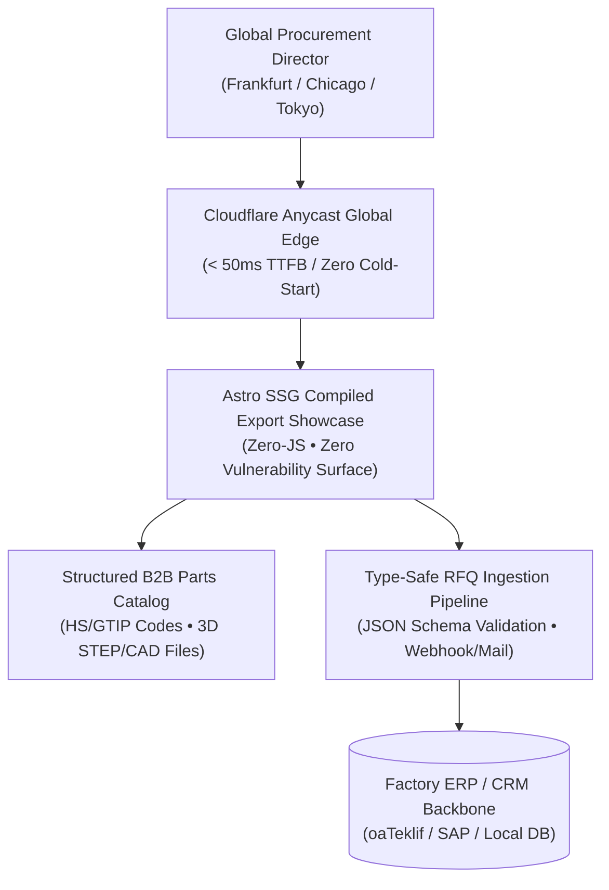

## Bridging the Chasm Between Industrial Capability and Digital Showcases

Throughout major manufacturing corridors—from Ankara's OSTIM and Sincan Industrial Zones to specialized European engineering hubs—enterprises operate world-class precision infrastructure: 5-axis CNC machining centers, cleanrooms, and stringent aerospace certifications such as AS9100D.

Yet when global procurement executives inspect their digital entry points, they frequently encounter an unacceptable reality: **Enterprises possessing millions of dollars in advanced manufacturing assets are represented by bloated, slow-rendering WordPress templates, missing engineering specifications, and broken email security records.**

Across dozens of architectural advisory audits, one operational truth has proven invariant: **A chief procurement officer or technical sourcing director assesses your manufacturing discipline through the technical rigor of your digital infrastructure before ever visiting your factory floor.** A sluggish, amateurish web portal immediately raises doubts regarding your internal quality assurance standards.

In this technical broadcast, I dissect the 5 architectural criteria required to elevate an industrial export showcase into a resilient, globally trusted platform.



---

## 5 Architecture Criteria That Build Global Buyer Trust

These five engineering principles establish undeniable credibility when international enterprises evaluate your factory:

### 1. Sub-50ms Global Edge Time-to-First-Byte (TTFB)
Hosting a corporate web presence on a traditional single-region origin server introduces 500ms to 1,500ms of latency for overseas clients. When coupled with heavy script parsing, Largest Contentful Paint (LCP) easily escalates past 6 seconds.

Modern export architecture disposes of centralized origin hosting. Under our [Ankara B2B web architecture](/en/ankara-b2b-web-architecture/) paradigm, pages are pre-rendered into static HTML/WebP artifacts and distributed across 330+ Cloudflare Anycast edge locations worldwide. When an engineering manager in Stuttgart or Chicago opens your catalog, the asset is delivered from their local edge cache in **under 50 milliseconds**.

### 2. True Multi-Language Hreflang and Semantic Isolation
Overlaying a client-side Google Translate dropdown is an immediate negative signal for international buyers. Technical terms such as surface roughness or metallurgy codes are garbled, and search engines cannot index the localized content.

An authoritative multi-language architecture compiles German, French, and English versions as distinct, static documents. The `<head>` block orchestrates strict bidirectional `hreflang` associations:

```html
<link rel="alternate" hreflang="tr" href="https://onuraksoy.com.tr/broadcasts/ankara-osb-sanayi-b2b-ihracat-web-mimarisi/" />
<link rel="alternate" hreflang="en" href="https://onuraksoy.com.tr/en/broadcasts/ankara-osb-sanayi-b2b-ihracat-web-mimarisi/" />
<link rel="alternate" hreflang="x-default" href="https://onuraksoy.com.tr/en/broadcasts/ankara-osb-sanayi-b2b-ihracat-web-mimarisi/" />
```

This ensures global search crawlers map search intent directly to your localized technical pages without international SEO dilution.

### 3. HS Code Catalogs and Structured 3D CAD Downloads
For an aerospace components fabricator or industrial valves manufacturer, a web portal is not an advertising brochure—it is an engineering data hub. Overseas procurement teams look for three core technical assets:
- **Harmonized System (HS) Codes:** Standardized customs trade classifications (e.g., `8412.21.80` for hydraulic cylinders), allowing buyers to immediately calculate import tariffs.
- **3D CAD Interoperability:** Production-ready STEP, IGES, and 2D dimensional PDF drawings that design engineers can insert into their CAD assemblies.
- **Material Standards & Certification:** Direct links to DIN, ASTM, EN, and ISO quality accreditations on product specification sheets.

In The Vault, the downloadable [B2B International Export RFQ Data Contract Schema](/vault/b2b/b2b-export-rfq-schema.json) demonstrates how these attributes are enforced at the data contract level.

### 4. Type-Safe RFQ Contracts and Zero-JS Form Security
High-value B2B inquiries cannot rely on basic web contact forms that discard structured data. Instead of generic PHP mailers that forward unstructured strings, an industrial pipeline must collect requested quantities, Incoterms delivery conditions (FOB, CIF, DAP), target delivery dates, and technical drawing attachments.

Mirroring the deterministic data modeling found in my [oaTeklif](/en/broadcasts/oateklif-ucretsiz-teklif-olusturucu/) and [oaPOS](/en/projects/oapos/) systems, RFQ forms should operate under strict schema validation while maintaining a Zero-JS frontend footprint that routes inquiries safely to internal webhooks.

### 5. Corporate Email Reputation and DNS Hardening
Regardless of how polished your digital showcase appears, if your sales engineers' formal quotations land in the prospect's spam filter, your commercial outreach fails. Hosting email on shared web servers frequently tarnishes IP reputation.

An enterprise web architecture enforces four DNS defense standards:
- **SPF (Sender Policy Framework):** Explicitly whitelists authorized mail dispatchers.
- **DKIM (DomainKeys Identified Mail):** Cryptographically signs outbound business correspondence.
- **DMARC (Domain-based Message Authentication):** Enforces a `p=reject` policy to prevent domain spoofing.
- **BIMI (Brand Indicators for Message Identification):** Displays authenticated corporate identity badges in enterprise mail clients.

---

## Architecture Comparison: Agency Template vs. Custom Systems Architecture

| Evaluation Dimension | Traditional Agency (WordPress / Theme) | Custom Systems Architecture (Astro SSG + Edge) |
|---|---|---|
| **Global TTFB (Latency)** | 600ms – 1,800ms (Origin dependent) | **< 40ms (330+ Anycast Edge Nodes)** |
| **Client-Side JS Overhead** | 1.8 MB – 4.5 MB (Plugin bloat) | **0 KB (Strict Zero-JS Baseline)** |
| **Attack Surface** | High (SQL injections, PHP CVEs) | **Zero (No origin database or runtime)** |
| **CAD & HS Code Schemas** | Static unstructured PDFs | **Type-Safe JSON-LD + Open Schema Model** |
| **Multi-Language Rigor** | Client-side widget translation | **Pre-Rendered Static Hreflang Documents** |
| **Inquiry Delivery Reliability** | Fragile PHP mailers / Spam risk | **Edge Webhooks + Resilient Ingestion Queue** |

---

## Actionable Modernization Roadmap

To modernize your manufacturing enterprise's digital infrastructure and build resilient global buyer trust, explore our [Ankara custom software architecture](/en/ankara-custom-software-architecture/) engineering principles:

1. **Perform Infrastructure Audits:** Benchmark your current portal's global latency, Core Web Vitals, and DNS security posture.
2. **Standardize Technical Catalog Data:** Structure parts numbers, HS codes, and 3D CAD files into a unified JSON contract.
3. **Decouple Frontends via Static Generation:** Migrate from dynamic server stacks to pre-rendered Astro SSG backed by Cloudflare Anycast.
4. **Deploy Type-Safe RFQ Ingestion:** Connect quotation forms directly to ERP webhooks with cryptographic validation.

Presenting your industrial capabilities with uncompromising digital craftsmanship is not an optional polish—it is a decisive driver of global procurement revenue.
