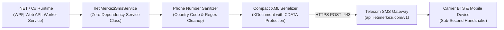

## Designing a Resilient SMS & OTP Gateway in .NET

From desktop enterprise tools and point-of-sale software to web APIs and user authentication flows, telecommunications SMS gateways are a mission-critical infrastructure component. Yet when integrating regional telecom APIs, developers are frequently confronted with antiquated sample code, fragile XML string concatenations, and a complete absence of type safety.

While engineering my Windows desktop POS system oaPOS and various client platforms, I encountered this exact integration bottleneck. Rather than relying on unmaintained third-party NuGet packages, I architected this open-source **C# XML API Library**—a zero-dependency, type-safe wrapper that drops into any .NET application via a single class file.

In this walkthrough and video breakdown, I demonstrate how to dispatch transactional alerts, handle high-priority two-factor authentication (OTP) tokens, trigger batch recipient broadcasts, and query account credit balances.



---

## Architectural Comparison: Heavy SDKs vs. Raw HTTP vs. Our Service

Here is an architectural comparison of integration approaches:

| Dimension | Bloated External SDKs | Raw WebClient / HttpClient | Our IletiMerkeziSmsService |
|---|---|---|---|
| **External Dependencies** | Requires Newtonsoft, RestSharp | None | **Zero Dependencies (Pure .NET Core)** |
| **Phone Sanitization** | Manual developer code | Manual developer code | **Built-In Automatic Regex Normalizer** |
| **Bulk Dispatch Support** | Frequently absent | Requires loop logic | **Batched Single-Request (<receipents>)** |
| **Error Handling Model** | Raw text / Exceptions | Raw response strings | **Structured SmsResponse Object** |
| **Integration Velocity** | 1–2 hours troubleshooting | 30–45 minutes | **Drop Single File: 2 Minutes** |

---

## 1. Zero-Dependency Integration

To incorporate the library, no package manager commands are necessary. Copy the `IletiMerkeziSmsService.cs` source file directly into your application's `Services/` or `Infrastructure/` directory (available in **The Vault** section).

Instantiate the service client by providing your credentials obtained from the provider portal:
- `apiKey`: Your alphanumeric gateway API key.
- `apiHash`: Your derived cryptographic API hash.
- `originator`: Your regulatory-approved alphanumeric sender title (e.g., `ONURAKSOY`).

```csharp
using IletiMerkeziApi;

var smsService = new IletiMerkeziSmsService(
    apiKey: "YOUR_API_KEY",
    apiHash: "YOUR_API_HASH",
    originator: "SENDER_ID"
);
```

---

## 2. Dispatching High-Priority 2FA OTP Codes

For user login verification and checkout confirmations, minimal latency is paramount. The `SendSingle` method automatically scrubs white space, parentheses, and leading country prefixes:

```csharp
// Any user format is automatically normalized
string recipientPhone = "+90 (551) 181 70 53";
string otpMessage = "Your verification token is 849201. Valid for 3 minutes.";

SmsResponse response = smsService.SendSingle(recipientPhone, otpMessage);

if (response.IsSuccess)
{
    Console.WriteLine($"Dispatched successfully! Gateway Status: {response.StatusCode}");
}
else
{
    Console.WriteLine($"Dispatch failed: {response.Message}");
}
```

---

## 3. High-Throughput Batch Broadcasting & Account Telemetry

When notifying hundreds or thousands of clients regarding scheduled maintenance or order status, sequential HTTP calls degrade throughput. `SendBulk` combines all recipients into a unified XML payload transmitted across a single TLS stream:

```csharp
var recipientList = new List<string> { "05511817053", "0532XXXXXXX", "0542XXXXXXX" };
string notification = "Scheduled maintenance completes tonight at 02:00 UTC.";

SmsResponse bulkResponse = smsService.SendBulk(recipientList, notification);

// Query available credit balance in real time:
int remainingCredits = smsService.QueryBalance();
Console.WriteLine($"Remaining Account Balance: {remainingCredits}");
```

---

## Troubleshooting Common Production Edge Cases

1. **"Status Code: 401 / Authentication Failed":**
   - *Cause:* Invalid API credentials or an unconfigured IP whitelist on the provider dashboard.
   - *Fix:* Ensure your production server's public egress IP is authorized under gateway security settings.
2. **"Status Code: 400 / Sender Not Found":**
   - *Cause:* The `originator` string does not match an approved sender title.
   - *Fix:* Verify your registered alphanumeric title matches casing exactly as approved by the telecom authority.
3. **Encoding issues with special or regional characters:**
   - *Fix:* The service serializes payloads via `Encoding.UTF8` and encapsulates message text within `<![CDATA[ ... ]]>` tags. Ensure incoming strings are valid UTF-8.

Download the complete C# class file and view the GitHub repository directly from **The Vault** section above.
