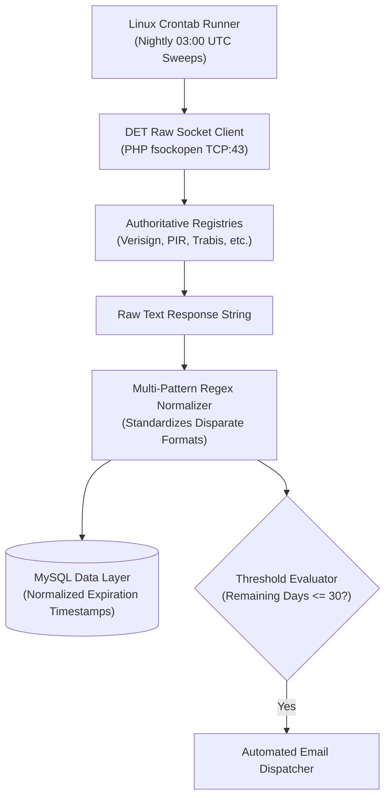

## Solving the Operational Risk of Forgotten Domain Expirations

While operating digital agencies and managing production infrastructure for dozens of enterprise clients, one recurring operational anxiety stood above all others: **An overlooked domain renewal date.** Allowing a critical domain to expire instantly severs corporate email routing, drops public web traffic, and invites automated auction bots (drop catchers) to hijack valuable digital assets within minutes.

Commercial domain monitoring SaaS platforms charge recurring monthly tolls and impose restrictive quotas after tracking a mere 10 to 20 domains.

To solve this risk permanently, I engineered **Domain Expiry Tracker (DET)**. Running entirely on your sovereign PHP/MySQL server, it requires zero paid API subscriptions. It queries authoritative registry servers directly over **raw TCP port 43 sockets**, archives renewal timestamps in MySQL, and triggers automated warning dispatches as critical deadlines near.

In this comprehensive 15-minute technical walkthrough, we unpack socket-level WHOIS communication, resilient date regex normalization, and Linux cron job automation.



---

## Architectural Comparison: Commercial SaaS vs. DET

Here is an architectural breakdown of domain monitoring strategies:

| Dimension | Commercial Monitoring SaaS | Generic Webhook Tools | Domain Expiry Tracker (DET) |
|---|---|---|---|
| **Monthly Subscription Toll** | $10 – $50 / month | Free with severe quotas | **100% Free & Open Source** |
| **Monitored Domain Quota** | 10 – 50 domains | 5 domains max | **Unlimited (Hardware scale)** |
| **Lookup Methodology** | Third-party API scraping | Basic DNS ping | **Direct Raw TCP:43 WHOIS Socket** |
| **Portfolio Security** | Portfolio exposed to SaaS vendors | Stored in shared clouds | **Isolated in your sovereign MySQL** |
| **Alert Customization** | Locked templates | Webhook only | **Customizable Email & Webhook Logic** |

---

## 1. Raw Socket WHOIS Architecture (RFC 3912)

Many developers attempt to scrape WHOIS data by issuing HTTP requests to web lookup services, which quickly fail due to Cloudflare or CAPTCHA challenges.

In DET, communication adheres strictly to the **RFC 3912 TCP socket standard**:
- The authoritative WHOIS server is determined based on the domain TLD (`whois.verisign-grs.com` for `.com`, `whois.pir.org` for `.org`, etc.).
- `fsockopen` opens an immediate TCP stream on port 43, transmitting the domain followed by CRLF (`\r\n`).
- The incoming text stream is ingested into memory and passed through the **Regex Normalization Engine** to resolve registrar date variations.

```php
// Core raw socket communication method from DET:
$socket = @fsockopen($whoisServer, 43, $errno, $errstr, 10);
if ($socket) {
    fwrite($socket, $domain . "\r\n");
    $rawResponse = '';
    while (!feof($socket)) {
        $rawResponse .= fgets($socket, 4096);
    }
    fclose($socket);
}
```

---

## 2. Server Installation & Database Setup

Setup takes less than 3 minutes on standard LAMP/LEMP hosting:
1. Extract the repository files into your target web root (e.g., `httpdocs/det`).
2. Supply database connection credentials inside `config.php`.
3. Import the included database structure (`schema.sql`) via phpMyAdmin or the MySQL CLI.
4. Open the administrative dashboard to ingest domain portfolios individually or via bulk text paste.

---

## 3. Automated Cron Execution & Rate-Limiting Protection

To maintain continuous oversight without human intervention, register the background runner in Linux crontab:

```bash
# Execute automated registry sweeps nightly at 03:00 UTC
0 3 * * * php /var/www/vhosts/yourdomain.com/httpdocs/det/cron.php >/dev/null 2>&1
```

> **Rate-Limiting Safeguard (Jitter):** Authoritative registries enforce IP throttles when bombarded with sequential queries. DET injects randomized delays of `usleep(rand(500000, 1500000))` (0.5 to 1.5 seconds) between lookups to maintain a clean reputation for your server IP.

---

## Troubleshooting Common Production Issues

1. **"fsockopen(): unable to connect to whois server (Connection timed out)":**
   - *Cause:* Outbound connections on TCP port 43 are blocked by your cloud provider or server firewall (UFW).
   - *Fix:* Execute `sudo ufw allow out 43/tcp` or request outbound port 43 clearance from your VPS host.
2. **"Failed to parse date / Expiry date returned empty":**
   - *Cause:* Rare or new gTLD registries that utilize non-standard text labels.
   - *Fix:* Append the specific label pattern to the `$EXPIRY_PATTERNS` array inside `det-whois-socket-engine.php` (available in **The Vault**).
3. **Automated emails flagged as spam:**
   - *Fix:* Configure authenticated SMTP credentials inside `config.php` rather than relying on unauthenticated PHP `mail()`.

Download the standalone PHP socket engine and the full GitHub repository archive directly from **The Vault** above.
