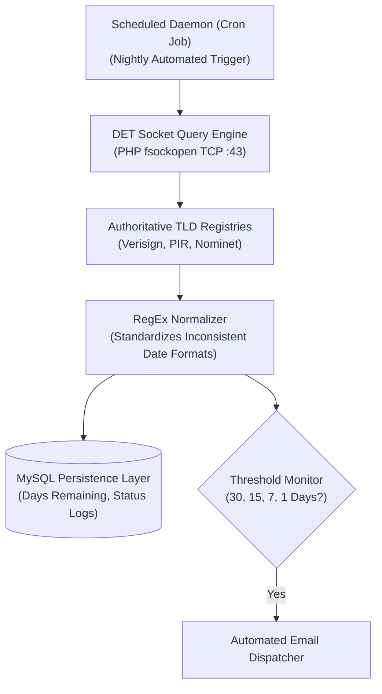

## Eliminating the Operational Risk of Forgotten Domain Renewals

For systems architects, digital agencies, and portfolio investors, managing the expiration cycles of dozens or hundreds of critical domains represents a severe operational liability. A single overlooked domain expiration can instantly compromise corporate DNS routing, take email systems offline, or result in catastrophic domain poaching at public drop auctions.

Commercial domain monitoring SaaS platforms charge recurring monthly fees and impose arbitrary tracking limits. To solve this sustainably, I developed **Domain Expiry Tracker (DET)**—a lightweight, self-hosted PHP and MySQL utility that connects directly to authoritative TLD WHOIS registries over raw TCP sockets to monitor and alert on renewal cycles.



---

## 1. Low-Level Socket WHOIS Architecture

DET bypasses commercial proxy services by establishing raw TCP connections directly to authoritative registry servers on port 43:

- Queries for `.com` and `.net` are routed to `whois.verisign-grs.com`.
- `.org` requests communicate directly with `whois.pir.org`.
- Raw response strings are parsed via an intelligent regular expression engine designed to accommodate hundreds of disparate registrar date formats (`YYYY-MM-DD`, `DD/MM/YYYY`, `ISO-8601`).
- The parsed expiration date is converted into normalized Unix epoch timestamps and stored in MySQL for differential date math.

---

## 2. Server Installation & Database Provisioning

Installation requires standard LAMP / LEMP hosting environments:
1. Clone the repository from GitHub into your target server directory.
2. Configure database credentials inside `config.php`.
3. Import the provided SQL schema (`schema.sql`) via phpMyAdmin or the MySQL CLI.
4. Access the administrative panel to ingest domain lists individually or in bulk.

---

## 3. Cron Job Scheduling & Rate-Limiting Engine

To automate nightly tracking, schedule the background runner using Linux crontab:

```bash
# Execute automated registry sweeps nightly at 03:00 UTC
0 3 * * * php /var/www/vhosts/yourdomain.com/httpdocs/det/cron.php >/dev/null 2>&1
```

> **Engineering Note on Rate-Limiting:** Public WHOIS registries enforce aggressive IP throttling when flooded with high-frequency sequential requests. DET implements intelligent jitter and randomized millisecond pauses between queries to prevent IP blocks and ensure uninterrupted tracking.

Explore the open-source code and download the deployment archive directly from GitHub.
