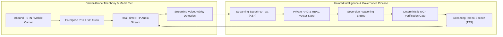

## Introduction: The Collapse of Touch-Tone Trees and the Voice Bot Fallacy

For more than two decades, the universal gateway to enterprise customer communications remained the dual-tone multi-frequency (DTMF) interactive voice response (IVR) tree. Promoted as an operational cost-cutting mechanism, "Press 1 for Sales, Press 2 for Support" became an infamous source of customer friction, protracted hold queues, and brand frustration.

In an urgent push toward modernization, many enterprises have rushed into an equally hazardous trap. Organizations frequently connect foundational language model APIs to incoming telephony lines via superficial WebRTC browser wrappers, branding the result as an "AI contact center."

Connecting ungrounded generative models directly to customer-facing telephone lines introduces severe structural liabilities:

First, sensitive customer data, corporate pricing matrices, and confidential contract terms leak into third-party cloud training pools. Second, multi-second round-trip network latencies disrupt natural conversational timing, creating awkward pauses where participants talk over one another. Third, stochastic language models regularly hallucinate, extending binding commercial promises, unauthorized discounts, or non-existent warranties to live callers.

A sustainable enterprise voice AI architecture is not created by renting a generic cloud bot. It requires uniting carrier-grade SIP/RTP telephony trunks with isolated Private RAG pipelines and deterministic Model Context Protocol (MCP) verification gates. As articulated under my [Onur Aksoy (Hackonomist)](/en/about/) moniker, institutional resilience demands sovereign engineering where operational data remains strictly under corporate ownership.

---

## 1. The Acoustic Latency Budget: Sub-450ms Conversational Turn-Taking

In natural human telephone dialogue, conversational turn-taking latency ranges between 200 and 400 milliseconds. When an automated conversational voice agent exhibits latency exceeding 600 milliseconds, the human caller presumes a dropped connection or transmission failure and resumes speaking. When round-trip response times exceed 1.5 seconds, callers and automated agents continually interrupt one another, causing conversational breakdown.

Consequently, the definitive engineering benchmark for telephony voice agents is the **End-to-End Acoustic Latency Budget**, which must remain strictly beneath 450 milliseconds across four sequential stages:

1. **Voice Activity Detection & Endpointing (< 120ms):** Highly optimized, lightweight neural models (such as Silero VAD variants) differentiate within milliseconds between an intra-sentence breathing pause and definitive conversational completion.
2. **Streaming Automatic Speech Recognition (ASR < 100ms):** Incoming audio frames are processed in 20-millisecond windows. Phoneme chunks convert to text incrementally while the caller is still vocalizing.
3. **Streaming Inference & Time to First Token (TTFT < 120ms):** The reasoning engine does not wait for a full paragraph response to synthesize; the initial conversational affirmative or response token immediately streams to the speech synthesizer.
4. **Streaming Text-to-Speech (TTS < 100ms):** Emitted text tokens convert to synthetic PCM audio without buffering, streaming back to the caller's ear via low-latency RTP packets.

A foundational component of this pipeline is **Dynamic Barge-In**. In legacy IVR environments, recorded voice prompts play rigidly until completion regardless of caller vocalizations. In a sub-450ms SIP pipeline, the microsecond a caller utters a syllable, VAD triggers, the outbound RTP transmission terminates instantly, speech synthesis buffers clear, and the conversational agent transitions into active listening mode.

---

## 2. Leaky Multi-Tenant SaaS Traps and GDPR Data Sovereignty

Many commercial voice AI solutions operate as multi-tenant cloud SaaS platforms, requiring organizations to redirect live telephony traffic entirely to remote third-party servers. When an enterprise deploys these services, every spoken conversation, caller identification number, financial figure, medical triage detail, and internal negotiation record traverses and resides within third-party cloud data centers.

This operational model creates immediate compliance breaches under both GDPR and domestic data protection frameworks. Regardless of external vendor data processing assurances, relinquishing control over live telecom audio pipelines surrenders institutional information sovereignty.

Under a sovereign architecture, telephone calls terminate strictly within enterprise-managed SIP telephony infrastructure (Asterisk, FreeSWITCH, or Kamailio). As engineered in our [oa-sip-recorder](/en/projects/oa-sip-recorder/) deployment, audio media streams are captured, analyzed, and encrypted directly on sovereign infrastructure without transit through external aggregators. Similarly, our low-latency simultaneous audio processing engines in [oaDub](/en/projects/oadub/) demonstrate how real-time audio telemetry can be processed locally without sacrificing throughput.

Enterprise data never leaves corporate boundaries; institutional knowledge resides within private networks, and external foundation models receive only sanitized, session-scoped tokens stripped of institutional identifiers.

---

## 3. Isolated Private RAG and Role-Based Access Control (RBAC)

A voice AI telephony assistant must access enterprise technical documentation, current inventory catalogs, and corporate operating procedures. However, dumping an entire corporate document repository into a unified vector space represents an unacceptable operational risk. An adversarial caller could deploy prompt injection techniques over the telephone, extracting confidential executive contacts or unannounced corporate financial metrics.

To eliminate this vulnerability, the system enforces an **Isolated Private RAG** topology governed by **Role-Based Access Control (RBAC)**:

- **Partitioned Vector Collections:** General customer documentation, partner pricing tiers, confidential technical manuals, and accounting ledgers reside within physically or logically isolated vector stores.
- **Caller Line Identification (CLI/ANI) Verification:** Upon call ingestion, the PBX queries the internal CRM database to establish caller verification credentials. Access to proprietary RAG retrieval partitions is restricted until authentication succeeds.
- **Dynamic Context Pruning:** Telephony agent context windows receive only 2 to 3 dense semantic chunks strictly relevant to the active dialogue state. Strict token budgeting narrows the attack surface for prompt injection and suppresses hallucinations.

As illustrated in our sovereign digital infrastructure for [HRS Ankara Kadın Hastanesi](/en/projects/hrs-ankara-kadin-hastanesi/), clinical triage logic and patient privacy standards are enforced through isolated boundaries without exposing internal database schemas or internal backend systems to public endpoints.

| Evaluation Dimension | Legacy DTMF Touch-Tone IVR | Leaky Multi-Tenant Cloud Bot | Deterministic SIP/PBX + Private RAG |
|---|---|---|---|
| **Caller Experience** | Rigid, frustrating numeric menus | Conversational but sluggish (1.5-3s delay) | Natural human cadence with sub-450ms latency |
| **Barge-In Handling** | Unsupported or severely delayed | Cloud latency causes unnatural collisions | Millisecond streaming VAD stops speech instantly |
| **Data Privacy & GDPR** | Confined to on-premise PBX | Audio transcripts leak to third-party clouds | Sovereign; on-premise PBX with encrypted storage |
| **Hallucination Risk** | Zero (hardcoded static trees) | High (uncontrolled commercial commitments) | Zero (Deterministic MCP and FSM contract gates) |
| **5-Year Scaling TCO** | Low operating cost, zero intelligence | Exponential billing based on metered minutes | Fixed infrastructure with predictable, low TCO |

---

## 4. Deterministic Finite-State Machines and MCP Governance

The most damaging failure mode for an enterprise voice assistant is making unauthorized verbal commitments to a caller. Examples include confirming delivery timelines for out-of-stock equipment, quoting unauthorized discount percentages, or reserving conflicting appointment slots in an enterprise database.

An enterprise voice agent cannot function as an unrestricted conversational chatterbot. The system core must be governed by a **Deterministic Finite-State Machine (FSM)** coordinated via the **Model Context Protocol (MCP)**.

As formalized in my open-access CERN/Zenodo academic monograph [10.5281/zenodo.24114159](https://doi.org/10.5281/zenodo.24114159) and my foundational AI systems paper [10.5281/zenodo.24113617](https://doi.org/10.5281/zenodo.24113617), the language model must never act as an unconstrained decision-maker; it serves strictly as a natural language interface mapping conversational intent to explicit state transitions:

- The language model holds zero direct access to underlying transactional databases.
- When an action is required (such as scheduling an appointment or checking inventory), the model passes structured parameters to an MCP tool defined by strict JSON-RPC schemas.
- The MCP server subjects all incoming parameters to business rule validation, invariant checks, and security gates. If incoming data violates corporate constraints, the action is rejected and an error code returns to the agent.
- Even if the generative model hallucinates an invalid instruction, not a single corrupted byte can enter production databases.

Our engineering principles for defending systems against stochastic code drift, documented in our analysis of [synthetic technical debt and deterministic systems](/en/broadcasts/sentetik-teknik-borc-ve-deterministik-mimari/), apply equally to conversational telephony agents. Compile-time invariant gates and schema verification represent mandatory survival requirements for voice automation.

---

## 5. Hybrid Failover Topology and 5-Year Total Cost of Ownership (TCO)

When evaluating voice automation architectures, organizations frequently make the mistake of assessing feasibility through initial pilot pricing. For a small office receiving a few dozen calls each month, metered cloud SaaS wrappers billing $0.15 to $0.30 per minute appear deceptively economical.

However, for an enterprise managing thousands of inbound calls daily with average call durations of 3 to 4 minutes, metered cloud pricing rapidly escalates into an unsustainable financial liability:

- **Metered Cloud SaaS Model:** 2,000 calls per day x 3 minutes = 6,000 minutes daily. At $0.20 per minute, operational expenses reach $1,200 per day, $36,000 monthly, and exceed $2.1 million across 5 years in pure infrastructure rent, without acquiring any proprietary enterprise assets.
- **Sovereign Deterministic Architecture:** Deploying dedicated hardware, open-source telephony servers (Asterisk/SIP), and optimized inference instances operates on fixed infrastructure overhead and direct token costs. Once initial setup is complete, recurring costs remain predictable, reducing 5-year total cost of ownership by more than 70 percent.

Furthermore, a hybrid architecture incorporates robust **Failover Protocols**. Should an external foundation model provider experience an outage or network latency degrade beyond predefined thresholds, the telephony switch does not fail. Inbound calls instantly route to an on-premise fallback model or transfer to designated human operator extensions.

Across our implementations in [Ankara custom software architecture](/en/ankara-custom-software-architecture/) and [Ankara enterprise AI automation](/en/ankara-enterprise-ai-automation/), we empower organizations to own their communication infrastructure rather than remain dependent tenants. Building upon [local-first software](/en/broadcasts/local-first-software/) and [AI-native systems architecture](/en/broadcasts/ai-native-architecture/) ensures enterprise voice telephony delivers absolute data security, deterministic reliability, and world-class conversational performance.
