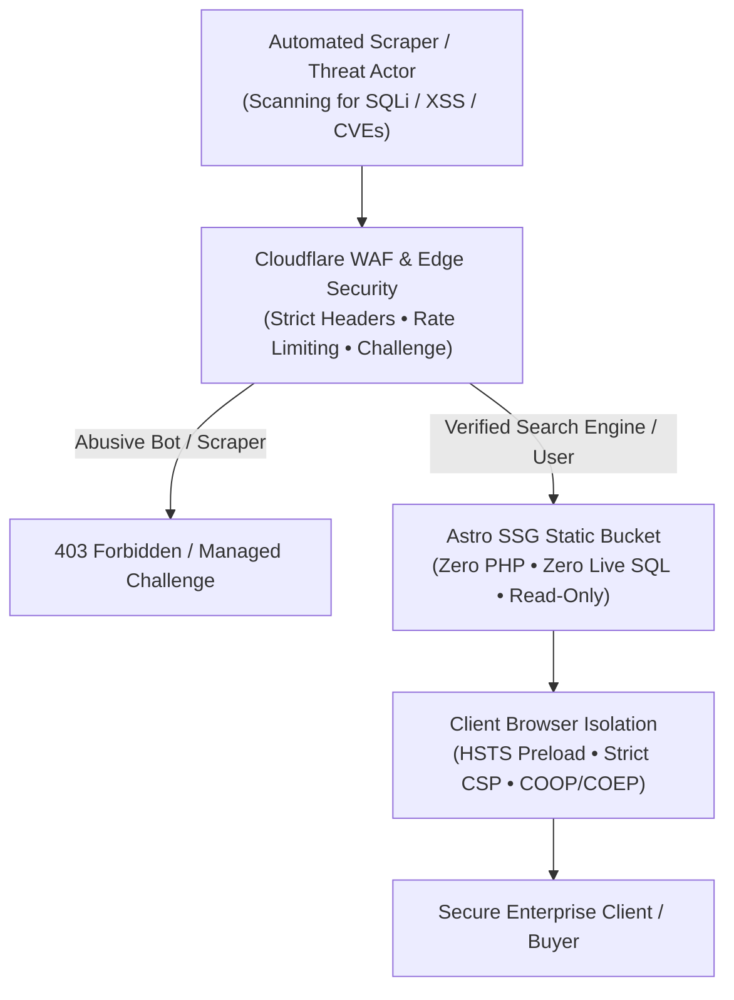

## Corporate Web Portals: The Most Overlooked Attack Vector

During enterprise security reviews with Chief Information Security Officers (CISOs) and IT leaders, I frequently encounter a critical security blindspot: While corporate internal networks, Active Directory domains, and VPN access gateways are guarded with multi-factor authentication and strict zero-trust rules, the enterprise's public-facing web portal is often treated as *"just marketing content"* and delegated to third-party web agencies.

Yet sophisticated threat actors and automated ransomware bots rarely assault hardened internal firewalls first. They scan for neglected, unpatched CMS plugins, exposed database endpoints, and insecure HTTP configurations on corporate web properties. A compromised corporate portal does not merely damage brand equity; it becomes a staging ground for credential harvesting, corporate domain blacklisting, and spear-phishing attacks against your own procurement clients.

In 2026, corporate web cybersecurity requires far more than a basic SSL padlock in the address bar.

In this technical breakdown, I outline the 5 indispensable cybersecurity standards IT and procurement teams must enforce on corporate web infrastructure.



---

## 5 Cybersecurity Criteria for Enterprise IT Audits

Before accepting delivery of any corporate web portal, IT departments must verify these five architectural layers:

### 1. HSTS Preload and 2-Year Enforced Encryption
Merely redirecting HTTP to HTTPS via an Apache or Nginx rewrite rule leaves a vulnerable window. If a user types your URL without the explicit `https://` prefix, the initial handshake travels over cleartext HTTP. A local attacker can intercept this initial request via SSL Stripping and impersonate your domain.

Enterprise infrastructure mandates the **HSTS Preload** header:

```http
Strict-Transport-Security: max-age=63072000; includeSubDomains; preload
```

When submitted to the official Chrome HSTS Preload list (shared across Chrome, Firefox, Safari, and Edge), the browser hardcodes HTTPS enforcement at the binary level. Plain HTTP requests are discarded before ever reaching the physical network interface.

### 2. Strict Content Security Policy (CSP) and XSS Neutralization
Cross-Site Scripting (XSS) accounts for the vast majority of client-side data leaks. If an enterprise website loads third-party tracking scripts, a compromise of that external vendor can result in credential theft from your quotation or RFQ forms.

A 2026 enterprise portal must serve an uncompromising CSP header:

```http
Content-Security-Policy: default-src 'self'; script-src 'self' https://static.cloudflareinsights.com; style-src 'self' 'unsafe-inline'; img-src 'self' data: https: blob:; font-src 'self' data:; connect-src 'self'; object-src 'none'; base-uri 'self'; form-action 'self'; frame-ancestors 'none';
```

By disallowing arbitrary external origins and blocking inline scripts, the browser guarantees that no rogue payload can execute or exfiltrate sensitive data.

### 3. Static Site Generation (SSG) for Zero Attack Surface
The most robust security principle in systems engineering is straightforward: **You cannot exploit a runtime that does not exist.**

Traditional monolithic portals rely on dynamic PHP interpreters, live Node.js servers, and listening MySQL ports that must be continually patched against zero-day exploits. Under the static compilation model applied in our [Ankara custom software architecture](/en/ankara-custom-software-architecture/), the production tier contains no backend code execution engine and no database server. Every page is pre-rendered into immutable HTML, CSS, and WebP assets during CI/CD. The attack surface for SQL injection or Remote Code Execution (RCE) is reduced to zero.

### 4. Permissions-Policy and Hardware Isolation
Modern browsers provide web applications with access to device hardware—webcams, microphones, geolocation sensors, and USB interfaces. For a corporate B2B or industrial engineering showcase, granting access to these sensors introduces unnecessary attack vectors.

A hardened `Permissions-Policy` response header:

```http
Permissions-Policy: accelerometer=(), camera=(), geolocation=(), microphone=(), payment=(), usb=()
```

This explicitly revokes browser hardware privileges across the entire site tree, assuring procurement officers and enterprise clients that their browsing session is fully sandboxed.

### 5. Cloudflare WAF, VIP AI Crawlers, and Scraper Management
The rise of large language models has triggered unprecedented automated scraping activity. However, blanket bot blocking is catastrophic for digital discovery:
- **Authorized VIP AI Crawlers:** Googlebot, Bingbot, OAI-SearchBot (ChatGPT Search), and PerplexityBot must be allowed full access to crawl technical catalogs for Generative Engine Optimization (GEO).
- **Aggressive Content Scrapers:** Unauthorized scrapers (ByteSpider, unverified data brokers) that clone intellectual property and drain server bandwidth must be neutralized at the edge.

The downloadable [2026 Enterprise Cybersecurity Headers & WAF Configuration](/vault/b2b/enterprise-security-headers-2026.conf) in The Vault provides production-tested Cloudflare WAF rules that execute this filtering at the edge in sub-millisecond time.

---

## Enterprise Security Headers Audit Matrix

Use command-line utilities (`curl -I`) or our [SEO Lens](/en/projects/seo-lens/) extension to audit your domain against this baseline:

| Security Header | Mandatory Production Value | Threat Mitigated |
|---|---|---|
| **Strict-Transport-Security** | `max-age=63072000; includeSubDomains; preload` | SSL Stripping, MitM Downgrade Attacks |
| **Content-Security-Policy** | `default-src 'self'; object-src 'none'; ...` | Cross-Site Scripting (XSS), Data Exfiltration |
| **X-Frame-Options** | `DENY` | Clickjacking, Hidden Iframe Phishing |
| **X-Content-Type-Options** | `nosniff` | MIME Type Sniffing & Script Execution |
| **Referrer-Policy** | `strict-origin-when-cross-origin` | Sensitive URL Parameter Leakage |
| **Cross-Origin-Opener-Policy** | `same-origin` | Side-Channel Memory Exploits (Spectre) |
| **Permissions-Policy** | `camera=(), microphone=(), geolocation=()` | Unauthorized Hardware Sensor Access |

---

## Action Plan for Enterprise IT Teams

To elevate your organization's web infrastructure to verified enterprise cybersecurity standards in line with our [Ankara B2B web architecture](/en/ankara-b2b-web-architecture/) and [Ankara custom software architecture](/en/ankara-custom-software-architecture/) methodology. Explore secure agent pipelines via [enterprise AI agency](/en/ankara-enterprise-ai-automation/) solutions, or coordinate security audits directly with [Onur Aksoy (Hackonomist)](/en/about/):

1. **Conduct an Edge Security Header Audit:** Benchmark your live domains via `securityheaders.com` and ensure an unconditional A+ grade.
2. **Deploy Production Configurations:** Download the [enterprise-security-headers-2026.conf](/vault/b2b/enterprise-security-headers-2026.conf) file from The Vault and inject the rules into your Nginx or Cloudflare Transform Ruleset.
3. **Decouple Frontends via Static SSG:** Following the architectural resilience of our [oaTeklif](/en/broadcasts/oateklif-ucretsiz-teklif-olusturucu/) and [oaPOS](/en/projects/oapos/) applications, replace fragile CMS backends with pre-compiled, immutable static frontends.

A hardened web infrastructure is the first tangible proof of your enterprise's operational and cybersecurity maturity.
