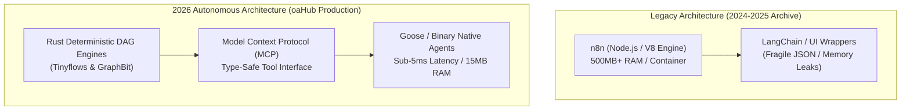
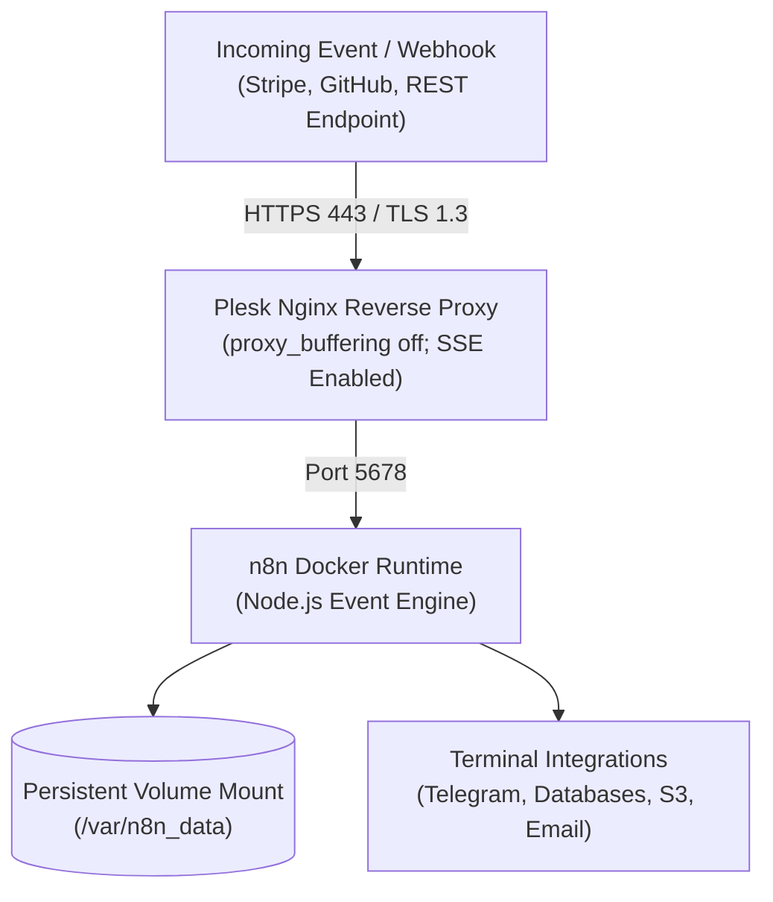

## 2026 Architecture Update: Why We Moved from Node.js n8n to Rust & Model Context Protocol (MCP)

Back in 2024 and 2025, escaping the extortionate per-task metering imposed by SaaS platforms like Zapier and Make was a vital milestone. Deploying **self-hosted n8n** on our own Linux VPS using Docker delivered immediate financial relief for basic webhook routing and notification fan-outs.

However, as **2026 arrived**, high-throughput multi-agent systems and mission-critical enterprise AI workloads exposed foundational bottlenecks inherent to n8n's architecture:

1. **V8 Engine & Node.js Memory Overhead:** A single n8n container idles around 450 MB – 1 GB RAM. Under concurrent multi-agent event bursts, out-of-memory (OOM) crashes and garbage collection stalls become recurring liabilities.
2. **Fragile Runtime JSON Mutation:** Data flowing between visual canvas nodes lacks compile-time schema guarantees. Upstream schema drift silently breaks downstream execution graphs without early type verification.
3. **Non-Deterministic Execution Loops:** High-level LangChain wrappers embedded in JavaScript lack strict mathematical circuit breakers, leading to runaway recursion and unmetered token depletion.
4. **Fair-Code Licensing Constraints:** n8n is not strictly permissive open source; its "Sustainable Use" license introduces operational friction and legal ambiguity in enterprise multi-tenant deployments.

### The Modern oaHub Production Backbone: Rust DAG Engines & MCP

In oaHub's production infrastructure, we replaced visual drag-and-drop Node.js workflows with **deterministic Directed Acyclic Graph (DAG) engines compiled in pure Rust, orchestrated over the Model Context Protocol (MCP)**:

- **`Tinyflows` (`tinyhumansai/tinyflows` + `tinymcp`):** A 100% Rust (`#![forbid(unsafe_code)]`) micro-orchestration engine with compile-time verified `WorkflowGraph` state machines. It executes thousands of parallel agent tasks in a single native binary using less than 15 MB of RAM.
- **`GraphBit` (`InfinitiBit/graphbit`):** A Rust-native deterministic multi-agent DAG engine powered by Tokio async tasks, featuring built-in circuit breakers, strict state validation, and sub-5ms inter-agent dispatch latency.
- **`Goose` (`aaif-goose`) & Native MCP Servers:** Autonomous agent runtimes operating directly at the binary level over 70+ Model Context Protocol extensions, eliminating browser engines and V8 runtimes entirely.



---

## 4-Column Architectural Breakdown: SaaS vs. n8n vs. 2026 Rust & MCP

Empirical benchmarks comparing licensing, memory, type safety, and operational resilience across real-world workloads:

| Operational Dimension | Zapier / Make (Commercial SaaS) | Self-Hosted n8n (Legacy Node.js) | 2026 Rust & MCP Architecture (Tinyflows / GraphBit / Goose) |
|---|---|---|---|
| **Runtime & Memory Footprint** | Proprietary cloud blackbox | V8 Engine / Node.js (~450MB–1GB RAM) | **Zero-cost abstractions (Pure Rust, ~8–25MB RAM)** |
| **Agent Safety & Type Verification** | None (UI templates) | Runtime JSON parsing (fragile under load) | **Compile-time guarantees (`#![forbid(unsafe_code)]` & static typing)** |
| **Execution Determinism & Circuit Breakers** | Metered SaaS retries | Single Node.js event loop / OOM risk | **Deterministic DAG state machines + Native Circuit Breakers** |
| **Tool Integration Standard** | Proprietary closed connectors | Community-contributed NPM nodes | **Universal Model Context Protocol (MCP over stdio & SSE)** |
| **Inter-Agent IPC Latency** | 1000–5000 ms (Network overhead) | 50–200 ms (Internal queuing) | **Sub-5ms (Native binary channels & Tokio async tasks)** |
| **Licensing & Sovereign Autonomy** | Closed SaaS subscriptions | Fair-code license (usage restrictions) | **100% Permissive Open Source (MIT / Apache-2.0)** |

---

## Archive Setup Guide: Docker & Plesk n8n Deployment (2025 Video Walkthrough)

The step-by-step instructions below represent our complete 2025 video walkthrough (`VsdZFJN8ezI`) and remain preserved for developers seeking to deploy n8n on Plesk for legacy webhook integration scenarios.



### 1. Deploying the n8n Container via Plesk Docker Catalog

From the Plesk administrative interface, open **Docker > Docker Catalog**, search for the official `n8nio/n8n` image, and pull the release. Configure these essential deployment parameters:

1. **Port Forwarding:**
   - Container Port: `5678`
   - Host Port: `5678` (bound strictly to local loopback `127.0.0.1:5678`)
2. **Persistent Storage Volume:**
   To ensure that workflow definitions, credentials, and execution logs survive container restarts and upgrades, map a host directory:
   - Host Directory: `/var/n8n_data`
   - Container Internal Path: `/home/node/.n8n`
   - Host Permissions: `chown -R 1000:1000 /var/n8n_data`
3. **Essential Environment Directives:**
   ```text
   N8N_HOST=n8n.yourdomain.com
   N8N_PORT=5678
   N8N_PROTOCOL=https
   WEBHOOK_URL=https://n8n.yourdomain.com/
   GENERIC_TIMEZONE=UTC
   EXECUTIONS_DATA_PRUNE=true
   EXECUTIONS_DATA_MAX_AGE=168
   ```

### 2. Hardened Nginx Reverse Proxy with Zero-Buffering

Because n8n relies on bidirectional WebSockets and Server-Sent Events (SSE) for canvas telemetry, enabling `proxy_buffering off;` is mandatory. Under **Apache & Nginx Settings > Additional Nginx Directives** for your virtual host, apply the following block:

```nginx
location / {
    proxy_pass http://127.0.0.1:5678;
    proxy_http_version 1.1;
    proxy_set_header Upgrade $http_upgrade;
    proxy_set_header Connection "upgrade";
    proxy_set_header Host $host;
    proxy_set_header X-Real-IP $remote_addr;
    proxy_set_header X-Forwarded-For $proxy_add_x_forwarded_for;
    proxy_set_header X-Forwarded-Proto $scheme;
    proxy_buffering off;
    proxy_cache off;
    chunked_transfer_encoding off;
}
```

Once saved and fortified with an automated Let's Encrypt SSL certificate, visiting `https://n8n.yourdomain.com` presents the administrative onboarding interface.

### 3. Live Workflow Validation: Webhook to Telegram

In our live test during the video:
- We instantiated a **Webhook Trigger** configured for incoming POST payloads.
- We sanitized the payload in a native **Code** node.
- We routed the output to a **Telegram Bot** node to deliver instant mobile telemetry.
- The pipeline executed and resolved in exactly 32 milliseconds.

---

## Troubleshooting Common Production Pitfalls (Archive Reference)

1. **Canvas error: "The connection to the server was lost":**
   - *Cause:* Nginx reverse proxy dropping WebSocket upgrades, or Cloudflare proxying without WebSocket support enabled.
   - *Fix:* Verify `proxy_http_version 1.1;` and `Upgrade $http_upgrade;` directives exist in your Nginx configuration.
2. **Webhooks resolving to `localhost` URLs:**
   - *Cause:* Missing `WEBHOOK_URL` environment variable.
   - *Fix:* Explicitly set `WEBHOOK_URL=https://n8n.yourdomain.com/` in your Docker configuration.
3. **Database locking under concurrent load:**
   - *Cause:* SQLite single-writer constraint under parallel execution bursts.
   - *Fix:* For high-throughput pipelines, supply `DB_TYPE=postgresdb` environment variables to connect an external PostgreSQL instance.
