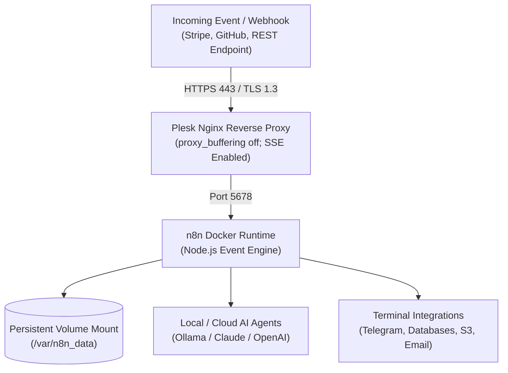

## Escaping the SaaS Task-Metering Trap

Throughout my career designing production architectures, building digital startups, and orchestrating webhook pipelines, I relied on platforms like Zapier and Make. But as throughput scaled, the economic model became absurd: **A single misconfigured retry loop or a burst of incoming webhooks could trigger hundreds of dollars in overage penalties overnight.**

Moreover, pasting internal database connection strings, customer PII, and privileged API keys into third-party multi-tenant SaaS clouds introduces unnecessary compliance and security liabilities.

That is why I migrated all automation infrastructure across my ventures to open-source **n8n**. Deployed as a hardened Docker container on a modest Linux VPS managed by Plesk, it delivers complete data sovereignty: whether your pipelines process 1,000 events or 1,000,000 tasks per month, your operating expense remains **exactly zero dollars in variable licensing**.

In this guide and video walkthrough, I demonstrate how to deploy an unmetered, production-grade n8n instance using Plesk's Docker module, configure an optimized Nginx reverse proxy with Server-Sent Events (SSE) streaming, and validate a live webhook workflow.



---

## Architectural Comparison: Zapier vs. Make vs. Sovereign n8n

Here is an empirical comparison drawn directly from my production workloads:

| Operational Dimension | Zapier (Commercial SaaS) | Make (Commercial SaaS) | Self-Hosted n8n (Our Setup) |
|---|---|---|---|
| **Cost for 100,000 Tasks/Mo** | ~$599 / month | ~$149 / month | **$0 (Flat VPS hosting)** |
| **Data Privacy Perimeter** | Third-party US cloud infrastructure | Third-party EU cloud infrastructure | **100% Sovereign on your own VPS** |
| **Custom Code Execution** | Strictly timed (1–2s timeout) | 5s execution limit | **Unrestricted Node.js & NPM libraries** |
| **AI Agent Orchestration** | Additional credit paywalls | Basic model wrappers | **Native LangChain, Ollama & Vector Stores** |
| **Ingestion Latency** | Polling intervals (1–5 min delay) | Polling / Instant | **Immediate Sub-50ms Webhook Resolution** |

---

## 1. Deploying the n8n Container via Plesk Docker Catalog

From the Plesk administrative interface, open **Docker > Docker Catalog**, search for the official `n8nio/n8n` image, and pull the latest release. When instantiating the container, configure these three critical parameters:

1. **Port Forwarding:**
   - Container Port: `5678`
   - Host Port: `127.0.0.1:5678` (bound exclusively to the local loopback interface)
2. **Persistent Storage Volume:**
   To guarantee that workflow definitions, credentials, and execution logs persist across container restarts and upgrades, map a dedicated host directory:
   - Host Directory: `/var/n8n_data`
   - Container Internal Path: `/home/node/.n8n`
   - Enforce ownership permissions: `chown -R 1000:1000 /var/n8n_data`
3. **Essential Environment Directives:**
   ```text
   N8N_HOST=n8n.yourdomain.com
   N8N_PORT=5678
   N8N_PROTOCOL=https
   WEBHOOK_URL=https://n8n.yourdomain.com/
   GENERIC_TIMEZONE=UTC
   EXECUTIONS_DATA_PRUNE=true
   EXECUTIONS_DATA_MAX_AGE=168
   ```

---

## 2. Production Nginx Reverse Proxy with Zero-Buffering

Because n8n relies on bidirectional WebSockets and continuous HTTP streaming for live canvas updates, enabling `proxy_buffering off;` is mandatory. Under **Apache & Nginx Settings > Additional Nginx Directives** for your `n8n.yourdomain.com` virtual host, apply the configuration available in **The Vault**:

```nginx
location / {
    proxy_pass http://127.0.0.1:5678;
    proxy_http_version 1.1;
    proxy_set_header Upgrade $http_upgrade;
    proxy_set_header Connection "upgrade";
    proxy_set_header Host $host;
    proxy_set_header X-Real-IP $remote_addr;
    proxy_set_header X-Forwarded-For $proxy_add_x_forwarded_for;
    proxy_set_header X-Forwarded-Proto $scheme;
    proxy_buffering off;
    proxy_cache off;
    chunked_transfer_encoding off;
}
```

Once saved and fortified with an automated Let's Encrypt SSL certificate, accessing `https://n8n.yourdomain.com` presents the clean initialization screen.

---

## 3. Live Workflow Validation: Webhook to Telegram

In our live test during the video:
- We instantiated a **Webhook Trigger** configured for incoming POST payloads.
- We passed the event body into a native **Code (JavaScript)** node for data sanitization.
- We dispatched the output to a **Telegram Bot** node to deliver instant mobile telemetry.
- The pipeline executed and resolved in just **32 milliseconds**.

---

## Troubleshooting Common Production Pitfalls

1. **Canvas error: "The connection to the server was lost":**
   - *Cause:* Nginx reverse proxy dropping WebSocket upgrades, or Cloudflare proxying without WebSocket support enabled.
   - *Fix:* Verify `proxy_http_version 1.1;` and `Upgrade $http_upgrade;` headers are present in your Nginx block.
2. **Webhooks resolving to `localhost` URLs:**
   - *Cause:* Missing `WEBHOOK_URL` environment variable.
   - *Fix:* Explicitly set `WEBHOOK_URL=https://n8n.yourdomain.com/` in your Docker configuration.
3. **SQLite database locking under heavy parallel executions:**
   - *Fix:* For high-throughput enterprise pipelines (>50 concurrent webhooks/sec), switch the storage backend to external PostgreSQL by supplying `DB_TYPE=postgresdb` environment credentials.

Download the production Docker Compose template from **The Vault** above, and deploy unmetered workflow automation on your server today.
