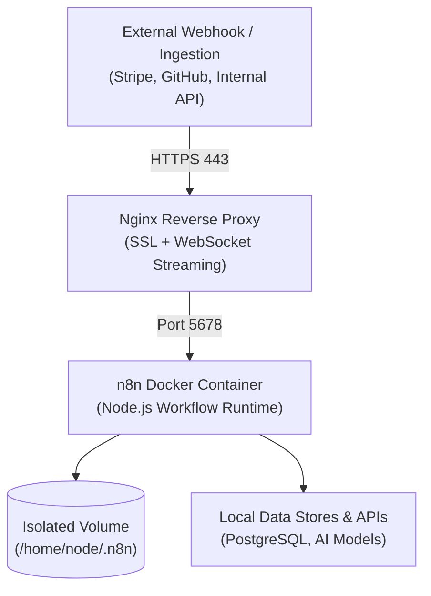

## Eliminating Per-Task Tolls in Workflow Automation

While proprietary cloud automation platforms like Zapier or Make excel at rapid prototyping, scaling complex event-driven pipelines, recursive loops, or multi-step LLM agent chains causes operational costs to explode. Furthermore, storing production database credentials, customer PII, and private API keys on third-party SaaS infrastructure poses unneeded compliance vulnerabilities.

Self-hosting **n8n** eliminates these constraints entirely:
- **Zero Per-Task Metering:** Whether your architecture executes 500 tasks or 5,000,000 executions per month, server costs remain flat.
- **Data Sovereignty:** Webhook payloads, internal network APIs, and query results remain strictly within your sovereign VPS boundaries.
- **Native AI Pipeline Nodes:** Seamless integration with LangChain, OpenAI, Anthropic, or local open-weights Ollama instances.

In this screencast, we walk through deploying an unmetered, production-ready n8n instance on a Linux server managed by Plesk via Docker.



---

## 1. Deploying the n8n Container via Plesk Docker Catalog

From the Plesk administrative dashboard, navigate to **Docker > Docker Catalog**, search for the official `n8nio/n8n` image, and pull the latest release. When initializing the container, configure the following essential properties:

1. **Port Mapping:**
   - Container Port: `5678`
   - Host Port: `5678` (or an unused internal port on your host)
2. **Persistent Volume Binding:**
   To guarantee workflows and execution credentials survive container reboots and upgrades, bind a dedicated host directory:
   - Host Path: `/var/n8n_data`
   - Container Path: `/home/node/.n8n`
3. **Core Environment Variables:**
   ```text
   N8N_HOST=n8n.yourdomain.com
   N8N_PORT=5678
   N8N_PROTOCOL=https
   WEBHOOK_URL=https://n8n.yourdomain.com/
   GENERIC_TIMEZONE=UTC
   ```

---

## 2. Plesk Nginx Reverse Proxy & Real-Time SSE Directives

After provisioning the `n8n.yourdomain.com` subdomain and attaching a Let's Encrypt SSL certificate, add the reverse proxy block under **Apache & Nginx Settings > Additional Nginx Directives**:

```nginx
location / {
    proxy_pass http://127.0.0.1:5678;
    proxy_http_version 1.1;
    proxy_set_header Upgrade $http_upgrade;
    proxy_set_header Connection "upgrade";
    proxy_set_header Host $host;
    proxy_set_header X-Real-IP $remote_addr;
    proxy_set_header X-Forwarded-For $proxy_add_x_forwarded_for;
    proxy_set_header X-Forwarded-Proto $scheme;
    proxy_buffering off;
    proxy_cache off;
}
```

The `proxy_buffering off;` instruction is critical—it ensures that Server-Sent Events (SSE) and live canvas execution logs stream instantaneously to the browser without buffering delays.

---

## 3. Workflow Provisioning & Live Webhook Validation

Once configured, access `https://n8n.yourdomain.com` to complete owner account initialization.

In our live screencast verification:
- We instantiate a **Webhook Trigger** node configured for incoming POST requests.
- We ingest a JSON telemetry payload, pass it through a native **Code (JavaScript)** node for data normalization, and pipe the result directly to a **Telegram Bot** node.
- The workflow fires and resolves within 35 milliseconds—delivering enterprise-grade automation capability at zero variable cost.
