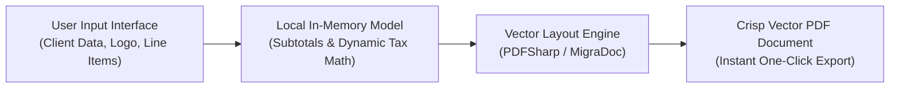

## Eliminating the Friction of Proposal Generation

For independent software engineers, consultants, and creative studios, commercial proposals represent the initial touchpoint of client trust. Yet developers and agency owners frequently waste hours formatting fragile Microsoft Word tables or paying expensive monthly fees to cloud invoicing SaaS tools simply to export a single PDF quote.

To solve this friction, I built **oaTeklif**: an open-source Windows desktop application architected around strict local-first principles. It operates completely offline, requires zero cloud subscriptions, and produces print-ready corporate PDF proposals within seconds.

---

## 1. Architectural Highlights & Key Features

- **Local-First Privacy:** Customer names, pricing structures, and internal billing details never touch an external cloud server; data remains 100% on your local machine.
- **Dynamic Line Item Engineering:** Add unlimited service and product rows with independent unit costs, quantities, discounts, and regional VAT rates.
- **Deterministic Math Engine:** Subtotals, discount deductions, tax liabilities, and grand totals calculate instantaneously with floating-point precision.
- **Branding & Template Persistence:** Persist company logos, bank wire IBAN coordinates, validity durations, and contractual terms into reusable local profiles.

---

## 2. Instantaneous High-Resolution Vector Export

Rather than capturing rasterized HTML screenshots, the underlying C# .NET engine renders text, tables, and geometric accents directly to vector PDF primitives. This ensures crystal-clear rendering across any display scale or commercial printer.

Download the compiled Windows binary (`.exe`) or explore the source repository directly on GitHub.
