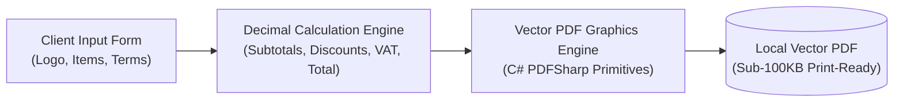

## Why I Built a Sovereign Proposal Engine for Desktop

As a software architect, independent technical consultant, and agency lead, the commercial quotation submitted to a client represents the direct embodiment of your professionalism and engineering discipline. For years, I endured the exact same recurring friction: **Wrestling with misaligned tables and broken fonts in Microsoft Word templates, or paying $20 to $40 every month for bloated cloud invoicing platforms just to output a handful of client PDF quotes.**

To eliminate this operational friction once and for all, I built **oaTeklif** using C# .NET. Designed around strict local-first principles, it functions entirely offline, incurs zero subscription tolls, and renders print-ready, vectorized corporate proposals within seconds.

In this brief screencast and architecture breakdown, we explore the internal data model, floating-point tax math safeguards, and vector layout rendering behind oaTeklif.



---

## Architectural Comparison: Word Templates vs. Cloud SaaS vs. oaTeklif

Here is an objective breakdown of proposal generation tooling:

| Capability Dimension | Microsoft Word / Excel Template | Cloud Invoicing SaaS | oaTeklif (Open-Source Desktop) |
|---|---|---|---|
| **Subscription Cost** | Bundled with Office 365 | $15 – $45 / month recurring | **100% Free & Open Source** |
| **Offline Independence** | Partially functional offline | Dead without internet | **100% Local-First Offline** |
| **Data Perimeter** | Local machine | Uploaded to third-party multi-tenant clouds | **Zero Outbound Telemetry** |
| **Mathematical Precision** | Fragile cell formulas prone to breaking | Automated | **Strict Type-Safe C# Decimal Math** |
| **Rendering Integrity** | Inconsistent across OS fonts | Rendered via HTML rasterization | **Pixel-Independent Vector Typography** |

---

## 1. Internal Architecture & Data Model

oaTeklif is designed as a standalone, zero-dependency C# .NET desktop client. The in-memory model adheres strictly to the architectural schema published in **The Vault**:

- **Dynamic Line Items:** Add arbitrary billing items representing software sprints, infrastructure setup, or design deliverables. Each row specifies quantity, billing unit (Hours, Days, Units, Licenses, Milestone), unit rate, discount percentage, and regional tax brackets.
- **Fixed-Point Financial Math:** To eliminate IEEE 754 binary floating-point rounding anomalies, calculations run exclusively against 128-bit C# `decimal` primitives with exact fractional currency rounding.
- **Local Persistence:** Company logos, banking coordinates, and standard warranty disclaimers serialize cleanly into local JSON configuration structures under the user's `AppData/Local` sandbox.

---

## 2. Direct Vector PDF Rendering

Rather than invoking an embedded headless browser to capture a blurry HTML raster screenshot, oaTeklif draws graphical primitives directly to a vector canvas using **PDFSharp Core**:
- Embedded logos retain full vector sharpness.
- Border rules, table headers, currency symbols, and contractual footers draw as native vector paths.
- The resulting document size is typically **under 100 KB**, ensuring instantaneous loading when emailed to enterprise procurement officers.

```csharp
// Vector rendering snippet from oaTeklif's internal layout engine
XGraphics gfx = XGraphics.FromPdfPage(page);
XFont boldFont = new XFont("Segoe UI", 11, XFontStyle.Bold);
gfx.DrawString("SUBTOTAL:", boldFont, XBrushes.DarkGray, new XPoint(380, cursorY));
gfx.DrawString(subtotal.ToString("C2", cultureInfo), boldFont, XBrushes.Black, new XPoint(500, cursorY));
```

---

## 3. Generating a Proposal in Under 60 Seconds

As demonstrated live in the video walkthrough:
1. Launch the executable and specify client metadata and project scope.
2. Enter your billable deliverables and service line items.
3. Configure project discounts and regional VAT; totals compute instantaneously.
4. Click **"Generate PDF"**; your polished proposal is written directly to your desktop ready for immediate dispatch.

---

## Common Edge Cases & Practical Solutions

1. **Logo distortion or clipping:**
   - *Fix:* oaTeklif auto-scales high-resolution images while preserving their intrinsic aspect ratio within a `200x80` bounding box. For optimal presentation, utilize transparent PNG brand marks.
2. **Tax totals not refreshing after in-cell edit:**
   - *Fix:* Ensure you press `Enter` or advance keyboard focus to trigger data binding validation before clicking export.
3. **Windows SmartScreen untrusted publisher warning:**
   - *Cause:* Independent open-source utilities distributed without expensive annual EV code signing certificates trigger Windows Defender heuristics.
   - *Fix:* Click "More info" and select "Run anyway". All source code is completely transparent and inspectable on GitHub.

Download the compiled installer (`.exe`) and the full architecture specification schema directly from **The Vault** section above.
