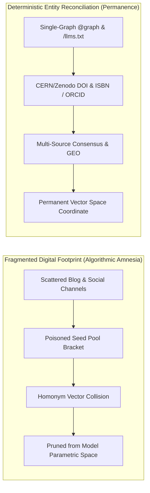

## Introduction: The Safe Illusion of the Search Bar

For the past two decades, the core foundation of digital asset management was anchored to a singular metric: securing the top spot on search engine results pages. Enterprise brands, marketing agencies, and independent consultants channeled millions of dollars into keyword density, backlink networks, and on-page technical optimization. The reward was straightforward; occupying the number one organic position meant capturing high-intent demand and establishing default market authority.

In recent months, a persistent and technically flawed myth has gained traction. Several commentators claim that enterprise websites ranking first on Google are somehow missing entirely from Google AI Overviews. This assertion misinterprets modern retrieval architectures. Google AI Overviews operates primarily as a retrieval-augmented generation (RAG) framework; it queries the topmost organic results for a given search string, using those high-ranking pages as its primary source context. Consequently, if your domain organically leads the rankings for your own brand name or exact query, it naturally appears within that synthesized summary box.

The actual systemic crisis does not stem from Google search indices failing to read web pages. The danger lies in an irreversible structural migration: the center of gravity for human decision-making has fundamentally abandoned the traditional search bar.

Today, enterprise decision-makers, global procurement directors, sovereign investors, and sophisticated consumers no longer type fragmented keywords to browse lists of blue hyperlinks. High-stakes research has shifted directly into the conversational interfaces of large language models (ChatGPT, Claude, Perplexity, Gemini) and the hyper-personalized discovery algorithms of modern distribution networks.

Within this new paradigm, the foundational mechanics have transformed: Search engines index and list web documents; artificial intelligence systems reconcile and synthesize entities within multidimensional vector spaces.

It is precisely at this intersection where organizations possessing hundreds of indexed pages and top-tier rankings suddenly vanish into complete algorithmic silence. As explored under my [Onur Aksoy (Hackonomist)](/en/about/) moniker in my monograph [Yapay Zeka Sizi Tanımıyor](/en/#book), organizations built upon digital tenancy fail to establish permanent coordinates within the parametric memory of cognitive models.

---

## 1. Inverted Search Indices vs. Probabilistic Weight Spaces

Traditional search engines operate on the principles of an exhaustive library index. At the architectural core lies the inverted index. When an inquiry enters the system, algorithmic pipelines scan tokenized entries, calculate term frequencies, evaluate spatial distribution within the document, and apply link-graph weighting algorithms such as PageRank to present an ordered list of URLs. To a search engine, the primary atomic unit is an individual web page.

Large language models do not function as document registries. They represent high-dimensional probabilistic weight spaces composed of hundreds of billions of parameters. During training across trillions of tokens, these models do not store discrete files. Instead, they convert semantic relationships, co-occurrence probabilities, and contextual hierarchies into numerical tensors.

This architectural divergence produces an inescapable reality: Optimizing a document to capture the first position in an organic search index does not guarantee that the underlying organization exists within a model's parametric memory. Even when conversational models perform real-time retrieval over the live web, they do not merely regurgitate text; they synthesize multi-source consensus regarding the entity in question.

If an enterprise, specialist, or brand possesses fragmented, contradictory, or unanchored digital traces, the underlying model cannot isolate it as an independent, coherent actor. It inevitably subsumes the organization into the identity of a dominant global incumbent or conflates it with an unrelated namesake. As demonstrated during audits with [SEO Lens](/en/projects/seo-lens/), superficial metadata alone fails to establish verifiable entity boundaries across modern vector spaces.

| Evaluation Metric | Classical Inverted Index SEO | Vector-Space Entity Reconciliation (GEO) |
|---|---|---|
| **Atomic Unit** | Individual Web Document (URL / HTML Page) | Multidimensional Entity Node (Vector Coordinate) |
| **Indexing Topology** | Tokenized Inverted Index & Lexical Matching | Dense High-Dimensional Embeddings & Tensors |
| **Query Resolution** | Ranked List of Ranked Hyperlinks (SERP) | Generative Synthesis & Consensus Attribution |
| **Authority Proof** | External Inbound Hyperlinks (PageRank Graph) | Sovereign Identity Anchors (ORCID, DOI, ISBN, @graph) |
| **Systemic Risk** | Search Engine Core Update Volatility | Homonym Collision & Complete Algorithmic Amnesia |

---

## 2. Homonym Collisions and Entity Conflation Risks

One of the most destructive vulnerabilities confronting institutional memory in the era of synthetic intelligence is homonym collision: the overlapping of identical or nearly indistinguishable brand names and trade titles across global markets.

In a conventional search paradigm, when a prospective client enters your exact corporate name, domain name mechanics ensure your official portal commands the first result. However, the operational reality shifts dramatically when an enterprise evaluator queries a conversational intelligence model:

*"Who is Enterprise X in this sector, what major infrastructures have they deployed, and what is their operational track record?"*

Language models are not absolute verifiers of fact; they are probabilistic inference engines designed to generate the most statistically coherent response within a defined token budget. If your enterprise lacks an unambiguous, immutable, and internationally verified entity boundary, the model encounters semantic ambiguity. It frequently merges your legitimate corporate record with the controversies, legal disputes, or bankruptcies of an unrelated namesake operating elsewhere in the world.

This failure mode is not a transient hallucination; it is a structural entity reconciliation breakdown occurring inside high-dimensional vector representations. Consequently, an organization finds its balance sheet, reputation, and commercial credibility penalized by events completely divorced from its actual operations. The sovereign information architecture implemented for [Tarihçi Anne Seda Aksoy](/en/projects/tarihci-anne-seda-aksoy/) provides an empirical example of how cultural and commercial entity boundaries are insulated from web noise.

---

## 3. The Social Graph Migration: Multimodal Embeddings

A parallel algorithmic disruption has completely reorganized social distribution networks such as YouTube, Instagram, and TikTok. These platforms have systematically dismantled the historical social graph.

Under the historic paradigm, mechanics were deterministic: A user followed a brand or creator, and published content populated that user's reverse-chronological feed. Follower counts served as direct indicators of institutional reach and media leverage.

Contemporary recommendation engines operate entirely upon multimodal embeddings. When video content is ingested, the pipeline dissects audio frequencies, vocal cadence, on-screen geometric objects, visual contrast, text overlays, and millisecond-level viewer drop-off trajectories, compiling these signals into a dense mathematical vector. The algorithmic dispatch no longer asks: "Who subscribes to this account?" Instead, it calculates: "Which specific viewer consumption vector in our network matches the content vector of this specific media asset at this exact moment?"

This operational pivot renders gross follower counts functionally obsolete. It explains why corporate profiles boasting hundreds of thousands of followers regularly register fewer than one thousand impressions on technical releases, while newly initialized channels capture millions of targeted views with a single release. Distribution is no longer tied to relational connections, but to dynamic vector alignment.

---

## 4. Seed Pool Poisoning and the Viral Growth Trap

At the computational heart of algorithmic distribution sits the seed pool mechanism. When media is published, the network does not deploy it broadly. It serves the asset to an initial testing cohort of roughly two hundred to five hundred users. Within this closed cohort, retention velocity, scroll-away latency, and engagement rates are scrutinized. If the testing cohort delivers statistically significant positive telemetry, distribution expands into subsequent concentric tiers.

This is precisely where established enterprises and content creators fall victim to the viral growth trap. In a misguided quest to artificially inflate view counts, social teams deploy popular humor, sensational commentary, or trend-chasing formats completely detached from the organization's core technical mission.

While these superficial formats may deliver short-lived engagement spikes, they inflict catastrophic damage upon the account's mathematical profile: Seed Pool Poisoning.

The platform's recommendation engine interprets these signals by locking the account vector into an audience bracket seeking lightweight entertainment. When the enterprise subsequently publishes a high-value technical paper, an architectural breakdown, or an industrial case study, the engine routes that asset directly into the corrupted seed pool. The entertainment-focused testing cohort scrolls past the content within the opening seconds. The algorithm concludes the asset lacks quality and terminates distribution entirely.

The enterprise effectively strangles its own distribution capacity. High gross follower numbers offer no protection once the seed pool is poisoned.

---

## 5. Digital Noise and the Mechanics of Algorithmic Amnesia

The conventional agency response to declining visibility is almost universal: "Publish higher volumes; post multiple times every day."

From a systems engineering standpoint, uncontrolled publishing volume does not resolve visibility deficits; it accelerates institutional erosion. Flooding the digital commons with generic corporate announcements, synthetic boilerplate text, and templated graphics creates unmanageable noise that modern algorithmic filters actively discard.

Next-generation foundation models apply stringent data-hygiene filters during both pre-training curation and post-training alignment. Content that lacks verifiable provenance, introduces repetitive patterns, or fails to deliver dense information value is pruned from training corpuses.

This process is algorithmic amnesia. Organizations that produce high volumes of superficial commentary without establishing original foundational concepts are systematically excluded from model weights. Visibility must not be confused with institutional retention. Visibility is an ephemeral spark of attention; retention is a permanent, immutable coordinate etched into the memory of intelligent systems.

---

## 6. The Commercial Balance Sheet: B2B Procurement and Export Risks

This structural shift extends far beyond public relations metrics; it directly impacts corporate balance sheets, enterprise valuation, and cross-border commercial viability.

Global procurement workflows are rapidly transitioning toward autonomous operations. Industrial conglomerates across Europe, North America, and East Asia are phasing out manual search engine evaluations for vendor discovery. Procurement departments now utilize isolated, enterprise-grade AI agents configured with rigorous technical specifications, compliance parameters, and logistical criteria to conduct automated market analyses.

When an autonomous procurement agent conducts an international market scan, your organization will not appear in the candidate matrix unless it exists as a verified, unambiguous entity within the model's semantic knowledge space. Having an elite sales team or an attractive pricing structure is irrelevant if the enterprise is never selected for the initial evaluation slate. As detailed in our guide on [Ankara OSB industrial B2B export web architecture](/en/broadcasts/ankara-osb-sanayi-b2b-ihracat-web-mimarisi/) and substantiated in my CERN/Zenodo academic paper [10.5281/zenodo.24113990](https://doi.org/10.5281/zenodo.24113990), visibility in algorithmic supply chains is secured through structured data contracts rather than catalog brochures.

Ranking first on Google for your own corporate name is merely the digital equivalent of answering the door when someone already arrives at your facility. True commercial resilience requires autonomous recommendation by the intelligence systems guiding global decision-makers who do not yet know your name, but urgently require your operational capability. Within our enterprise pipelines for [Ankara enterprise AI automation](/en/ankara-enterprise-ai-automation/), we engineer the exact semantic structures required to establish authoritative positioning before autonomous procurement models.

---

## 7. The Shared Criterion: Entity Reconciliation

Modern digital infrastructure is governed by two computational centers of power: recommendation engines directing immediate human attention, and conversational language models mediating knowledge retrieval and strategic decisions.

Despite operating on distinct algorithmic architectures, both systems evaluate enterprises, creators, and leaders through a single foundational test:

*"What distinct, verifiable, and unambiguous problem does this entity resolve with zero noise and absolute consistency?"*

If an enterprise constantly shifts focus, oscillating between disparate topics and superficial commentary, its semantic vector degrades into mathematical ambiguity. Recommendation engines cannot classify its distribution audience, and language models cannot map its expertise.

The sustainable path forward does not involve purchasing more ad placements or chasing transient social media trends. It demands unifying an organization's entire digital footprint around rigorous entity reconciliation, anchored by verifiable corporate provenance and immutable records. Those who mistake noise for authority will be pruned by algorithmic systems; those who build an unshakeable semantic core will remain permanent reference points in the memory of the intelligent age.
