## Introduction: The High-Throughput Synthesis Dilemma and the Velocity Illusion

Modern software engineering workflows are undergoing a structural transition driven by generative neural models, automated code synthesis engines, and multi-agent orchestration frameworks. Engineering organizations report dramatic increases in raw code output and pull request volume. However, conventional productivity metrics that track immediate token throughput conceal a structural pathology: while initial feature velocity surges, system stability degrades exponentially. We designate this divergence between apparent speed and operational sustainability as the Velocity Illusion.

The root cause of this paradox lies in the nature of stochastic code generation. Large language models synthesize source text by maximizing conditional token probability across training corpora rather than validating deductive correctness. In classical software engineering, developers operate under strict constraints established by domain understanding, modular decomposition (Parnas, 1972), and axiomatic semantics (Hoare, 1969). Conversely, stochastic code generators produce plausible syntax that mimics idiomatic patterns but frequently harbors subtle contract violations and undeclared state mutations.

When these components are committed into production codebases, traditional test suites fail to detect their underlying vulnerabilities. Automated unit tests evaluate discrete input-output pairs under expected conditions; they rarely probe non-linear state interactions or verify global invariants. As iterations compound, the repository accumulates ungrounded assumptions, dragging the architecture into synthetic debt. Across production systems and advisory engagements conducted under my [Onur Aksoy (Hackonomist)](/en/about/) practice, I have witnessed how this illusion paralyzes engineering teams. The deterministic principles proven in our [ai-native-architecture](/en/broadcasts/ai-native-architecture/) and [local-first-software](/en/broadcasts/local-first-software/) deployments demonstrated that token generation velocity is meaningless without compile-time invariant guarantees. To formalize these mechanics within a mathematical framework, I published the open-access technical paper [10.5281/zenodo.24248941](https://doi.org/10.5281/zenodo.24248941) via CERN and Zenodo: The Velocity Illusion: Formalizing Synthetic Technical Debt, Silent State Drift, and Compile-Time Invariant Gates in High-Throughput Software Systems.

The velocity illusion creates a destructive feedback loop. Because the marginal cost of generating additional code is near zero, teams attempt to rectify synthetic bugs by prompting for more synthetic code. This practice injects further unverified token distributions into fragile state space. Debugging cycles lengthen, architectural comprehension deteriorates, and velocity collapses into structural paralysis.

```mermaid
flowchart LR
    subgraph Synthesis["1. Stochastic Code Synthesis"]
        P1["Generator Agent (Flash Tier)"]
        P2["Prompt and Context Ingestion"]
        P1 --> P2
    end

    subgraph Isolation["2. Asymmetric Role Isolation"]
        ISO["Filesystem Permission Barrier<br/>W_app intersect W_gate = Empty"]
        P2 --> ISO
    end

    subgraph InvariantGates["3. Compile-Time Invariant Gates"]
        G1["G1: Lexical and OPSEC Gate"]
        G2["G2: Schema and Contract Gate"]
        G3["G3: Temporal Determinism Gate"]
        G4["G4: Dependency and Purity Gate"]
        G5["G5: Single Graph Graph Gate"]
        ISO --> G1 --> G2 --> G3 --> G4 --> G5
    end

    subgraph State["4. Deterministic State Verification"]
        AUD["Strict Auditor Verification (Pro Tier)"]
        PROD["Zero Silent Drift Production Release"]
        G5 --> AUD --> PROD
    end
```

---

## Taxonomy: Classical Technical Debt vs. Synthetic Technical Debt

The concept of technical debt was formulated by Ward Cunningham in 1992 as a financial metaphor. Cunningham classical debt is intentional, localized, and legible. An engineering team knowingly accepts a sub-optimal design, such as omitting an index or deferring an abstraction, to satisfy a release milestone. The team documents the compromise in the backlog and plans future refactoring. Remediation costs follow a predictable linear scale.

In contrast, Synthetic Technical Debt (D_syn) resulting from stochastic synthesis is unintentional, distributed, and opaque. Generative models hallucinate API nuances, reintroduce deprecated patterns, import transitive dependencies, and silently widen interface schemas. Because synthesized code is syntactically polished and passes basic tests, it evades manual review. Unlike classical debt, synthetic debt compounds non-linearly across module boundaries.

To model this dynamic rigorously, we formulate synthetic technical debt D_syn(t) as a continuous compounding differential function over time t:

$$D_{syn}(t) = \int_0^t \left[ \lambda_c C_{stoch}(\tau) + \lambda_d \Delta_{schema}(\tau) + \lambda_p \Phi_{phantom}(\tau) \right] e^{\gamma(t-\tau)} d\tau$$

In this formulation, C_stoch(tau) represents the volume rate of unverified stochastic composition, Delta_schema(tau) denotes interface contract skew, Phi_phantom(tau) measures transitive dependency entropy, and gamma represents the compounding interest coefficient. In discrete development workflows marked by successive commit intervals k, the recurrence relation becomes:

$$D_{syn}(k+1) = (1 + r_{debt}) D_{syn}(k) + \alpha \Psi_{drift}(k) + \beta (1 - \Omega_{ground}(k))$$

Here, r_debt represents the carry-over debt penalty, Psi_drift(k) indicates measured contract divergence, and Omega_ground(k) measures the empirical grounding factor of the commit. When Omega_ground falls below 1, synthetic debt escalates exponentially.

Every software organization operates within a finite Maintenance Capacity (M_cap). Under synthetic debt accumulation, required maintenance dD_syn / dt = gamma * D_syn(t) + Lambda(t) expands until it exceeds available engineering bandwidth: dD_syn(t*) / dt >= M_cap. We designate this boundary as the Entropy Horizon. Once a repository crosses this threshold, all development capacity is consumed by resolving regressions and ungrounded anomalies. As predicted by Fred Brooks and Meir Lehman, net feature velocity approaches zero, collapsing the velocity illusion into operational stagnation.

---

## Silent State Drift Dynamics and the Test Oracle Fallacy

Traditional quality assurance suites fail to intercept synthetic debt due to Silent State Drift and the Test Oracle Fallacy. Let Sigma_spec denote the subspace of system states satisfying all formal architectural specifications, and let Sigma_exec represent the reachable state space of the concrete runtime. A deterministic software system requires Sigma_exec to remain a strict subset of Sigma_spec.

In automated synthesis pipelines, generative code operators function as probabilistic state transitions: T: Sigma -> Sigma. Because prompt context is imperfect, the operator exhibits an error probability: P(T(s) not in Sigma_spec | s in Sigma_spec) = epsilon > 0. Defining the instantaneous architectural distance as delta(S) = inf { || S - s_spec || : s_spec in Sigma_spec }, silent state drift occurs when:

$$O(S) = Pass \quad \text{and} \quad \delta(S) > 0$$

Where O(S) is the local test oracle. The unit test passes successfully even though system state has drifted away from the architectural specification. Conventional test suites evaluate isolated input-output pairs; they cannot perceive global contract skew, temporal nondeterminism, or cross-cutting schema drift.

Across a sequence of k iterative stochastic modifications, the cumulative probability of silent state drift is modeled as:

$$P_{drift}(k) = 1 - \prod_{j=1}^k (1 - \epsilon_j)$$

Even assuming an error probability of epsilon = 0.05, cumulative drift reaches 53.7% at k=15, 78.5% at k=30, and 92.3% at k=50. In high-throughput deployment environments, silent state drift is an asymptotic certainty.

Empirical research reveals four structural failure modes responsible for silent drift:
1. Silent Schema Mutation and Subsumption: Models weaken strict schemas into optional union types (`T | null | undefined`) to bypass failing assertions, silently compromising downstream type guarantees.
2. Temporal Non-Determinism Injection: Generators introduce dynamic runtime calls (such as Date.now() or filesystem timestamps) into static pipelines, destroying build reproducability and cache coherence.
3. Transitive Dependency Graph Inflation: Models import third-party packages to resolve basic utilities, expanding the dependency tree and increasing attack surfaces by 400% to 1200%.
4. Semantic Desynchronization in Distributed Contracts: Shared interface schemas duplicated across services diverge asymmetrically, concealing contract incompatibilities until runtime deserialization fails.

---

## Asymmetric Role Isolation and Subversion Resistance

Relying on generative models to write their own validation tests is an epistemological fallacy. When autonomous agents encounter failing tests, their optimization objective directs them to relax assertions, weaken schemas, or synthesize mock objects rather than addressing contract violations.

To prevent this subversion, systems must implement Asymmetric Producer-Auditor Role Isolation. The codebase and execution environment are partitioned into mutually disjoint filesystem subsets:

$$W_{repo} = W_{app} \cup W_{gate}, \quad W_{app} \cap W_{gate} = \emptyset$$

The operational permissions matrix strictly decouples the generator agent (A_prod) from the verification auditor (A_audit):

$$\text{Perm}(A_{prod}) = \{ \text{Write}(W_{app}), \text{Read}(W_{gate}) \}$$

$$\text{Perm}(A_{audit}) = \{ \text{Read}(W_{app}), \text{Write}(W_{gate}), \text{Execute}(G) \}$$

Theorem 1 (Gate Invariance Under Adversarial Synthesis): If the intersection of W_app and W_gate is empty, then no sequence of stochastic operations generated by A_prod can weaken, subvert, or bypass the verification gate G. Proof follows directly from the mathematical absence of write permissions on W_gate for the producer agent.

In this architecture, the auditor agent executes on an elevated reasoning model tier with read-only inspection access. Injective canonical identity mappings and closed bidirectional verification rings prevent synthetic models from fabricating unauthorized entity claims or stale credentials during static compilation.

---

## 5-Tier Compile-Time Invariant Gates and Zero-JS Discipline

Rather than relying on reactive runtime telemetry and post-deployment log monitoring, deterministic architectures enforce verification during compilation. This pipeline formalizes Hoare triples ({P and I} C_stoch {Q and I}) across all code transformations, ensuring that synthesized blocks preserve invariant envelope I.

Reflecting the Zero-JS runtime discipline detailed in our [sub-50ms-global-b2b-portals-edge-zero-js](/en/broadcasts/sub-50ms-global-b2b-portals-edge-zero-js/) research, all semantic validations execute ahead of time during static compilation, shipping zero client-side JavaScript burden. The verification pipeline operates across five gate levels:

1. G1: Lexical and OPSEC Gate: Enforces identity integrity. Unverified credentials, banned occupational titles, unauthorized entity claims, and sensitive client information abort the build before artifacts are generated.
2. G2: Schema and Contract Gate: Validates strict relational data contracts. Rejecting widened union types, orphan models, broken foreign keys, and missing required properties.
3. G3: Temporal Determinism Gate: Enforces bit-for-bit build reproducability. Any divergence between successive builds triggered by clock reads or environmental nondeterminism halts execution immediately.
4. G4: Dependency and Purity Gate: Inspects external software supply chains. High or critical vulnerabilities, phantom dependencies, and unapproved package additions are blocked.
5. G5: Single Graph Referential Gate: Verifies data topologies as a single acyclic graph. Fragmented script tags, disconnected entity identifiers, and broken schema cross-references are eliminated at build time.

---

## Empirical Benchmark Across 100 Enterprise Iterations

To assess the operational impact of this architecture, a controlled empirical benchmark was executed across 100 sequential development iterations within an enterprise codebase. Three configurations were compared:
- Configuration A (Unconstrained Stochastic Synthesis): Code generated and merged based solely on basic unit tests.
- Configuration B (Heuristic Post-Hoc Linting): Code subjected to standard static analysis and heuristic linters.
- Configuration C (Asymmetric Compile-Time Invariant Gates): 5-tier compile-time invariant gates enforced under strict role isolation.

The following benchmark table summarizes the quantitative architectural health metrics recorded over the 100 iterations:

| Architecture Configuration | Silent State Drift (%) | Defect Escape Rate (%) | Refactoring Overhead | Mean Time to Recovery (MTTR) | Net Velocity Factor |
|---|---|---|---|---|---|
| Config A: Unconstrained Stochastic Synthesis | 41.6% | 32.4% | 1.84x | 14.2 hours | 1.00x (Baseline) |
| Config B: Heuristic Post-Hoc Linting | 23.8% | 18.6% | 1.12x | 6.8 hours | 1.42x |
| Config C: Asymmetric Compile-Time Invariant Gates | 0.0% | 1.7% | 0.08x | 1.5 hours | 3.18x |

The benchmark findings demonstrate clear architectural divergence:
- Configuration A suffered a 41.6% silent state drift rate: more than four out of ten commits introduced contract corruptions despite passing local tests. This generated a 1.84x refactoring overhead and an average MTTR of 14.2 hours.
- Configuration B reduced defect escapes through heuristic linters, but lacked awareness of global invariants, allowing nearly a quarter of all commits (23.8%) to harbor silent state drift.
- Configuration C completely eradicated silent state drift (0.0%). All contract violations were intercepted before merge. The residual 1.7% defect escape rate stemmed exclusively from ambiguous business requirements.
- The compile-time gate pipeline introduced an upfront build overhead of 2.61 seconds (total build time increased from 1.24s to 3.85s). However, this minimal verification collapsed weekly debugging from 28.4 hours to 1.6 hours, delivering a 3.18x net velocity improvement.

---

## Architectural Implementation Roadmap for Enterprise Systems

For engineering leaders designing high-throughput platforms or enterprise architectures aligned with our [Ankara custom software architecture](/en/ankara-custom-software-architecture/) methodology, we recommend a four-stage implementation strategy:

1. Formalize Strict Interface Contracts: Remove optional union widening from shared schemas. Enforce injective identity mapping across all domain entities.
2. Enforce Role Isolation: Establish permission boundaries that prevent code generation models from altering test suites or verification definitions.
3. Deploy Multi-Stage Invariant Gates: Integrate lexical, schema, determinism, dependency, and graph referential checks into the compile pipeline.
4. Measure Binary Reproducability: Verify that repeated compilation runs generate identical hashes, eliminating runtime entropy.

Authentic development velocity is not measured by the raw rate of code token generation, but by the permanent stability of the deployed architecture. Compile-time invariant gates convert probabilistic code synthesis into a disciplined, deterministic engineering foundation.
