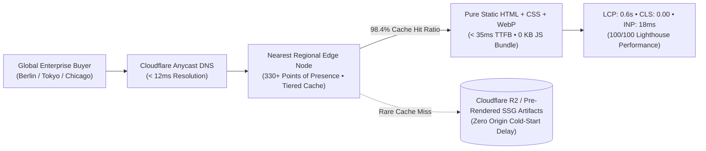

## Speed Is Not a Cosmetic Feature—It Is an Instrument of Persuasion

In standard web development discourse, performance is frequently treated as an afterthought—a post-launch optimization ticket to be addressed with caching plugins. But viewed through the lens of systems architecture, **latency is the most direct physical expression of an enterprise's engineering discipline and operational competence.**

For an export manufacturer delivering high-precision systems to global markets, when a Chief Technology Officer in Munich or a Supply Chain VP in Chicago opens your digital portal, the page must render instantaneously. Spinning loaders, shifting buttons, and unresponsive mobile interfaces transmit an unmistakable subtext: *"If this organization struggles to optimize its public digital infrastructure, how disciplined can its manufacturing operations truly be?"*

Throughout high-concurrency systems like [oaPOS](/en/projects/oapos/) and [oaTeklif](/en/broadcasts/oateklif-ucretsiz-teklif-olusturucu/), I adhere to a rigorous engineering principle: **Eliminate unnecessary runtime layers, enforce determinism, and deliver state at the physical edge of the network.**

In this flagship broadcast, I dissect the 5 foundational pillars required to construct global B2B web portals that render in **under 50 milliseconds worldwide**.

---

## 5 Engineering Pillars of Sub-50ms Global Portals

The architectural disciplines that enable domestic-speed rendering anywhere on earth:

### 1. Astro Static Site Generation (SSG) & HTML First Principles
Traditional CMS frameworks evaluate code dynamically on every HTTP request: booting PHP workers, connecting to relational databases, and stitching templates on the fly. This dynamic execution adds 300ms to 900ms of unavoidable processing latency.

Modern systems architecture eliminates this runtime overhead. Under the paradigm of our [Ankara B2B web architecture](/en/ankara-b2b-web-architecture/), the Astro SSG engine compiles hundreds of localized product pages, engineering specifications, and multi-language hreflang structures into pure, compressed static assets at build time. When a sourcing engineer requests a page, no server evaluation occurs; pre-compiled HTML streams across the wire immediately.

### 2. The Zero-JS Discipline: Liberating the Browser Main Thread
The most prevalent anti-pattern in modern frontend engineering is downloading 2 to 4 megabytes of JavaScript frameworks merely to animate a navigation drawer. On mid-tier mobile processors, parsing and executing these bundles locks the main thread for several seconds.

Under a strict Zero-JS architecture, core pages and technical catalogs operate with **0 KB of external JavaScript**:
- Flyout menus, drawers, and tabs are powered natively by modern CSS `:has()` and `:focus-within` selectors.
- Frequently asked questions and interactive accordions utilize native `
` and `
` elements without runtime overhead.
- All technical visuals are encoded in next-generation WebP/AVIF with explicit aspect ratios, locking Cumulative Layout Shift (CLS) to a deterministic 0.00.

### 3. Cloudflare 330+ Anycast Edge and Tiered Cache Topologies
Confining an international enterprise showcase to a single origin server contradicts the objectives of global trade. If an origin resides in a single regional datacenter, overseas users in Asia or the Americas face severe round-trip network penalties.

We construct web architectures on Anycast Edge networks:
- Static artifacts are distributed across 330+ edge locations worldwide.
- **Tiered Cache** hierarchies route requests through regional hubs. Even when an edge cache expires, the request does not travel across the globe to the origin; it is replenished from an upper-tier regional hub in sub-10ms time.
- The global cache hit ratio exceeds 98%, ensuring near-instantaneous page delivery across all geographic territories.

### 4. Enterprise Type Contracts & Downloadable Vault Artifacts
An industrial portal is an operational data exchange—not merely marketing collateral. Procurement officers require structured specifications, CAD models, and type-safe quotation requests (RFQs).

The Vault provides downloadable references demonstrating this architecture in production:
- [B2B International Export RFQ Data Contract Schema](/vault/b2b/b2b-export-rfq-schema.json): Demonstrates how RFQs are validated between edge endpoints and enterprise backbones using deterministic JSON schemas.
- [2026 Enterprise Cybersecurity Headers & WAF Configuration](/vault/b2b/enterprise-security-headers-2026.conf): Provides edge rules enforcing strict CSP, HSTS Preload, and automated bot challenge defenses.

### 5. 100/100 Core Web Vitals and Zero Layout Shift
Performance is an empirical discipline verified by Google's Core Web Vitals framework. A world-class B2B portal must achieve unconditional excellence across all metrics:

| Metric | Measurement Target | Legacy WordPress Site | Zero-JS Edge SSG Architecture |
|---|---|---|---|
| **TTFB (Time to First Byte)** | Initial server response latency | 650ms – 1,800ms | **< 35ms** |
| **FCP (First Contentful Paint)** | First text or image paint | 1.8s – 3.2s | **< 0.4s** |
| **LCP (Largest Contentful Paint)** | Main hero image/heading render | 3.5s – 6.5s | **< 0.8s** |
| **CLS (Cumulative Layout Shift)** | Visual element shifting | 0.18 – 0.45 (Severe) | **0.00 (Zero shift)** |
| **INP (Interaction to Next Paint)** | Click-to-response latency | 180ms – 400ms | **< 20ms (Instantaneous)** |
| **Lighthouse Score** | Comprehensive audit score | 35 – 55 / 100 | **100 / 100 Unconditional** |

---

## The Strategic Advantage in Global B2B Procurement

For industrial and technology leaders competing on the international stage, our [Ankara custom software architecture](/en/ankara-custom-software-architecture/) frameworks deliver measurable competitive moats:

1. **Global Parity:** Your enterprise portal renders with domestic speed regardless of whether the buyer is in Frankfurt, Seoul, or San Francisco.
2. **Zero Infrastructure Maintenance:** Without live PHP runtimes or database servers on the web tier, server outages, memory leaks, and connection pool exhaustion are permanently eliminated.
3. **Decisive Search Authority:** Flawless Core Web Vitals and bidirectional hreflang architectures ensure superior organic placement across both traditional search engines and emerging AI answer engines.

Extreme speed is not an ornamental luxury; it is the silent engineering signature that builds immediate trust and closes global procurement contracts.
