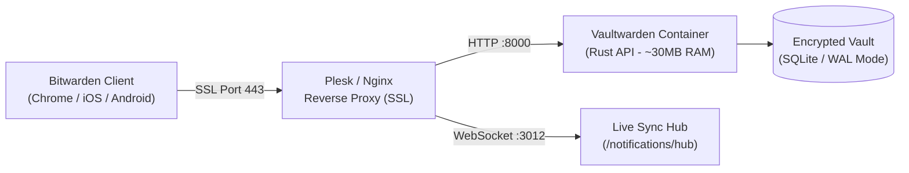

## Why Outsource Your Master Keys to Third-Party Clouds?

Password managers are no longer a convenience; they form the foundational security perimeter for modern engineering teams and digital entrepreneurs. However, recurring breaches in centralized SaaS vaults and shifting subscription paywalls make self-hosted alternatives the only rational architecture for complete operational sovereignty.

While the official Bitwarden backend is engineered on enterprise .NET and MSSQL stacks requiring 2-4 GB of RAM, **Vaultwarden**—rewritten from scratch in Rust—delivers the identical Bitwarden client API with a lightweight footprint of just **25-40 MB RAM**. Furthermore, features gated behind paid tiers in official SaaS (built-in TOTP two-factor generation, encrypted file attachments, and organization sharing) are fully enabled and unmetered in Vaultwarden.

In this technical breakdown, we walk through deploying an end-to-end Vaultwarden instance on Plesk / Ubuntu Linux via my open-source `oaVaultWardenInstaller` script.



---

## 1. Automated One-Command Installation Wizard

To ensure repeatable, production-grade deployments with zero configuration drift, I developed the open-source `oaVaultWardenInstaller` utility. It inspects Docker daemon availability, establishes isolated storage directories, and guides server administrators through a hardened configuration wizard:

```bash
# Execute the deployment wizard directly via GitHub
wget -qO- https://raw.githubusercontent.com/oaonuraksoy/oaVaultWardenInstaller/main/install.sh | bash
```

The script configures key architectural parameters:
1. **Persistent Volume:** `/opt/vaultwarden/data` isolated Docker mount for encrypted vault storage.
2. **Domain Binding:** Dedicated FQDN mapping (e.g., `vault.yourdomain.com`).
3. **Argon2id Admin Authentication:** Replaces legacy SHA256 hashes with modern Argon2id derivation to protect the `/admin` control interface.
4. **Registration Locking:** Automatically enforces `SIGNUPS_ALLOWED=false` after initial administrative provisioning to eliminate unauthorized public registrations.

---

## 2. Plesk Nginx Reverse Proxy & WebSocket Streaming

Real-time synchronization between browser extensions and mobile clients requires bidirectional WebSocket transport (`/notifications/hub`). Under Plesk or standalone Nginx, add the following directive block:

```nginx
location / {
    proxy_pass http://127.0.0.1:8000;
    proxy_set_header Host $host;
    proxy_set_header X-Real-IP $remote_addr;
    proxy_set_header X-Forwarded-For $proxy_add_x_forwarded_for;
    proxy_set_header X-Forwarded-Proto $scheme;
}

location /notifications/hub {
    proxy_pass http://127.0.0.1:3012;
    proxy_set_header Upgrade $http_upgrade;
    proxy_set_header Connection "upgrade";
}

location /notifications/hub/negotiate {
    proxy_pass http://127.0.0.1:8000;
}
```

Paired with a Let's Encrypt certificate, this configuration provides an end-to-end encrypted (E2EE) TLS tunnel.

---

## 3. Live Client Configuration & Built-In TOTP Verification

Once deployed, point your official Bitwarden desktop application or browser extension to your custom endpoint under **Settings > Self-hosted Environment** (`https://vault.yourdomain.com`).

As demonstrated live in the video:
- When storing new credentials, paste the 2FA secret seed into the built-in **Authenticator Key (TOTP)** field.
- Vaultwarden computes rolling 30-second 6-digit TOTP codes directly inside the encrypted vault item, removing reliance on external apps like Google Authenticator or Authy.
- Upon navigating to target websites, the Bitwarden extension automatically autofills username/password and pre-copies the active TOTP token to your clipboard for instantaneous zero-friction sign-in.

Inspect the complete shell installer and container parameters on GitHub to deploy your own sovereign vault within minutes.
