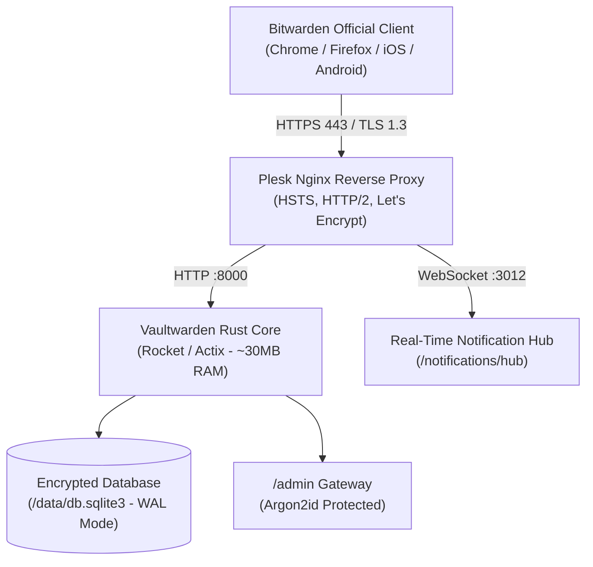

## Sovereign Credential Architecture: Why I Host Vaultwarden

Over years of architecting sovereign infrastructure, shipping digital products, and managing enterprise client keys across hundreds of servers, one realization became undeniable: **Delegating master passwords and two-factor authentication (TOTP) seed secrets to commercial third-party clouds is an unacceptable systemic vulnerability.**

We have all witnessed recurring breaches in centralized SaaS vaults like LastPass, as well as unpredictable licensing shifts where essential security features are abruptly locked behind enterprise subscription paywalls. However, attempting to self-host the official Bitwarden stack on a standard VPS presents a massive hurdle: an enterprise .NET architecture with MSSQL containers demanding **3 to 4 gigabytes of memory** just to idle.

That is where **Vaultwarden**—rewritten from the ground up in Rust—completely alters the equation. Running in my production clusters, it implements the official Bitwarden client API with 100% fidelity while consuming a minuscule **25 to 40 megabytes of RAM**. Even better: features paywalled in commercial SaaS (built-in rolling 30-second TOTP authenticators, encrypted attachments, and organization sharing) are entirely unlocked, private, and unmetered.

In this architectural guide and screencast, I walk through deploying a hardened Vaultwarden instance on Linux / Plesk using my open-source `oaVaultWardenInstaller` script.



---

## Architectural Breakdown: Official Bitwarden vs. Vaultwarden

Here is an empirical comparison drawn directly from my production benchmarks:

| Evaluation Metric | Official Bitwarden Server (Docker) | Vaultwarden (Rust Self-Hosted) |
|---|---|---|
| **Underlying Stack** | C# .NET Core + Microsoft SQL Server + Node.js | Rust (Rocket/Actix) + SQLite / PostgreSQL |
| **Memory Footprint** | ~2.5 GB – 4.0 GB RAM | **25 MB – 40 MB RAM** |
| **Container Count** | 10–12 microservice containers | **A single lightweight container** |
| **Built-In TOTP (2FA)** | Paid Premium tier ($10/yr personal, $40/user org) | **100% Free and Unlimited** |
| **Attachment Storage** | Capped at 1 GB default | **Limited only by your NVMe storage** |
| **Backup Simplicity** | Complex multi-volume database dumps | **Atomic copy of a single SQLite file** |

---

## 1. Automated Provisioning: `oaVaultWardenInstaller`

To eliminate manual Docker mapping errors, port conflicts, and security oversights, I developed the open-source `oaVaultWardenInstaller` shell script. Run it directly on your clean VPS:

```bash
# Debian 11/12 or Ubuntu 20.04+ servers
curl -fsSL https://raw.githubusercontent.com/oaonuraksoy/oaVaultWardenInstaller/main/install-vaultwarden-debian.sh -o install-vaultwarden-debian.sh \
  && chmod +x install-vaultwarden-debian.sh \
  && sudo ./install-vaultwarden-debian.sh

# AlmaLinux 8, Rocky Linux 8 or RHEL 8 servers
curl -fsSL https://raw.githubusercontent.com/oaonuraksoy/oaVaultWardenInstaller/main/install-vaultwarden-almalinux8.sh -o install-vaultwarden-almalinux8.sh \
  && chmod +x install-vaultwarden-almalinux8.sh \
  && sudo ./install-vaultwarden-almalinux8.sh
```

The script deterministically executes the following setup steps:
1. Validates the Docker daemon environment and installs official dependencies if absent.
2. Creates the isolated persistent volume `/opt/vaultwarden/data` with hardened filesystem permissions (`chmod 700`).
3. Derives a high-entropy **Argon2id** hash for administrative dashboard protection.
4. Spawns the official `vaultwarden/server:latest` container bound to local interfaces: `127.0.0.1:8000` (API) and `127.0.0.1:3012` (WebSocket hub).

```bash
# Verify container health:
docker ps --filter "name=vaultwarden"
```

---

## 2. Production Nginx Reverse Proxy & WebSocket Configuration

Never expose raw container ports directly to the internet. Under Plesk or standalone Nginx, attach a Let's Encrypt SSL certificate to your domain (`vault.yourdomain.com`) and apply the reverse proxy directives provided in my downloadable Vault asset:

```nginx
# Allow encrypted attachments up to 128MB
client_max_body_size 128M;

# 1. Main Vaultwarden API and Web Vault
location / {
    proxy_pass http://127.0.0.1:8000;
    proxy_set_header Host $host;
    proxy_set_header X-Real-IP $remote_addr;
    proxy_set_header X-Forwarded-For $proxy_add_x_forwarded_for;
    proxy_set_header X-Forwarded-Proto $scheme;
}

# 2. Real-Time Push Notification Hub (Essential for instant sync)
location /notifications/hub {
    proxy_pass http://127.0.0.1:3012;
    proxy_http_version 1.1;
    proxy_set_header Upgrade $http_upgrade;
    proxy_set_header Connection "upgrade";
    proxy_set_header Host $host;
    proxy_set_header X-Real-IP $remote_addr;
    proxy_set_header X-Forwarded-For $proxy_add_x_forwarded_for;
    proxy_set_header X-Forwarded-Proto $scheme;
    proxy_read_timeout 3600s;
    proxy_send_timeout 3600s;
}

location /notifications/hub/negotiate {
    proxy_pass http://127.0.0.1:8000;
    proxy_set_header Host $host;
    proxy_set_header X-Real-IP $remote_addr;
    proxy_set_header X-Forwarded-For $proxy_add_x_forwarded_for;
    proxy_set_header X-Forwarded-Proto $scheme;
}
```

---

## 3. Client Configuration & Live TOTP 2FA Verification

Open the official Bitwarden browser extension (Chrome, Firefox, Edge, or Brave):
1. Click the gear icon (**Settings**) at the top left of the login screen.
2. In the **Self-hosted Environment** field, input your sovereign URL: `https://vault.yourdomain.com`.
3. Create your master account and sign in.
4. When storing new service credentials, paste your two-factor seed into the **Authenticator Key (TOTP)** field.

From this point forward, logging into online platforms automatically autofills your username and password, while simultaneously copying the rolling 30-second 6-digit TOTP code to your clipboard for effortless one-click authentication.

---

## Troubleshooting Common Edge Cases

In my deployments, the top three edge cases and their direct remedies:

1. **"WebSocket connection failed" / Devices do not sync in real time:**
   - *Cause:* Missing `/notifications/hub` block in Nginx or port 3012 not bound on Docker.
   - *Fix:* Ensure `WEBSOCKET_ENABLED=true` is set in the environment and port `3012` is mapped in your container flags.
2. **Preventing unwanted public signups:**
   - *Fix:* Immediately after registering your administrative account, set `SIGNUPS_ALLOWED=false` in `/opt/vaultwarden/vaultwarden.env` and restart the container (`docker restart vaultwarden`).
3. **Admin dashboard token mismatch:**
   - *Fix:* Never store raw plaintext tokens in `ADMIN_TOKEN`. Always generate an Argon2id hash using `docker exec -it vaultwarden /vaultwarden hash` and paste the derived hash.

Download the complete configuration template from **The Vault** section above, and star the open-source installer on GitHub.
