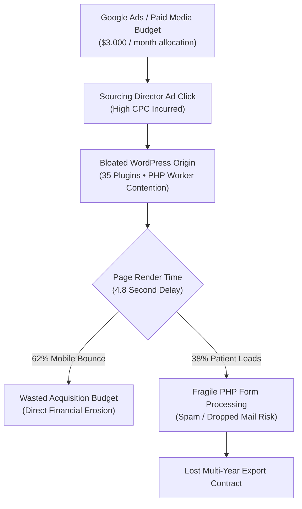

## The Illusion of "Free and Fast": A Corporate Systems Autopsy

In corporate boardroom discussions, a recurring rationalization frequently emerges: *"Why invest capital in custom software architecture when an agency can assemble a WordPress site with off-the-shelf plugins in under a week?"*

While this decision may appear financially prudent across the first quarter, as an enterprise scales its product catalog and commits serious budget to international marketing, that dynamic WordPress installation morphs into a chronic capital sinkhole. When auditing the digital balance sheets of mid-market B2B enterprises, I consistently uncover hundreds of thousands in hidden expenses quietly leaking from what was supposed to be a "low-cost" digital presence.

The issue is not WordPress as a blogging tool, but rather the fundamental mismatch of forcing a monolithic, dynamic, plugin-dependent PHP blogging framework to serve as a high-performance B2B export engine.

In this analysis, I break down the 4 hidden cost centers draining enterprise budgets and contrast them against custom systems architecture.

---

## 4 Hidden Cost Centers Draining Enterprise Margins

The hidden operational taxes of unmanaged technical debt:

### 1. Plugin Licensing and the Annual Renewal Treadmill
To adapt WordPress for enterprise-grade operations, the core CMS is insufficient. Organizations accumulate subscriptions across a sprawling plugin stack:
- **Internationalization (WPML / Polylang):** ~$99 – $199 / year
- **Custom Schema & Fields (ACF Pro):** ~$49 – $249 / year
- **Visual Layout Builders (Elementor / Divi):** ~$59 – $199 / year
- **Enterprise Form Engines (Gravity Forms / WPForms Pro):** ~$159 – $299 / year
- **Security & WAF Plugins (Wordfence / iThemes):** ~$119 – $199 / year
- **Server Caching & Optimization (WP Rocket):** ~$59 – $299 / year

These subscriptions demand **$600 to $1,500 annually** in pure software license renewals. Neglecting renewals leaves administrative dashboards broken or exposes sites to unpatched zero-day vulnerabilities.

### 2. Server Resource Inflation and Over-Provisioning
Every page request in a plugin-heavy WordPress setup forces the origin server to parse dozens of PHP files and execute upwards of 40 database queries. Concurrency of just 15 simultaneous visitors can spike server CPU utilization to 100%.

Rather than addressing architectural inefficiencies, agencies typically advise clients to upgrade server hardware: *"The site is sluggish; we need an 8-core dedicated cloud instance."* This inflates monthly hosting bills into the hundreds of dollars.

Conversely, under the static generation principles powering our [Ankara B2B web architecture](/en/ankara-b2b-web-architecture/), pages are compiled into immutable static artifacts. Serving pre-compiled HTML from global edge nodes incurs fractional compute costs while effortlessly handling immense traffic concurrency.

### 3. Google Ads Budget Waste via Degraded Quality Scores
This is the single largest financial loss overlooked by financial controllers. If an export enterprise allocates $3,000 monthly to search and LinkedIn campaigns:
- A sluggish render speed (LCP > 3.5s) triggers Google Ads to penalize the **Landing Page Experience** rating.
- With a Quality Score dropping to 4 out of 10, the enterprise must bid **40% to 80% higher CPC** just to achieve the same ad rank as an optimized competitor.
- Furthermore, more than half of mobile sourcing engineers abandon the tab if the page does not paint within 3 seconds.

Across a $36,000 annual advertising budget, this performance friction represents **thousands of dollars in completely wasted ad spend**.

### 4. Vulnerability Remediation and Emergency Response
WordPress plugins represent one of the web's most exploited attack surfaces. A single unmaintained utility plugin can expose your server to automated bots injecting malicious redirect scripts or SEO spam.

When Google flags an enterprise domain with a "This site may be hacked" security warning, urgent emergency remediation and forensic audit costs easily bill at high consultancy rates per incident.

---

## 3-Year Total Cost of Ownership (TCO) Comparison

Evaluating the financial trajectory over a 36-month horizon reveals the true unit economics:

| Expenditure Category | 3-Year Enterprise WordPress Deployment | 3-Year Custom Systems Architecture |
|---|---|---|
| **Initial Implementation** | $3,500 – $5,500 (Deceptively accessible) | $7,500 – $11,000 (Rigorous engineering) |
| **Annual Plugin Licensing (3 Yrs)** | $2,000 – $4,500 | **$0 (Zero third-party license lock-in)** |
| **Origin Hosting & Database (3 Yrs)** | $3,600 – $7,200 (Over-provisioned VPS) | **$150 – $400 (Distributed Global Edge)** |
| **Google Ads Inefficiency Waste** | $6,000 – $12,000 (Sub-par Quality Scores) | **$0 (10/10 Landing Page Performance)** |
| **Emergency Patching & Maintenance** | $2,500 – $5,000 | **$500 (Static, maintenance-free core)** |
| **3-YEAR TOTAL COST (TCO)** | **$17,600 – $34,200** | **$8,150 – $11,900** |

The economic conclusion is indisputable: The "inexpensive" CMS solution ultimately costs the enterprise **two to three times more capital** over three years than a custom-engineered architecture.

---

## Architectural Strategic Path for Decision Makers

To break free from recurring plugin debt and turn your digital presence into a capital-efficient revenue driver, consider the engineering approaches outlined in [Ankara B2B web architecture](/en/ankara-b2b-web-architecture/) and [Ankara custom software architecture](/en/ankara-custom-software-architecture/). Explore [enterprise AI automation](/en/ankara-enterprise-ai-automation/) to streamline operational queues, or schedule an architectural consultation with [Onur Aksoy (Hackonomist)](/en/about/):

1. **Perform a Dependency Audit:** Catalogue all active plugins to isolate those providing trivial functionality that can be replaced with native CSS or static configuration.
2. **Transition to Static Site Generation:** Ingest existing content via the CMS API into an Astro SSG pipeline, eliminating live PHP and database dependencies.
3. **Isolate Paid Traffic Landing Pages:** Build campaign-specific landing pages with a strict Zero-JS baseline to maximize Google Ads Quality Scores and conversion rates.
4. **Harden Commercial Pipelines:** In line with our [oaTeklif](/en/broadcasts/oateklif-ucretsiz-teklif-olusturucu/) and [oaPOS](/en/projects/oapos/) systems, route customer RFQs through type-safe API webhooks rather than fragile email plugins.

Evaluate architectural investments not by day-one purchase price, but by their multi-year unit economics and structural resilience.
