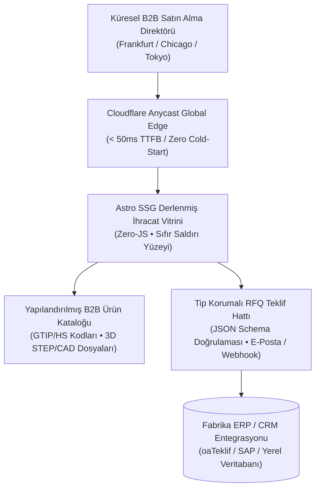

## Ankara'nın Üretim Gücü ile Dijital Vitrini Arasındaki Uçurum

OSTİM, İvedik Organize Sanayi Bölgesi, Sincan ASO 1. OSB ve Başkent OSB başta olmak üzere Ankara sanayisi; savunma sanayiinden medikal cihazlara, hassas talaşlı imalattan ağır iş makinelerine kadar dünya standartlarında üretim yapıyor. Fabrikalarımızın üretim hatları 5 eksenli CNC tezgâhlarıyla, temiz odalarla ve AS9100 gibi en katı havacılık kalite sertifikalarıyla donatılmış durumda.

Fakat bu yüksek mühendislik gücünün yurt dışındaki potansiyel alıcılara yansıyan yüzüne baktığımızda acı bir tabloyla karşılaşıyoruz: **Milyonlarca dolarlık üretim kabiliyetine sahip sanayi devlerimiz, internette 8-10 saniyede açılan, kırık WordPress şablonlarına hapsolmuş, teknik şartnamesi bulunmayan ve kurumsal e-posta itibarı sıfırlanmış web siteleriyle temsil ediliyor.**

Kendi geliştirdiğim sistemlerde ve kurumsal danışmanlık süreçlerimde incelediğim yüzlerce ihracatçı firma verisi bana tek bir gerçeği gösterdi: **Küresel bir satın alma yöneticisi (Procurement Manager), fabrikanızın kapısından içeri girmeden önce web sitenizin teknik altyapısını inceler.** Ağır, hantal ve amatör bir web sitesi; alıcıda doğrudan "Bu şirket üretim süreçlerinde de özensizdir" algısı yaratır.

Bu yayında; Ankara sanayi ve OSB firmalarının ihracat vitrinlerini küresel güven standardına ulaştıran 5 kritik teknik mimari kriteri inceliyoruz.



---

## B2B İhracatta Teknik Güven İnşa Eden 5 Mimari Kriter

Fabrikanızın dijital vitrinini yurt dışı satın almacıların gözünde vazgeçilmez kılacak 5 mühendislik standardı:

### 1. 50ms Altı Küresel Edge Yanıt Süresi (Global Latency)
Ankara'daki bir sunucu merkezine (veri merkezine) yerleştirilmiş klasik dinamik siteler, Almanya'dan bağlanan bir alıcıya 400-800 milisaniye, ABD veya Japonya'dan bağlanan bir alıcıya ise 1.5 - 2 saniye sunucu yanıt süresi (TTFB) üretir. Üzerine ağır eklentiler ve kütüphaneler eklendiğinde ilk görselin belirmesi (LCP) 6-8 saniyeyi bulur.

Modern ihracat mimarisinde web sitesi tek bir sunucuda barındırılmaz. [Ankara kurumsal web tasarım](/ankara-kurumsal-web-tasarim/) yaklaşımımızda olduğu gibi; tüm sayfalar önceden statik HTML/WebP olarak derlenir ve dünya genelinde 330'dan fazla noktada çalışan Cloudflare Edge ağına dağıtılır. Satın almacı siteye bağlandığında istek Ankara'ya gelmez; alıcının bulunduğu şehirdeki en yakın edge düğümünden **50 milisaniyenin altında** teslim edilir.

### 2. Kusursuz Çoklu Dil Hreflang ve Semantik İzolasyon
Çoğu sanayi sitesinde sağ üst köşeye konulan Google Çeviri butonu, uluslararası ticarette profesyonellik intiharıdır. "Tornalama" terimini yanlış bağlamda çeviren veya teknik tolerans tablolarını bozan otomatik araçlar alıcıyı anında kaçırır.

Doğru mimaride İngilizce, Almanca veya Fransızca sürümler bağımsız sayfalar olarak mimarileştirilir. Her sayfanın `<head>` bloğunda iki yönlü `hreflang` etiketleri yer alır:

```html
<link rel="alternate" hreflang="tr" href="https://onuraksoy.com.tr/broadcasts/ankara-osb-sanayi-b2b-ihracat-web-mimarisi/" />
<link rel="alternate" hreflang="en" href="https://onuraksoy.com.tr/en/broadcasts/ankara-osb-sanayi-b2b-ihracat-web-mimarisi/" />
<link rel="alternate" hreflang="x-default" href="https://onuraksoy.com.tr/en/broadcasts/ankara-osb-sanayi-b2b-ihracat-web-mimarisi/" />
```

Bu yapı, Google ve Bing'e hangi dilin hangi coğrafyada servis edileceğini bildirir ve uluslararası teknik aramalarda fabrikanızı ilk sayfaya taşır.

### 3. GTIP / HS Kodlu Ürün Katalogları ve 3D CAD İndirme Altyapısı
Bir savunma sanayii tedarikçisi veya hidrolik silindir üreticisi için web sitesi bir reklam broşürü değil, teknik bir veri bankasıdır. Yurt dışı satın almacı web sitesinde şu 3 unsuru görmediği anda sekmeyi kapatır:
- **Uluslararası GTIP (HS Code):** Gümrük tarife istatistik pozisyonu (örneğin `8412.21.80` hidrolik silindirler). Alıcı ülkesindeki ithalat vergisini anında hesaplayabilmelidir.
- **3D CAD Modelleri:** Tasarım mühendislerinin projelerine ekleyebileceği STEP, IGES ve 2D PDF teknik çizim dosyaları.
- **Alaşım ve Standart Uyumluluğu:** DIN, ASTM, EN ve ISO kalite sertifikalarının doğrudan ürün sayfasına bağlanması.

The Vault üzerinde paylaştığım [B2B Uluslararası İhracat RFQ Veri Sözleşmesi Şeması](/vault/b2b/b2b-export-rfq-schema.json), bu alanların kurumsal API seviyesinde nasıl tip korumalı olarak tutulduğunu belgeler.

### 4. Kurumsal RFQ (Teklif Talebi) Veri Sözleşmeleri ve Sıfır Eklenti Güvenliği
B2B ihracatta teklif alma süreci standart bir iletişim formuyla yürütülemez. "Mesajınız alındı" diyen ve veriyi e-posta kutusuna düz metin olarak fırlatan güvensiz PHP formları yerine; istenen adet, Incoterm teslim şekli (FOB, CIF, DAP), hedef teslim tarihi ve teknik şartname yükleme alanı içeren tip korumalı bir form hattı kurulmalıdır.

Kendi geliştirdiğim sistemlerde [oaTeklif](/broadcasts/oateklif-ucretsiz-teklif-olusturucu/) ve [oaPOS](/projects/oapos/) mimarilerinde uyguladığım katı tip doğrulaması prensibini web formlarına da taşırım. Form istemci tarafında Zero-JS mimarisiyle çalışır; tarayıcıda şişkin script çalıştırmadan güvenli uç noktaya JSON veri sözleşmesiyle bağlanır.

### 5. Kurumsal E-Posta İtibarı ve DNS Siber Savunması
Fabrikanızın web sitesi ne kadar iyi olursa olsun; satış temsilcinizin gönderdiği kurumsal teklif e-postası Alman müşterinin "Spam / Önemsiz" klasörüne düşüyorsa ihracat operasyonunuz çökmüş demektir. Çoğu Ankara sanayi firması standart paylaşımlı hosting sunucuları üzerinden e-posta gönderdiği için IP adresleri kara listelere girer.

Kurumsal web mimarisinde DNS seviyesinde şu 4 protokol zorunlu olarak yapılandırılır:
- **SPF (Sender Policy Framework):** Yalnızca yetkilendirilmiş sunucuların fabrikanız adına posta atabilmesi.
- **DKIM (DomainKeys Identified Mail):** Giden e-postaların kriptografik olarak imzalanması.
- **DMARC (Domain-based Message Authentication):** `p=reject` politikasıyla yetkisiz taklit maillerin tamamen engellenmesi.
- **BIMI (Brand Indicators for Message Identification):** Kurumsal logonuzun Gmail ve Outlook gelen kutularında doğrulanmış mavi tik ile görünmesi.

---

## Mimari Kıyaslama: Standart Ajans Çözümü vs. İhracat Odaklı Özel Sistem Mimarisi

| Değerlendirme Boyutu | Tipik Ajans Çözümü (WordPress / Tema) | Özel Mühendislik Mimarisi (Astro SSG + Edge) |
|---|---|---|
| **Küresel TTFB (Yanıt Süresi)** | 600ms – 1.800ms (Hantal sunucu) | **< 40ms (Anycast 330+ Edge Düğümü)** |
| **İstemci Taraflı JS Boyutu** | 1.8 MB – 4.5 MB (Şişkin eklentiler) | **0 KB (Zero-JS Ön Yüz Disiplini)** |
| **Siber Güvenlik Açığı** | SQL Enjeksiyonu, WP Eklenti Zafiyetleri | **Sıfır Saldırı Yüzeyi (Veritabanı yok)** |
| **CAD & GTIP Entegrasyonu** | Manuel PDF linkleri, dağınık yapı | **Yapılandırılmış JSON-LD + Şema Modeli** |
| **Çoklu Dil Mimarisi** | Dinamik Google Translate eklentisi | **Tam Bağımsız Statik Hreflang Sayfaları** |
| **Teklif Kaybı Riski** | PHP mail() çökmesi / Spam klasörü | **Webhook + Yedekli Edge API Hattı** |

---

## Ankara Sanayisi İçin Uygulama Yol Haritası

Ankara merkezli sanayi firmanızın dijital altyapısını modernize etmek ve küresel ihracat pazarında sarsılmaz bir güven inşa etmek istiyorsanız, [ankara kurumsal web tasarım](/ankara-kurumsal-web-tasarim/) ve [ankara web yazılım](/ankara-web-yazilim/) odaklı mühendislik yaklaşımlarımızla ilerleyebilirsiniz. ERP ve teklif süreçlerini otonomlaştırmak için [kurumsal yapay zeka otomasyonu](/ankara-yapay-zeka-otomasyonu/) hatlarını devreye alabilir; mimari denetim ve danışmanlık için doğrudan [Onur Aksoy (Hackonomist)](/about/) ile temasa geçebilirsiniz:

1. **Altyapı Denetimi:** Mevcut web sitenizin TTFB, Core Web Vitals ve güvenlik açıklarını analiz edin.
2. **Teknik Veri Sözleşmesi:** Ürünlerinizin GTIP kodlarını, teknik toleranslarını ve 3D modellerini kurumsal bir şemada toplayın.
3. **Statik Derleme & Edge Dağıtımı:** PHP ve veritabanı bağımlılıklarını kaldırarak sitenizi Astro ve Cloudflare Edge üzerine taşıyın.
4. **Kurumsal RFQ Hattı:** Teklif taleplerini doğrudan şirket içi iş akışlarınıza bağlayan tip güvenli formlar entegre edin.

Fabrikanızın üretim kalitesini dijital dünyada hak ettiği ciddiyetle temsil etmek bir lüks değil, küresel ihracat rekabetinde doğrudan ciro üreten bir zorunluluktur.
