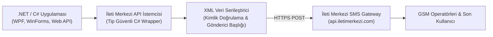

## Kurumsal Uygulamalarda Güvenilir SMS & OTP Entegrasyonu

Masaüstü uygulamalarından e-ticaret altyapılarına kadar modern kurumsal yazılımlarda kullanıcı doğrulaması (2FA/OTP), sipariş bildirimleri ve randevu hatırlatmaları için SMS ağ geçitleri kritik bir bileşendir. Ancak telekom sağlayıcılarının ham API dokümantasyonları genellikle karmaşık XML yapıları ve tutarsız hata kodlarıyla doludur.

Bu entegrasyonu standartlaştırmak amacıyla geliştirdiğim açık kaynaklı **İleti Merkezi C# XML API Kütüphanesi**, .NET projelerinize tek bir sınıf dosyasıyla eklenebilen, tip güvenli ve hata toleranslı bir wrapper sunar.



---

## 1. Kütüphanenin Mimari Özellikleri

- **Hafif ve Sıfır Bağımlılık:** Harici ağır NuGet paketleri gerektirmez; yerleşik .NET `System.Net` ve `System.Xml` sınıfları üzerinde çalışır.
- **Tekil ve Toplu SMS Desteği:** Tek bir telefon numarasına anlık işlem bildirimi gönderebileceğiniz gibi, binlerce numaraya tek bir HTTP isteğiyle farklı veya ortak mesaj içeriklerini toplu olarak iletebilirsiniz.
- **Kritik 2FA OTP Hızı:** Tek kullanımlık doğrulama şifreleri (OTP) için optimize edilmiş hafif istek gövdesiyle milisaniyeler içinde ağ geçidine ulaşır.
- **Hesap Bakiye ve Başlık (Originator) Kontrolü:** Gönderim öncesinde kalan SMS kredinizi ve operatör tarafından onaylanmış yasal başlıklarınızı dinamik olarak sorgulama imkanı sunar.

---

## 2. Örnek Kod Kullanımı

Kütüphaneyi projenize dahil ettikten sonra tek satırla SMS gönderebilirsiniz:

```csharp
using IletiMerkeziApi;

// API kimlik bilgilerinizi tanımlayın
var smsClient = new SmsSender("API_KEY", "API_HASH", "BASLIK");

// Tekli SMS Gönderimi
string sonuc = smsClient.TekliSmsGonder("5511817053", "Siparişiniz başarıyla onaylandı. Kod: 849201");

// Bakiye Sorgulama
string bakiye = smsClient.BakiyeSorgula();
Console.WriteLine($"Kalan SMS Bakiyesi: {bakiye}");
```

Videolu anlatımda adım adım canlı olarak test ettiğimiz sınıf kütüphanesini GitHub deposundan indirip doğrudan kendi projelerinize entegre edebilirsiniz.
