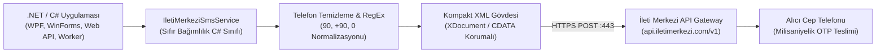

## Kurumsal .NET Projelerinde Güvenilir SMS Mimarisi

Masaüstü otomasyon yazılımlarından e-ticaret arka yüzlerine ve iki adımlı doğrulama (2FA) kapılarına kadar kurumsal uygulamalarda SMS ağ geçitleri vazgeçilmez bir altyapı bileşenidir. Ancak telekom ve toplu SMS sağlayıcılarının resmi belgelerini incelediğinizde genellikle karşınıza güncelliğini yitirmiş örnek kodlar, karmaşık XML paketleri ve tip güvenliğinden yoksun yapılar çıkar.

Masaüstü POS yazılımım oaPOS ve çeşitli kurumsal müşteri projelerimde İleti Merkezi SMS ağ geçidini entegre ederken yaşadığım zaman kaybını başkaları yaşamasın diye bu açık kaynaklı **C# XML API Kütüphanesini** geliştirdim. Tek bir `.cs` dosyasıyla projenize ekleyebileceğiniz, sıfır dış bağımlılıklı ve tip güvenli bir servis katmanı sunar.

Bu yayında; C# .NET üzerinde tekli bildirim, yüksek hızlı OTP doğrulama, toplu mesaj gönderimi ve hesap bakiye sorgulama adımlarını canlı olarak inceliyoruz.



---

## Mimari Kıyaslama: Ağır SDK'lar vs. Ham HTTP vs. Bizim Servis

Kendi mimari deneyimimden çıkardığım kıyaslama tablosu:

| Kriter | Ağır Harici SDK'lar | Ham WebClient / HttpClient | Bizim IletiMerkeziSmsService |
|---|---|---|---|
| **Dış Bağımlılık (NuGet)** | Newtonsoft, RestSharp vb. gerektirir | Bağımlılık yok | **Sıfır Bağımlılık (Pure .NET Core)** |
| **Telefon Numarası Temizleme** | Manuel kodlama gerekir | Manuel | **Dahili Otomatik Normalizasyon** |
| **Toplu Gönderim Desteği** | Genellikle eksik | Manuel döngü kurulur | **Tek İstekte Binlerce Alıcı (<receipents>)** |
| **Hata Yönetimi ve Tip Güvenliği** | Ham string | Ham metin çıktısı | **Yapılandırılmış SmsResponse Nesnesi** |
| **Entegrasyon Süresi** | Paket çakışmalarıyla 1–2 saat | 30–45 dakika | **Tek Dosya ile 2 Dakika** |

---

## 1. Sıfır Bağımlılıkla Kütüphaneyi Projenize Dahil Etme

Kütüphaneyi kullanmak için karmaşık paket yöneticileriyle uğraşmanıza gerek yoktur. **The Vault** bölümünde paylaştığım `IletiMerkeziSmsService.cs` dosyasını doğrudan projenizin `Services/` veya `Helpers/` klasörüne ekleyin.

Sınıfı başlatırken ağ geçidinden aldığınız 3 temel bilgiyi geçmeniz yeterlidir:
- `apiKey`: İleti Merkezi kullanıcı panelinizden aldığınız API anahtarı.
- `apiHash`: Güvenlik parolası karması.
- `originator`: Operatör tarafından onaylanmış yasal SMS başlığınız (örn. `ONURAKSOY`).

```csharp
using IletiMerkeziApi;

var smsService = new IletiMerkeziSmsService(
    apiKey: "YOUR_API_KEY",
    apiHash: "YOUR_API_HASH",
    originator: "BASLIK"
);
```

---

## 2. Tekli SMS ve İki Adımlı Doğrulama (OTP) Gönderimi

Kullanıcı kayıtlarında veya şifre sıfırlamalarda kritik olan şey gecikmesiz teslimattır. `SendSingle` metodu telefon numarasındaki tüm boşluk, parantez ve ülke kodlarını otomatik temizler:

```csharp
// Kullanıcı numarası nasıl girerse girsin otomatik normalize edilir
string telefon = "+90 (551) 181 70 53";
string mesaj = "Sayın Onur Aksoy, tek kullanımlık giriş kodunuz: 849201";

SmsResponse sonuc = smsService.SendSingle(telefon, mesaj);

if (sonuc.IsSuccess)
{
    Console.WriteLine($"SMS Başarıyla İletildi! Durum Kodu: {sonuc.StatusCode}");
}
else
{
    Console.WriteLine($"Hata Oluştu: {sonuc.Message}");
}
```

---

## 3. Toplu SMS ve Anlık Bakiye Sorgulama

Yüzlerce veya binlerce müşteriye aynı anda kampanya veya duyuru çıkarken her numara için ayrı bir HTTP isteği atmak sunucuyu kilitler. `SendBulk` metodu tüm numaraları tek bir XML gövdesinde toplayarak tek bir HTTPS oturumu üzerinden gönderir:

```csharp
var aliciListesi = new List<string> { "05511817053", "0532XXXXXXX", "0542XXXXXXX" };
string duyuru = "Sistem bakımı bu gece 02:00'de tamamlanacaktır.";

SmsResponse topluSonuc = smsService.SendBulk(aliciListesi, duyuru);

// Kalan kredi bakiyesini anlık kontrol etme:
int bakiye = smsService.QueryBalance();
Console.WriteLine($"Kalan SMS Krediniz: {bakiye}");
```

---

## Sık Karşılaşılan Sorunlar ve Çözümleri

1. **"Status Code: 401 / Authentication Failed":**
   - *Sebep:* API Key veya API Hash değerlerinin hatalı girilmesi ya da panelde IP kısıtlamasının açık olması.
   - *Çözüm:* İleti Merkezi panelinde API ayarlarınızdan sunucu dış IP adresinizin beyaz listede (whitelist) olduğunu teyit edin.
2. **"Status Code: 400 / Sender Not Found":**
   - *Sebep:* `originator` parametresinde belirttiğiniz başlığın operatör tarafından henüz onaylanmamış olması.
   - *Çözüm:* Panelinizde **Onaylı Başlıklar** bölümünden başlığınızın aktif olduğunu doğrulayın ve harfiyen aynı büyük/küçük harf düzeniyle girin.
3. **Özel karakterlerin (Türkçe karakter) bozuk görünmesi:**
   - *Çözüm:* Servis XML gövdesini `Encoding.UTF8` ile oluşturur ve mesaj içeriğini `<![CDATA[ ... ]]>` içine alır. Mesaj metninizin UTF-8 dizesi olduğundan emin olun.

Kütüphanenin kaynak kodlarını ve GitHub reposunu yukarıdaki **The Vault** indirme alanından hemen edinebilirsiniz.
