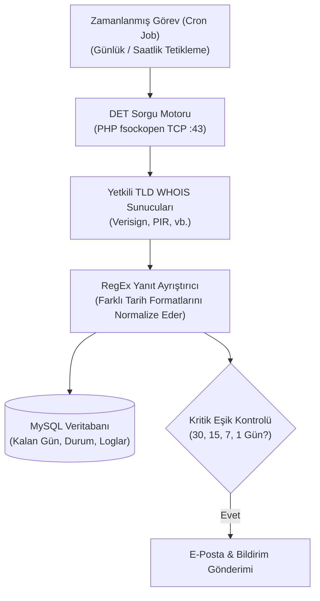

## Alan Adı Sürelerini Manuel Kontrol Etme Çilesine Son

Web geliştiricileri, ajanslar ve alan adı yatırımcıları (domainer) için müşterilere ait onlarca veya yüzlerce domainin yenileme tarihlerini takip etmek büyük bir operasyonel risktir. Süresi unutulan tek bir alan adı dahi firmanın tüm web ve e-posta altyapısının çökmesine ya da değerli bir varlığın açık artırmada başkalarına kaptırılmasına yol açabilir.

Üçüncü parti alan adı takip servisleri ise genellikle aylık abonelik satmakta ve takip edilebilecek domain sayısına katı kotalar koymaktadır. Bu ihtiyacı karşılamak için geliştirdiğim açık kaynaklı **Domain Expiry Tracker (DET)**; kendi web sunucunuzda çalışan, doğrudan ham TCP/IP soketleri üzerinden yetkili WHOIS sunucularına bağlanan ve yenileme tarihlerini otomatik arşivleyen bağımsız bir betiktir.



---

## 1. Mimari Yapı ve Soket Bazlı WHOIS Mekanizması

DET, harici ücretli API'lara veya üçüncü parti proxy servislerine bağımlı değildir. Her üst seviye alan adı (TLD) için tanımlı resmi WHOIS sunucusuna TCP 43 numaralı port üzerinden doğrudan ham soket açar:

- `.com` ve `.net` sorguları doğrudan `whois.verisign-grs.com` üzerinden çekilir.
- `.org` sorguları `whois.pir.org` üzerinden işlenir.
- Gelen ham metin çıktısı, yüzlerce farklı kayıt kuruluşunun (registrar) tarih formatlarını (`YYYY-MM-DD`, `DD/MM/YYYY`, `ISO-8601`) tanıyan akıllı bir düzenli ifade (RegEx) motorundan geçirilir.
- Elde edilen bitiş tarihi evrensel Unix zaman damgasına (timestamp) dönüştürülerek MySQL veritabanına kaydedilir.

---

## 2. Sunucu Kurulumu ve Veritabanı Yapılandırması

Kurulum adımları son derece basittir:
1. GitHub üzerinden projeyi indirin ve sunucunuzun `public_html` altındaki bir dizine çıkartın.
2. `config.php` dosyasını açarak MySQL veritabanı bağlantı bilgilerinizi girin.
3. SQL döküm dosyasını (`schema.sql`) phpMyAdmin veya terminal üzerinden veritabanınıza aktarın.
4. Yönetim arayüzüne giriş yaparak takip etmek istediğiniz alan adlarını tek tek veya toplu olarak sisteme ekleyin.

---

## 3. Otomatik Cron Job ve Hız Sınırlaması (Rate-Limiting)

Sorguların belirli aralıklarla otomatik çalışabilmesi için Linux sunucunuzda aşağıdaki Cron komutunu tanımlamanız yeterlidir:

```bash
# Her gece saat 03:00'te tüm alan adlarını kontrol et
0 3 * * * php /var/www/vhosts/siteniz.com/httpdocs/det/cron.php >/dev/null 2>&1
```

> **Önemli Mimari Not:** WHOIS sunucuları kısa sürede yapılan çoklu sorgularda IP adresinizi geçici olarak engelleyebilir (rate-limiting). DET, sorgular arasına rastgele milisaniyelik gecikmeler (jitter) ekleyerek sunucunuzun engellenmesini engeller ve kararlı bir takip sağlar.

Açık kaynak kodları ve kurulum dosyalarını GitHub reposundan hemen inceleyebilirsiniz.
