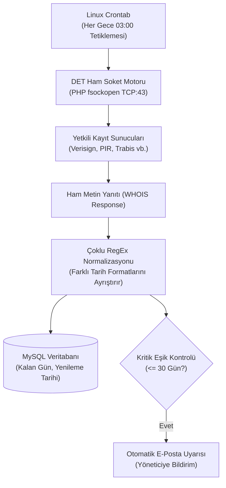

## Süresi Unutulan Alan Adı Kabusuna Nasıl Çözüm Ürettim?

Dijital ajans işletirken ve onlarca kurumsal müşterinin web varlıklarını yönetirken en büyük operasyonel korkularımdan biri, **müşterinin veya kendi projelerimin alan adı yenileme tarihinin gözden kaçmasıydı.** Tek bir alan adının süresinin unutulması; firmanın tüm e-posta trafiğinin kesilmesine, web sitesinin kapanmasına ve en kötüsü de değerli bir alan adının açık artırma botları (drop catchers) tarafından saniyeler içinde kapılmasına yol açabilir.

Piyasadaki alan adı takip araçları ise genellikle aylık abonelikler talep ediyor ve 10-20 domain sonrasında absürt fiyat tarifeleri uyguluyordu. Üstelik çoğunun sorgu motoru harici kotalara bağlıydı.

Bu operasyonel riski kalıcı olarak çözmek için açık kaynaklı **Domain Expiry Tracker (DET)** projesini yazdım. Kendi PHP/MySQL sunucunuzda çalışan bu betik; harici hiçbir ücretli API'a ihtiyaç duymadan, doğrudan resmi TLD kayıt operatörlerinin WHOIS sunucularına **TCP 43 numaralı port üzerinden ham soket** açarak yenileme tarihlerini arşivler ve kritik günlerde e-posta uyarısı fırlatır.

Bu yayında; 15 dakikalık derinlemesine teknik incelemeyle DET'in mimarisini, soket seviyesinde WHOIS sorgulamayı ve Cron Job entegrasyonunu adım adım inceliyoruz.



---

## Mimari Kıyaslama: Üçüncü Parti Takip Servisleri vs. DET

Kendi üretim ihtiyaçlarım doğrultusunda hazırladığım mimari karşılaştırma tablosu:

| Karşılaştırma Kriteri | Üçüncü Parti SaaS Takip Servisleri | Ücretsiz Webhook Araçları | Domain Expiry Tracker (DET) |
|---|---|---|---|
| **Aylık Takip Ücreti** | $10 – $50 / ay | Ücretsiz ancak kısıtlı kota | **%100 Ücretsiz ve Sınırsız** |
| **Domain Takip Sınırı** | 10 – 50 domain kotası | 5 domain kotası | **Sınırsız (Veritabanınız kadar)** |
| **Sorgu Yöntemi** | Üçüncü parti API scraping | Basit DNS A kaydı kontrolü | **Doğrudan Ham TCP:43 WHOIS Soketi** |
| **Veri Güvenliği** | Portföyünüz başkasının elinde | Dış sunucularda saklanır | **Kendi MySQL Veritabanınızda İzole** |
| **Bildirim Esnekliği** | Sabit şablonlar | Webhook | **Özelleştirilebilir E-Posta / Webhook** |

---

## 1. Ham Soket Seviyesinde WHOIS Mekanizması

Çoğu geliştirici WHOIS sorgularını web sitelerinden HTML çekerek (cURL scraping) yapmaya çalışır; ancak bu yöntem kayıt kuruluşlarının bot korumalarına takılır.

DET'te uyguladığım mimari doğrudan IANA ve TLD standartlarına uygun **RFC 3912 TCP soket iletişimidir**:
- Alan adı uzantısına göre resmi WHOIS sunucusu seçilir (`.com` için `whois.verisign-grs.com`, `.tr` için Trabis vb.).
- `fsockopen` ile 43 numaralı porta bağlanılır ve alan adı CRLF (`\r\n`) ile iletilir.
- Gelen ham metin, farklı tescil firmalarının döndürdüğü tarih varyasyonlarını yakalayan **RegEx Normalizasyon Motoru** tarafından işlenir.

```php
// DET çekirdeğindeki ham soket sorgu mantığından kesit:
$socket = @fsockopen($whoisServer, 43, $errno, $errstr, 10);
if ($socket) {
    fwrite($socket, $domain . "\r\n");
    $rawResponse = '';
    while (!feof($socket)) {
        $rawResponse .= fgets($socket, 4096);
    }
    fclose($socket);
}
```

---

## 2. Sunucu Kurulumu ve MySQL Veritabanı Yapılandırması

Kurulum süreci standart bir PHP/MySQL barındırma ortamında 3 dakikada tamamlanır:
1. GitHub deposundaki dosyaları sunucunuzun `httpdocs/det` dizinine çıkartın.
2. `config.php` dosyasını açıp MySQL veritabanı kullanıcı adı ve şifrenizi tanımlayın.
3. Proje içindeki `schema.sql` dosyasını phpMyAdmin veya terminal üzerinden içe aktarın.
4. Tarayıcınızdan yönetim paneline erişerek takip etmek istediğiniz alan adlarını tek tek veya toplu liste halinde girin.

---

## 3. Otomatik Cron Job ve Rate-Limiting Koruması

Alan adlarının her gün insan müdahalesi olmadan kontrol edilmesi için Linux sunucunuzda aşağıdaki Cron görevini zamanlamanız yeterlidir:

```bash
# Her gece saat 03:00'te tüm alan adlarını kontrol et ve gerekirse uyar
0 3 * * * php /var/www/vhosts/alanadiniz.com/httpdocs/det/cron.php >/dev/null 2>&1
```

> **Hız Sınırlaması (Jitter) Notu:** Kayıt kuruluşları aynı IP adresinden peş peşe gelen onlarca sorguyu engelleyebilir. DET, sorgular arasına rastgele `usleep(rand(500000, 1500000))` (0.5 – 1.5 saniye) bekleme süresi koyarak sunucu IP'nizin temiz kalmasını sağlar.

---

## Sık Karşılaşılan Sorunlar ve Çözümleri

1. **"fsockopen(): unable to connect to whois server (Connection timed out)":**
   - *Sebep:* Hosting firmanız veya sunucu güvenlik duvarınız (UFW/Firewall) dışarıya doğru TCP 43 portunu engelliyor olabilir.
   - *Çözüm:* Sunucu konsolunda `sudo ufw allow out 43/tcp` çalıştırarak veya barındırma sağlayıcınızdan port 43 çıkış izni talep ederek sorunu çözebilirsiniz.
2. **"Tarih ayrıştırılamadı / Bitiş tarihi boş dönüyor":**
   - *Sebep:* Bazı nadir TLD uzantıları (özellikle yeni gTLD'ler) standart dışı etiketler kullanır.
   - *Çözüm:* İndirme kasasında paylaştığım `det-whois-socket-engine.php` dosyasındaki `$EXPIRY_PATTERNS` dizisine ilgili kayıt kuruluşunun özel regex desenini ekleyin.
3. **E-postalar spam klasörüne düşüyor:**
   - *Çözüm:* `config.php` içinde PHP yerel `mail()` fonksiyonu yerine sunucunuzun kimlik doğrulamalı yerel SMTP (ör. `localhost:25` veya `localhost:587`) ayarlarını aktif hale getirin.

DET'in ham soket PHP çekirdeğini ve GitHub deposunu yukarıdaki **The Vault** alanından hemen edinebilirsiniz.
