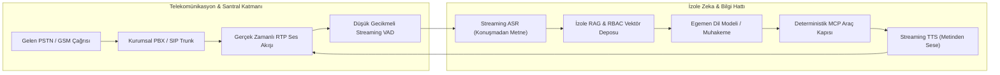

## Giriş: Tuşlamalı Menülerin Sonu ve Kurumsal Çağrı İflası

Son yirmi yıl boyunca kurumsal müşteri hizmetlerinin ve çağrı merkezlerinin değişmeyen giriş kapısı, DTMF (Dual-Tone Multi-Frequency) tabanlı klasik tuşlamalı IVR (Interactive Voice Response) sistemleri oldu. "Satış için 1'e, teknik destek için 2'ye basınız" anonslarıyla başlayan bu mekanik ağaç yapısı; şirketler için maliyet düşürme aracı olarak pazarlandı, ancak müşteriler için derin bir sürtünme, zaman kaybı ve memnuniyetsizlik kaynağına dönüştü.

Günümüzde ise şirketler başka bir uçurumun kenarına sürüklenmektedir. Birçok organizasyon, popüler büyük dil modellerinin API uç noktalarını ince bir WebRTC sarmalayıcısıyla santrallerine bağlayarak "yapay zeka çağrı merkezi" kurduğunu varsaymaktadır. Oysa kontrolsüz bulut sohbet botlarını telefon hatlarına bağlamak, kurumsal bilgi güvenliği ve marka itibarı açısından telafisi imkansız riskler doğurmaktadır.

Bu risklerin başında; kurum içi fiyatlandırma stratejilerinin, hasta veya müşteri gizliliğinin üçüncü parti sağlayıcıların eğitim havuzlarına sızması, 2-3 saniyeyi bulan gecikmeler yüzünden konuşmaların birbirine girmesi ve modelin telefondaki müşteriye yetkisiz taahhütlerde bulunması (halüsinasyon riski) gelmektedir.

Gerçek bir kurumsal sesli yapay zeka dönüşümü; genel amaçlı bir chatbot arayüzü kiralamakla değil, telekomünikasyon düzeyinde SIP/RTP hatlarını izole kurumsal bilgi depolarıyla (Private RAG) ve deterministik araç yürütme protokolleriyle (Model Context Protocol - MCP) birleştiren egemen bir sistem mimarisi inşa etmekle mümkündür. Kurumsal altyapılarda [Onur Aksoy (Hackonomist)](/about/) vizyonuyla savunduğumuz egemen mühendislik disiplini, bu iki dünyayı sıfır veri sızıntısıyla birleştirmeyi hedefler.

---

## 1. Akustik Gecikme Bütçesi: Sub-450ms Dönüş ve Dinamik Barge-In

İnsanlar arası doğal bir telefon görüşmesinde iki taraf arasındaki ortalama tepki gecikmesi 200 ila 400 milisaniye arasındadır. Bir sesli asistanın yanıt süresi 600 milisaniyenin üzerine çıktığında, arayan kişi karşı tarafın kendisini duymadığını veya hattın düştüğünü varsayarak tekrar konuşmaya başlar. Yanıt süresi 1.5 saniyeyi aştığında ise iki taraf sürekli birbirinin sözünü keser ve iletişim felç olur.

Bu nedenle kurumsal bir sesli santral asistanında en kritik mühendislik metriği **Uçtan Uca Akustik Gecikme Bütçesidir (End-to-End Latency Budget)**. Bu bütçe şu adımlardan oluşur ve toplamda 450 milisaniyenin altında kalmalıdır:

1. **Ses Aktivite Tespiti (VAD) ve Konuşma Sonu Eşiği (< 120ms):** Kullanıcının cümlenin ortasında nefes almak için duraklaması ile konuşmayı tamamen bitirmesi arasındaki farkı milisaniyeler içinde sezen hafif yerel sinir ağı modelleri (Silero VAD türevleri) çalıştırılır.
2. **Akışkan Konuşmayı Metne Dönüştürme (Streaming ASR < 100ms):** Ses paketleri 20 milisaniyelik pencerelerle işlenir ve ilk anlamlı sözcük parçaları kullanıcı konuşurken eşzamanlı olarak metne dökülür.
3. **Akışkan Muhakeme ve İlk Token Yanıtı (TTFT < 120ms):** Model tüm yanıtın bitmesini beklemez; ilk cümle veya onay ifadesi üretildiği anda ses sentezine beslenir.
4. **Akışkan Metinden Sese Dönüştürme (Streaming TTS < 100ms):** Üretilen metin tokenları tamponlanmadan ses dalgalarına çevrilir ve RTP paketleri halinde müşterinin ahizesine aktarılır.

Bu boru hattının ayrılmaz bir parçası **Dinamik Barge-In (Söz Kesme)** mekanizmasıdır. Klasik IVR sistemlerinde robot konuşurken konuşsanız da robot durmaz. Düşük gecikmeli SIP mimarisinde ise müşteri tek bir kelime söylediği anda VAD motoru tetiklenir, giden ses yayını milisaniyeler içinde susturulur, TTS tamponu boşaltılır ve asistan müşteriyi dinleme durumuna geçer.

---

## 2. Kiralık SaaS Tuzakları ve KVKK / GDPR Veri Egemenliği

Piyasadaki birçok popüler sesli yapay zeka platformu, telefon trafiğini tamamen kendi uzak sunucularına yönlendiren çok kiracılı (multi-tenant) bulut sarmalayıcıları olarak çalışır. Kurumsal bir şirket bu hazır hizmetleri kullandığında, telefon hattından geçen tüm ses kayıtları, müşteri T.C. kimlik numaraları, bankacılık bilgileri, hasta sağlık verileri ve şirket içi ticari pazarlıklar yabancı veri merkezlerindeki üçüncü parti sunucularda depolanır.

Bu durum hem KVKK (Kişisel Verilerin Korunması Kanunu) hem de GDPR (Genel Veri Koruma Tüzüğü) açısından açık bir mevzuat ihlalidir. Veri işleme sözleşmeleri ne kadar süslü olursa olsun, telekom ses akışını dışarıya emanet etmek kurumsal bilgi egemenliğinin devredilmesi anlamına gelir.

Egemen mimaride ise çağrı doğrudan şirketin kendi kontrolündeki SIP santralinde (Asterisk, FreeSWITCH veya Kamailio) sonlandırılır. [oa-sip-recorder](/projects/oa-sip-recorder/) projemizde uyguladığımız gibi, ses akışı hiçbir harici aracıya uğramadan yerel ağda kaydedilir ve şifrelenir. Benzer şekilde [oaDub](/projects/oadub/) projesinde geliştirdiğimiz düşük gecikmeli eşzamanlı ses işleme boru hatları, telemetrinin dışarıya bağımlı olmadan nasıl yüksek performansla yürütülebileceğini kanıtlamaktadır.

Şirket verisi üçüncü partilere gitmez; kurum içi bilgi kaynakları izole bir ağda barındırılır ve dış modellerle yalnızca bağlamdan soyutlanmış, geçici oturum tokenları üzerinden kontrollü iletişim kurulur.

---

## 3. İzole Özel RAG ve Rol Tabanlı Erişim Denetimi (RBAC)

Bir sesli yapay zeka asistanının şirketin teknik dokümanlarına, ürün fiyat listelerine ve kurumsal prosedürlerine hakim olması gerekir. Ancak tüm şirket arşivini tek bir vektör havuzuna boca etmek ölümcül bir güvenlik açığıdır. Arayan sıradan bir müşteri, modelin açıklarını manipüle ederek (prompt injection) şirket yöneticilerinin özel iletişim bilgilerine veya henüz açıklanmamış finansal tablolara erişebilir.

Bu riski bertaraf etmek için **İzole Özel RAG (Isolated Private RAG)** ve **Rol Tabanlı Erişim Denetimi (RBAC)** mimarisi uygulanır:

- **Bölümlenmiş Vektör Uzayı:** Genel müşteri bilgileri, bayi özel şartları, teknik servis yönergeleri ve muhasebe kayıtları birbirinden bağımsız fiziksel veya mantıksal koleksiyonlarda tutulur.
- **Arayan Numara (CLI/ANI) Kimlik Doğrulaması:** Çağrı santrale ulaştığında, arayan numara CRM veritabanı üzerinden doğrulanır. Müşterinin yetki seviyesi belirlenmeden RAG arama katmanına erişim yetkisi verilmez.
- **Dinamik Bağlam Budama:** Sesli asistanın çalışma belleğine yalnızca o çağrının kapsamıyla doğrudan ilişkili 2-3 anlamsal paragraf aktarılır. Token bütçesi sıkı tutularak halüsinasyon alanı daraltılır.

Sağlık ve kritik danışmanlık sektöründe hayata geçirdiğimiz [HRS Ankara Kadın Hastanesi](/projects/hrs-ankara-kadin-hastanesi/) dijital dönüşüm vizyonunda olduğu gibi; hasta mahremiyeti ve triyaj ilkeleri, veritabanı iç detayları dış dünyaya açılmadan, egemen güvenlik katmanlarıyla korunur.

| Karşılaştırma Kriteri | Klasik Tuşlamalı IVR | Kiralık Bulut Ses Botu | Deterministik SIP/PBX + İzole RAG |
|---|---|---|---|
| **Arayan Deneyimi** | Hantal ve katı tuşlama menüleri | Serbest konuşma ancak yüksek gecikme (1.5-3s) | Doğal akışkan diyalog ve sub-450ms dönüş |
| **Söz Kesme (Barge-In)** | Desteklenmez veya hantal çalışır | Bulut gecikmesi nedeniyle senkron kayması | Milisaniyelik streaming VAD ile anında durma |
| **Veri Güvenliği & KVKK** | Yerel santralde kalır | Tüm ses ve müşteri verisi dış buluta sızar | Tam veri egemenliği; yerel PBX ve şifreli depolama |
| **Halüsinasyon Riski** | Sıfır (katı kurallar) | Yüksek (model yetkisiz taahhütte bulunabilir) | Sıfır (Deterministik MCP ve FSM durum makineleri) |
| **Ölçekleme & Maliyet (5 Yıl)** | Düşük operasyon maliyeti, sıfır zeka | Dakika başı sayaç ile katlanan yüksek maliyet | Sabit altyapı yatırımı ve öngörülebilir düşük TCO |

---

## 4. Deterministik Durum Makineleri ve MCP Yönetişimi

Bir çağrı merkezinde sesli asistanın en tehlikeli davranış biçimi, elindeki bilgiye dayanmayan konularda arayan kişiye hayali sözler vermesidir. Örneğin; depoda bulunmayan bir ürüne teslimat garantisi vermek, yetkisi dahilinde olmayan bir indirim oranı telaffuz etmek veya sistemde çakışan bir saate randevu yazmak.

Bu nedenle kurumsal bir sesli asistan, serbest bir sohbet arkadaşı gibi çalışamaz. Sistemin kalbinde **Deterministik Sonlu Durum Makinesi (Finite State Machine - FSM)** ve **Model Context Protocol (MCP)** omurgası yer almalıdır.

Bu yaklaşımı CERN ve Zenodo altyapısında açık erişimli olarak yayımladığım [10.5281/zenodo.24114159](https://doi.org/10.5281/zenodo.24114159) DOI numaralı akademik makalemde ve [10.5281/zenodo.24113617](https://doi.org/10.5281/zenodo.24113617) kayıtlı yapay zeka yerel mimari tezimde ayrıntılarıyla formüle ettiğim üzere; yapay zeka ajanı karar verici değil, yalnızca durum geçişlerini yorumlayan bir arayüzdür.

- Dil modeli doğrudan veritabanına sorgu atamaz veya kayıt oluşturamaz.
- Model bir işlem yapmak istediğinde (örneğin randevu teyidi), bunu standart bir JSON-RPC şemasıyla tanımlanmış MCP aracına (tool call) parametre olarak iletir.
- MCP sunucusu gelen parametreleri şema doğrulamasından, iş kurallarından ve güvenlik kontrollerinden geçirir. Eğer parametreler iş kuralına aykırıysa işlem reddedilir ve modele hata durumu bildirilir.
- Böylece modelin halüsinasyon üretmesi durumunda dahi kurumsal veritabanına hatalı tek bir bayt dahi yazılamaz.

Mimariyi stokastik kod üretiminden ve gevşek sarmalayıcılardan koruma prensiplerimizi [sentetik teknik borç ve deterministik mimari](/broadcasts/sentetik-teknik-borc-ve-deterministik-mimari/) analizimizde kapsamlı olarak tartıştık. Aynı değişmez kapı disiplini, sesli telefon asistanları için de mutlak bir hayatta kalma kuralıdır.

---

## 5. Hibrit Yük Devretme ve 5 Yıllık Maliyet Analizi (TCO)

Çağrı merkezlerinde teknoloji seçimi yapılırken sıklıkla yapılan hata, ilk ayın deneme faturalarına bakarak karar vermektir. Ayda birkaç yüz arama alan küçük bir işletme için dakika başı 0.15 - 0.30 dolar isteyen kiralık SaaS servisleri cazip görünebilir.

Ancak günde binlerce çağrı alan, ortalama çağrı süresi 3-4 dakika olan kurumsal bir yapıda bu hesap hızla sürdürülemez bir finansal kara deliğe dönüşür:

- **Kiralık SaaS Modeli:** Günde 2.000 çağrı x 3 dakika = Günlük 6.000 dakika. Dakikası 0.20 dolardan günlük 1.200 dolar, aylık 36.000 dolar, 5 yılda ise 2.1 milyon doları aşan saf altyapı kirası demektir. Üstelik şirket hiçbir teknolojik mülkiyete sahip olamaz.
- **Egemen Deterministik Mimari:** Kurum bünyesinde konuşlandırılan özel donanım ve yerel açık kaynak santral yığını (Asterisk / SIP), optimize edilmiş çıkarım sunucuları ve doğrudan API token maliyetleriyle çalışır. İlk kurulum ve donanım yatırımı yapıldıktan sonra aylık operasyonel maliyet sabit kalır ve 5 yıllık toplam sahip olma maliyetinde yüzde 70'in üzerinde doğrudan tasarruf sağlar.

Ayrıca hibrit mimari, internet bağlantısı veya dış API sağlayıcıları çöktüğünde devreye giren katı bir **Yük Devretme (Failover)** protokolüne sahiptir. Harici model yanıt vermediğinde santral kilitlenmez; çağrı anında kurum içindeki yerel bir yedek modele aktarılır veya önceden tanımlanmış kurumsal operatör dahili numarasına yönlendirilir.

Gerek [Ankara web yazılım](/ankara-web-yazilim/) gerekse [Ankara yapay zeka otomasyonu](/ankara-yapay-zeka-otomasyonu/) projelerimizde kurduğumuz altyapılar, müşterilerimize kiralık bir tüketici olmak yerine kendi iletişim altyapılarının mutlak egemeni olma kabiliyetini kazandırmaktadır. [Yerel öncelikli yazılım](/broadcasts/local-first-software/) ve [yapay zeka yerel mimari](/broadcasts/ai-native-architecture/) ilkeleriyle inşa edilen bir sesli santral; kurumun hem veri güvenliğini teminat altına alır hem de çağrı kalitesini küresel standartların zirvesine taşır.
