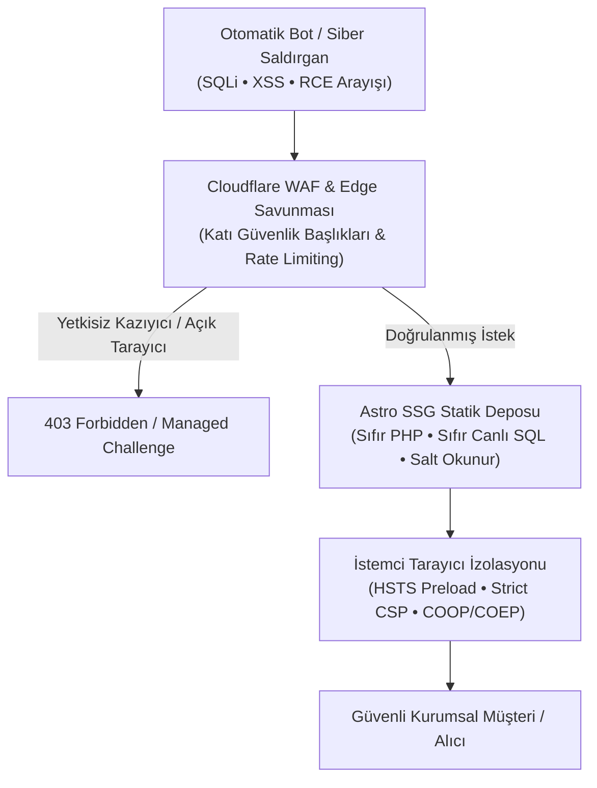

## Kurumsal Web Siteleri: Siber Saldırganların En Kolay Giriş Kapısı

Kurumsal şirketlerin bilgi işlem (IT) ve siber güvenlik direktörleriyle yaptığım görüşmelerde sıkça karşılaştığım tehlikeli bir yanılgı vardır: Şirket içi ERP sistemleri, güvenlik duvarları ve VPN hatları en katı standartlarla korunurken, şirketin dış dünyaya açılan web sitesi genellikle *"pazarlamanın işi"* denilerek göz ardı edilir.

Oysa gelişmiş tehdit aktörleri (APT) ve otomatik fidye yazılımı botları, bir kuruma sızmak için şirketinizin iç ağını değil, dışarıda unutulmuş, güncellenmeyen WordPress eklentilerini veya korumasız web sunucularını hedef alır. Ele geçirilen bir kurumsal web sitesi; şirketinizin kurumsal itibarını yok etmekle kalmaz, e-posta alan adınızın kara listeye girmesine ve müşterilerinizin kimlik avı (phishing) saldırılarına maruz kalmasına yol açar.

2026 yılı itibarıyla kurumsal web güvenliği, "yeşil bir SSL kilit ikonu" almaktan çok daha öteye geçmiştir. 

Bu yayında; bilgi işlem ekiplerinin ve tedarik direktörlerinin denetlemesi gereken 5 temel kurumsal web siber güvenlik standardını inceliyoruz.



---

## 2026 Bilgi İşlem Denetiminde Aranacak 5 Güvenlik Kriteri

Bir web projesini kabul etmeden önce bilgi işlem departmanınızın mutlaka doğrulaması gereken 5 mimari katman:

### 1. HSTS Preload ve 2 Yıllık Zorunlu Şifreleme
Yalnızca `https://` protokolüne sahip olmak yetmez. Kullanıcı tarayıcıya sitenizin adresini yazdığında ilk istek HTTP üzerinden giderse, aradaki saldırgan (MitM) bağlantıyı ele geçirerek kullanıcıyı sahte bir siteye yönlendirebilir (SSL Stripping).

Bunu engellemek için kurumsal sitelerde **HSTS Preload** başlığı zorunludur:

```http
Strict-Transport-Security: max-age=63072000; includeSubDomains; preload
```

Bu başlık; sitenizin Google Chrome, Firefox ve Apple Safari çekirdeğindeki dahili "HSTS Preload List" veritabanına kaydedilmesini sağlar. Tarayıcı, sitenize daha ilk bağlantıda dahi HTTP protokolünü doğrudan reddeder; şifresiz iletişim donanımsal olarak imkansız hale gelir.

### 2. Strict CSP (İçerik Güvenlik Politikası) ile XSS İzolasyonu
Web sitelerinin %60'ından fazlası Siteler Arası Betik Çalıştırma (XSS) saldırılarına açıktır. Bilgisizce eklenen bir sayaç kodu veya üçüncü parti canlı destek widget'ı, sitenize sızan saldırganın kullanıcıların form verilerini çalmasına olanak tanır.

2026 standardında bir web sitesi katı bir CSP başlığı ile servis edilmelidir:

```http
Content-Security-Policy: default-src 'self'; script-src 'self' https://static.cloudflareinsights.com; style-src 'self' 'unsafe-inline'; img-src 'self' data: https: blob:; font-src 'self' data:; connect-src 'self'; object-src 'none'; base-uri 'self'; form-action 'self'; frame-ancestors 'none';
```

Bu kural; siteniz üzerinde yetkisiz hiçbir harici JavaScript dosyasının veya `eval()` fonksiyonunun çalıştırılamayacağını tarayıcı seviyesinde garanti eder.

### 3. Statik Site (SSG) Mimarisi ile Sıfır Saldırı Yüzeyi
Kurumsal güvenliğin altın kuralı basittir: **Var olmayan bir şeyi hackleyemezsiniz.**

Geleneksel web sitelerinde sunucuda çalışan PHP yorumlayıcısı, Python framework'ü veya açık MySQL veritabanı portları sürekli yeni güvenlik açıkları (CVE) üretir. [Ankara web yazılım](/ankara-web-yazilim/) ve kurumsal altyapı projelerimizde uyguladığımız Astro SSG modelinde, üretim sunucusunda hiçbir kod yorumlayıcısı veya veritabanı bulunmaz. Sayfalar derleme anında oluşturulur ve salt okunur statik dosyalar olarak dağıtılır. Saldırganın SQL sorgusu atabileceği bir veritabanı bulunmadığı için siber saldırı yüzeyi matematiksel olarak sıfıra iner.

### 4. Permissions-Policy ve Donanım İzolasyonu
Modern tarayıcılar; sitelere kamera, mikrofon, coğrafi konum ve USB cihazlara erişim yetkisi tanır. Kurumsal bir ihracat veya tanıtım sitesinin kullanıcının mikrofonuna veya kamerasına erişmesi anlamsız bir güvenlik açığıdır.

Web sunucusu üzerinden yayınlanacak modern bir `Permissions-Policy` başlığı ile:

```http
Permissions-Policy: accelerometer=(), camera=(), geolocation=(), microphone=(), payment=(), usb=()
```

Kullanıcının tarayıcısındaki tüm hassas donanım arayüzleri siteniz için tamamen devre dışı bırakılır; böylece tedarikçileriniz veya alıcılarınız sitenizi gezerken en yüksek gizlilik güvencesine sahip olur.

### 5. Cloudflare WAF, VIP AI Arama Botları ve Kazıyıcı Yönetimi
2026 yılında kurumsal siteler devasa bir yapay zeka botu akınıyla karşı karşıyadır. Ancak burada kritik bir ayrım yapılmalıdır:
- **İzin Verilmesi Gereken VIP Botlar:** Googlebot, Bingbot, OAI-SearchBot (ChatGPT Arama) ve PerplexityBot gibi meşru AI arama motorları sitenizi indekslemeli ve yanıt motorlarına taşımalıdır.
- **Engellenmesi Gereken Kazıyıcılar:** Şirketinizin ürün kataloglarını, teknik şartnamelerini ve fiyat politikalarını çalan yetkisiz botlar (ByteSpider, anonim Python scraper'ları).

The Vault bölümünde paylaştığım [2026 Kurumsal Siber Güvenlik Başlıkları & WAF Konfigürasyonu](/vault/b2b/enterprise-security-headers-2026.conf), Cloudflare Edge seviyesinde bu ayrımı milisaniyeler içinde yapan hazır kural setlerini içerir.

---

## Kurumsal Güvenlik Başlıkları Matrisi

Bilgi işlem ekibinizin `curl -I` veya [SEO Lens](/projects/seo-lens/) gibi analiz araçlarıyla doğrulaması gereken kontrol matrisi:

| Güvenlik Başlığı | Minimum Kabul Değeri | Güvenlik Amacı |
|---|---|---|
| **Strict-Transport-Security** | `max-age=63072000; includeSubDomains; preload` | SSL Stripping ve MitM saldırılarını önleme |
| **Content-Security-Policy** | `default-src 'self'; object-src 'none'; ...` | XSS ve yetkisiz veri sızıntılarını donanımsal engelleme |
| **X-Frame-Options** | `DENY` | Clickjacking ve iframe içi sahte form saldırılarını önleme |
| **X-Content-Type-Options** | `nosniff` | Kötü amaçlı MIME türü tahminini engelleme |
| **Referrer-Policy** | `strict-origin-when-cross-origin` | Dış sitelere hassas token ve URL parametresi sızmasını önleme |
| **Cross-Origin-Opener-Policy** | `same-origin` | Yan kanal ve bellek sızıntısı saldırılarını izole etme |
| **Permissions-Policy** | `camera=(), microphone=(), geolocation=()` | Tarayıcı donanım erişimlerini kapatarak gizlilik sağlama |

---

## Bilgi İşlem Ekipleri İçin Eylem Planı

Kurumsal web varlıklarınızın siber güvenlik duruşunu uluslararası standartlara taşımak için [Ankara kurumsal web tasarım](/ankara-kurumsal-web-tasarim/) standartlarımız doğrultusunda şu 3 adımı devreye alabilirsiniz:

1. **Güvenlik Başlığı Taraması:** Sitenizin mevcut başlıklarını `securityheaders.com` üzerinden test edin ve A+ skorunu hedefleyin.
2. **Kasa Konfigürasyonunu İndirin:** The Vault'tan [enterprise-security-headers-2026.conf](/vault/b2b/enterprise-security-headers-2026.conf) dosyasını alıp Nginx veya Cloudflare Edge kural setlerinize doğrudan entegre edin.
3. **Monolitik Altyapılardan Ayrılın:** Tıpkı [oaTeklif](/broadcasts/oateklif-ucretsiz-teklif-olusturucu/) ve [oaPOS](/projects/oapos/) mimarilerimizde uyguladığımız gibi, kritik veri akışlarını statik ön yüzlerle yalıtarak sıfır güven (Zero-Trust) mimarisine geçiş yapın.

Kurumsal web siteniz, şirketinizin siber güvenlik disiplininin dış dünyaya açılan ilk kanıtıdır.
