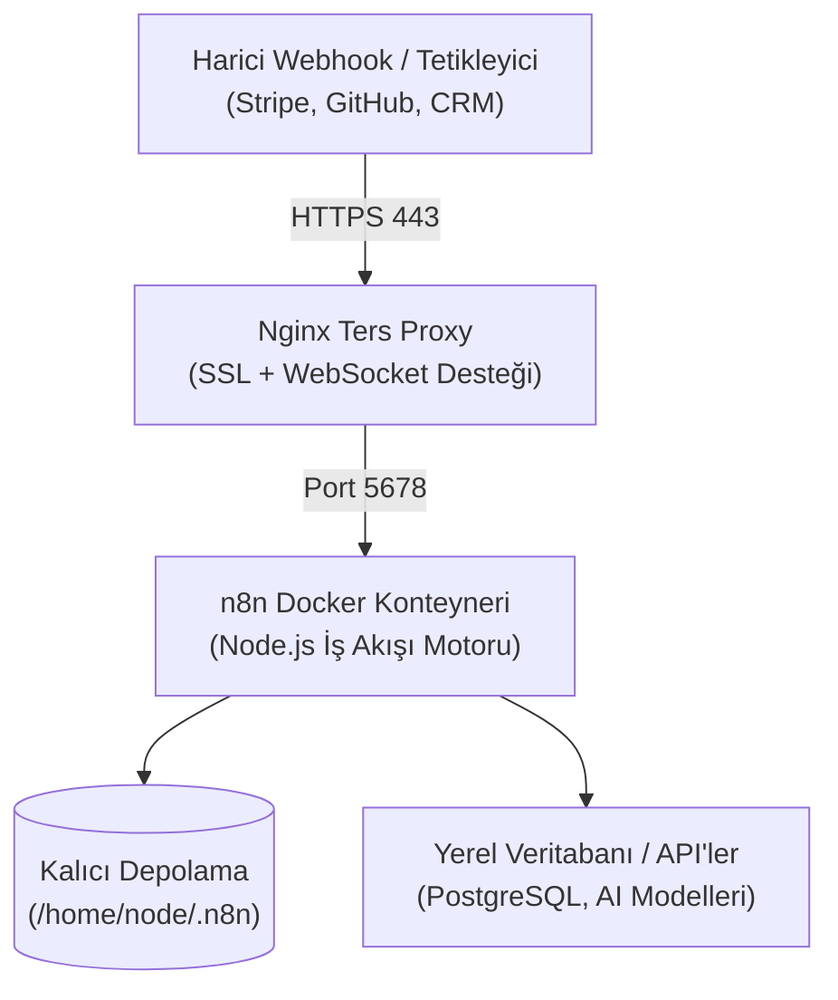

## Adım Başı Ücret Ödeyen SaaS Otomasyonlarına Son

Zapier, Make veya benzeri bulut otomasyon araçları hızlı prototipleme için kullanışlı görünse de; karmaşık iş akışları, döngüler (loops) veya yapay zeka LLM ajanları devreye girdiğinde adım (task) bazlı faturalandırma şirket bütçelerini hızla tüketir. Üstelik hassas veritabanı kimlik bilgilerinizi, müşteri verilerinizi ve API anahtarlarınızı üçüncü parti sunucularda saklamak ciddi bir güvenlik riskidir.

Açık kaynak kodlu **n8n**, kendi sunucunuzda (self-hosted) çalıştığında:
- **Sınırsız İşlem Adımı:** Ayda 100 işlem de yapsanız, 1.000.000 işlem de çalıştırsanız ek fatura ödemezsiniz.
- **Tam Veri Gizliliği:** Webhook yükleri, API anahtarları ve veritabanı sorguları yerel sunucunuzda izole kalır.
- **Yerel AI Düğüm Desteği:** LangChain, OpenAI, Anthropic veya yerel Ollama modelleri doğrudan akışlara entegre edilebilir.

Bu teknik yayında; Plesk kurulu bir Linux sunucuda Docker konteyneri ile n8n'i nasıl dakikalar içinde ayağa kaldırdığımızı inceliyoruz.



---

## 1. Plesk Docker Kataloğu Üzerinden n8n Konteyner Kurulumu

Plesk kontrol panelinde **Docker > Docker Kataloğu** sekmesine giderek `n8nio/n8n` resmi imajını aratıyor ve indiriyoruz. Konteyneri başlatırken dikkat edilmesi gereken kritik yapılandırma parametreleri şunlardır:

1. **Port Yönlendirme:**
   - Konteyner Portu: `5678`
   - Sunucu Portu: `5678` (veya sunucu içinde boşta olan herhangi bir yerel port, örn. `5678`)
2. **Kalıcı Veri Hacmi (Volume Mapping):**
   İş akışlarınızın ve veritabanı kayıtlarınızın konteyner yeniden başlatıldığında silinmemesi için sunucudaki yerel bir dizini bağlamalıyız:
   - Sunucu Yolu: `/var/n8n_data`
   - Konteyner Yolu: `/home/node/.n8n`
3. **Kritik Ortam Değişkenleri (Environment Variables):**
   ```text
   N8N_HOST=n8n.sizin-domaininiz.com
   N8N_PORT=5678
   N8N_PROTOCOL=https
   WEBHOOK_URL=https://n8n.sizin-domaininiz.com/
   GENERIC_TIMEZONE=Europe/Istanbul
   ```

---

## 2. Nginx Ters Proxy ve SSL Güvenliği

Plesk üzerinde `n8n.sizin-domaininiz.com` alt alan adını oluşturduktan sonra, **Apache & Nginx Ayarları > Ek Nginx Yönergeleri** bölümüne ters proxy kuralını ekliyoruz:

```nginx
location / {
    proxy_pass http://127.0.0.1:5678;
    proxy_http_version 1.1;
    proxy_set_header Upgrade $http_upgrade;
    proxy_set_header Connection "upgrade";
    proxy_set_header Host $host;
    proxy_set_header X-Real-IP $remote_addr;
    proxy_set_header X-Forwarded-For $proxy_add_x_forwarded_for;
    proxy_set_header X-Forwarded-Proto $scheme;
    proxy_buffering off;
    proxy_cache off;
}
```

Bu yapılandırmada yer alan `proxy_buffering off;` direktifi, n8n'in gerçek zamanlı yürütme çıktılarını ve SSE (Server-Sent Events) bildirimlerini gecikmesiz görüntüleyebilmeniz için hayati önem taşır.

---

## 3. İlk Otomasyon Akışı ve Canlı Webhook Doğrulaması

Kurulum tamamlandığında `https://n8n.sizin-domaininiz.com` adresine giderek ilk sahip hesabını açıyoruz.

Videoda canlı olarak oluşturduğumuz test senaryosunda:
- Bir **Webhook Tetikleyicisi** oluşturup POST isteklerini dinlemeye alıyoruz.
- Gelen JSON verisini bir **Code (JavaScript)** düğümüyle dönüştürüp, bir **Telegram Bot** düğümü üzerinden anlık bildirim olarak cep telefonumuza iletiyoruz.
- İstek tetiklendiğinde milisaniyeler içinde akış başarıyla sonuçlanıyor; sıfır aracı maliyet, tam veri egemenliği.
