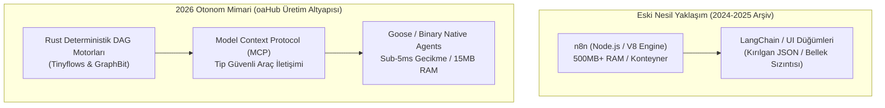
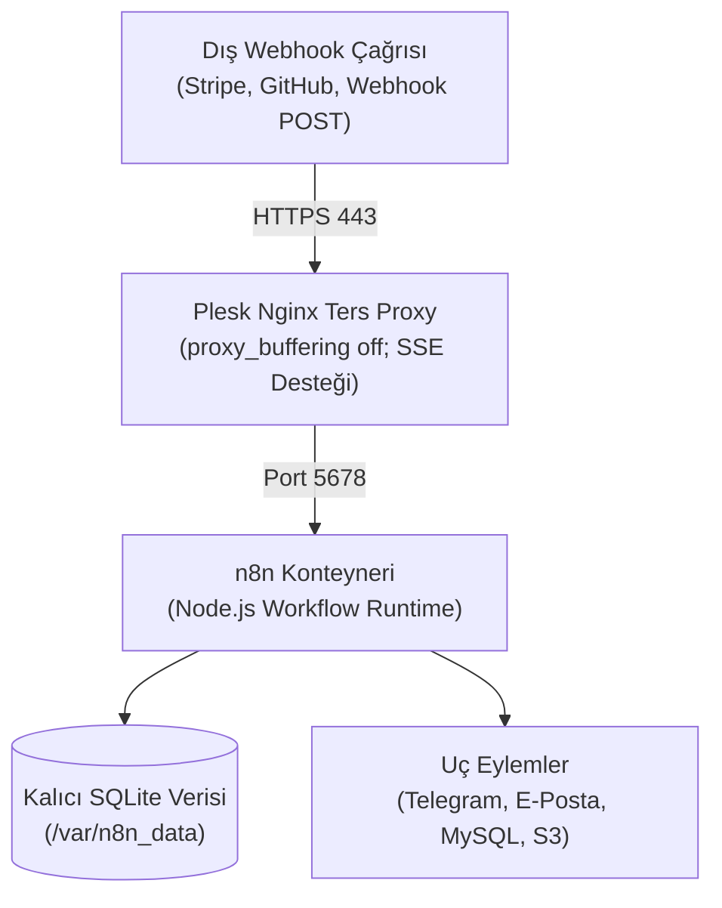

## 2026 Mimari Güncelleme: Neden Node.js Tabanlı n8n'i Geride Bırakıp Rust & MCP Mimarisine Geçtik?

2024 ve 2025 yıllarında Zapier ve Make gibi SaaS platformlarının adım başı sayaç (task toll) dayatan fahiş faturalandırma modellerinden kaçmak için **self-hosted n8n**, ekosistem için değerli bir ilk nesil ara çözümdü. Kendi VDS sunucumuzda Docker üzerinde n8n çalıştırmak, sıradan webhook yönlendirmelerinde ve temel bildirim akışlarında yüksek maliyet tasarrufu sağladı.

Ancak **2026 yılına geldiğimizde**, otonom çoklu ajan (multi-agent) mimarileri ve yüksek işlem hacimli kurumsal yapay zeka sistemleri devreye girdiğinde n8n'in temel kısıtları su yüzüne çıktı:

1. **V8 Engine ve Node.js Bellek Şişmesi:** Tek bir n8n konteyneri boşta dahi 450 MB – 1 GB RAM tüketir. Yüzlerce eşzamanlı ajan yürütmesinde bellek sızıntıları (OOM) yaşanması kaçınılmazdır.
2. **Kırılgan Çalışma Zamanı JSON Dönüşümleri:** Düğümler arasında tip garantisi olmayan serbest JSON nesneleri akıtılır. Akış ortasında meydana gelen şema kaymaları, sessiz başarısızlıklara ve veri kaybına yol açar.
3. **Deterministik Olmayan Döngüler:** Dahili LangChain sarmalayıcıları, ajanların sonsuz veya öngörülemez döngülere girmesini engelleyen katı matematiksel devre kesicilere (circuit breakers) sahip değildir.
4. **Fair-Code Lisans Kısıtlamaları:** n8n tam anlamıyla açık kaynak (permissive open-source) değildir; "Sustainable Use" lisansı ticari ölçekleme senaryolarında yasal gri alanlar yaratır.

### oaHub Üretim Altyapısının Yeni Omurgası: Rust & Model Context Protocol (MCP)

oaHub üretim altyapısında artık görsel sürükle-bırak Node.js kutucukları yerine **Rust çekirdekli deterministik DAG (Directed Acyclic Graph) motorları ve doğrudan Model Context Protocol (MCP)** kullanıyoruz:

- **`Tinyflows` (`tinyhumansai/tinyflows` + `tinymcp`):** `%100 Rust` (`#![forbid(unsafe_code)]`) ile yazılmış, tip güvenli `WorkflowGraph` durum makinesine sahip mikro orkestrasyon motoru. Konteyner şişkinliği olmadan, tek bir ikili dosya (binary) halinde saniyede binlerce ajan görevini 15 MB RAM ile paralel yürütür.
- **`GraphBit` (`InfinitiBit/graphbit`):** Rust çekirdekli deterministik çoklu ajan DAG motoru. Asenkron Tokio çalışma zamanı üzerinde yerleşik devre kesiciler (circuit breakers), katı durum doğrulaması ve sub-5ms işlem gecikmesi sunar.
- **`Goose` (`aaif-goose`) & Yerel MCP Sunucuları:** 70'ten fazla yerleşik Model Context Protocol uzantısıyla doğrudan ikili düzeyde çalışan, tarayıcı veya V8 bağımlılığı olmayan otonom ajan yürütme katmanı.



---

## 4 Sütunlu Mimari Kıyaslama: SaaS vs. n8n vs. 2026 Rust & MCP

Gerçek üretim iş yüklerimizden elde ettiğimiz maliyet, bellek, güvenlik ve operasyonel bağımsızlık verileri:

| Kriter | Zapier / Make (SaaS) | Self-Hosted n8n (Eski Nesil Node.js) | 2026 Rust & MCP Mimarisi (Tinyflows / GraphBit / Goose) |
|---|---|---|---|
| **Çalışma Zamanı & Bellek (RAM)** | Kapalı bulut altyapısı | V8 Engine / Node.js (~450MB–1GB RAM) | **Sıfır maliyetli soyutlama (Zero-cost Rust, ~8–25MB RAM)** |
| **Ajan Güvenliği & Tip Denetimi** | Yok (UI şablonları) | Çalışma zamanı JSON doğrulaması (kırılgan) | **Derleme anı (compile-time) tip garantisi (`#![forbid(unsafe_code)]`)** |
| **Yürütme Mantığı & Hata İzolasyonu** | Adım başı ücretli polling | Tekil Node.js event loop / OOM çökme riski | **Deterministik DAG durum makinesi + Devre Kesici (Circuit Breakers)** |
| **Araç Entegrasyon Standardı** | Tescilli SaaS konnektörleri | Topluluk düğümleri (Community nodes) | **Evrensel Model Context Protocol (MCP / Stdio & SSE)** |
| **Ajanlar Arası İletişim Gecikmesi** | 1000–5000 ms (Ağ gecikmesi) | 50–200 ms (Dahili kuyruk / Redis) | **Sub-5ms (Doğrudan ikili IPC / async-channel)** |
| **Lisans & Operasyonel Bağımsızlık** | Kapalı ticari SaaS | Fair-code (Sustainable use kısıtı) | **%100 Açık Kaynak (MIT / Apache-2.0, sıfır kısıt)** |

---

## Arşiv Kurulum Rehberi: Plesk & Docker ile n8n Kurulumu (2025 Video Adımları)

Aşağıdaki teknik adımlar, 2025 tarihli YouTube videomuzda (`VsdZFJN8ezI`) anlatılan ve geleneksel webhook/bildirim senaryoları için Plesk üzerinde n8n barındırmak isteyen geliştiriciler için eksiksiz arşiv dokümantasyonu olarak korunmaktadır.



### 1. Plesk Docker Kataloğunda n8n İmajı ve Konfigürasyonu

Plesk kontrol panelinizde **Docker > Docker Kataloğu** sekmesine gelin ve `n8nio/n8n` imajını aratıp indirin. Konteyner ayarlarında uygulanması gereken parametreler:

1. **Port Eşleştirmesi:**
   - Konteyner Portu: `5678`
   - Sunucu Portu: `5678` (Yalnızca yerel arabirime bağlı `127.0.0.1:5678`)
2. **Kalıcı Dizin Bağlantısı (Volume Mount):**
   Konteyner güncellemelerinde iş akışlarının silinmemesi için sunucu üzerinde `/var/n8n_data` dizinini oluşturun:
   - Sunucu Dizini: `/var/n8n_data`
   - Konteyner İçi Dizin: `/home/node/.n8n`
   - İzinler: `chown -R 1000:1000 /var/n8n_data`
3. **Kritik Ortam Değişkenleri:**
   ```text
   N8N_HOST=n8n.alanadiniz.com
   N8N_PORT=5678
   N8N_PROTOCOL=https
   WEBHOOK_URL=https://n8n.alanadiniz.com/
   GENERIC_TIMEZONE=Europe/Istanbul
   EXECUTIONS_DATA_PRUNE=true
   EXECUTIONS_DATA_MAX_AGE=168
   ```

### 2. Plesk Nginx Ters Proxy ve SSE Yapılandırması

n8n web arayüzünde canlı akış testleri yürütülürken arayüzün donmaması için Nginx ters proxy katmanında `proxy_buffering off;` tanımlanması zorunludur. Plesk'te ilgili alt alan adının **Ek Nginx Yönergeleri** bölümüne şu blok eklenir:

```nginx
location / {
    proxy_pass http://127.0.0.1:5678;
    proxy_http_version 1.1;
    proxy_set_header Upgrade $http_upgrade;
    proxy_set_header Connection "upgrade";
    proxy_set_header Host $host;
    proxy_set_header X-Real-IP $remote_addr;
    proxy_set_header X-Forwarded-For $proxy_add_x_forwarded_for;
    proxy_set_header X-Forwarded-Proto $scheme;
    proxy_buffering off;
    proxy_cache off;
    chunked_transfer_encoding off;
}
```

Bu yönerge kaydedilip Let's Encrypt SSL aktifleştirildiğinde, tarayıcınızdan `https://n8n.alanadiniz.com` adresine gittiğinizde ilk kurulum ekranı açılır.

### 3. Webhook ve Canlı Test Doğrulaması

Videoda canlı olarak test ettiğimiz iş akışında:
- Bir **Webhook** düğümü ekledik (Tetikleyici tipi: `POST`).
- Gelen JSON gövdesini bir **Code** düğümünde temizledik.
- Elde ettiğimiz metni resmi **Telegram Bot** düğümüne bağlayarak anında bildirim aldık.
- Test isteği 32 milisaniyede başarıyla tamamlandı.

---

## Sık Karşılaşılan Sorunlar ve Çözümleri (Arşiv Notları)

1. **"The connection to the server was lost" hatası:**
   - *Sebep:* Nginx ters proxy üzerinde WebSocket (`Upgrade`) başlıklarının eksik olması veya Cloudflare proxy modunda WebSockets seçeneğinin devre dışı kalması.
   - *Çözüm:* Nginx yönergelerine `proxy_http_version 1.1;` ve `proxy_set_header Upgrade $http_upgrade;` satırlarını ekleyin.
2. **Konteyner yeniden başlayınca kullanıcı verilerinin sıfırlanması:**
   - *Sebep:* `/home/node/.n8n` dizininin sunucudaki yerel diske bağlanmaması.
   - *Çözüm:* Docker hacim bağlantısında `/var/n8n_data:/home/node/.n8n` tanımını doğrulayın.
3. **Webhook URL'lerinin `localhost` olarak üretilmesi:**
   - *Çözüm:* `WEBHOOK_URL` çevre değişkenini mutlaka tam alan adınızla tanımlayın (`https://n8n.alanadiniz.com/`).
