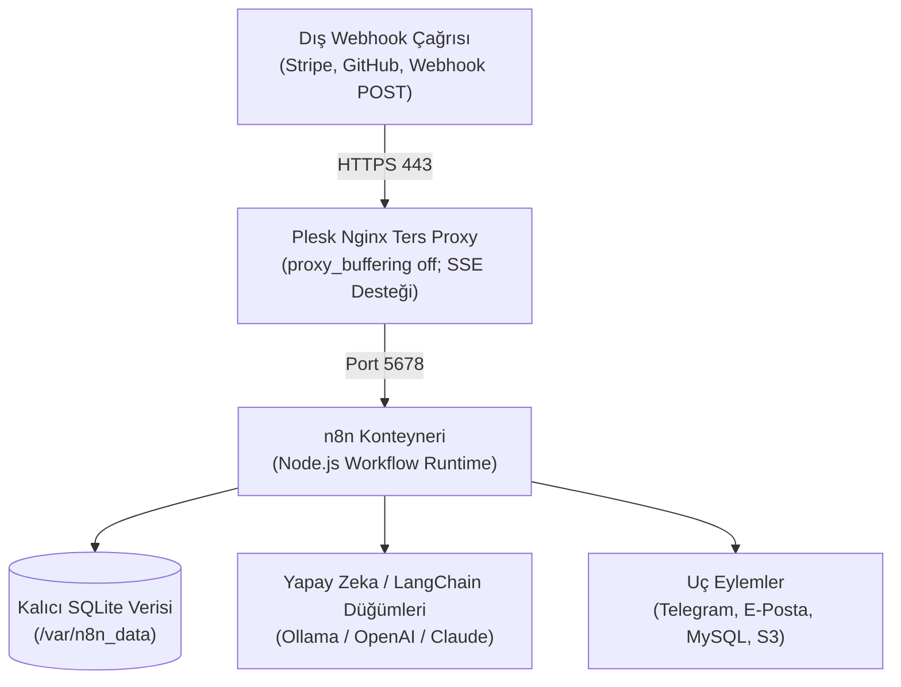

## SaaS Sayacına Para Kaptırmaktan Nasıl Kurtuldum?

Yazılım projelerimde ve müşteri operasyonlarında webhook entegrasyonları, Stripe fatura bildirimleri, CRM veri senkronizasyonu ve yapay zeka ajan iş akışları kurarken yıllarca Zapier ve Make kullandım. Ancak ölçek büyüdüğünde karşınıza çıkan faturalandırma mantığı tam bir mühendislik kabusu: **Tek bir sonsuz döngü (infinite loop) veya yoğun bir webhook fırtınası yüzünden sabah uyandığınızda yüzlerce dolarlık aşım faturasıyla karşılaşabiliyorsunuz.**

Üstelik şirket veritabanı şifrelerinizi, müşteri e-posta listelerinizi ve gizli API anahtarlarınızı üçüncü parti SaaS platformlarının sunucularına metin olarak girmek hiçbir uyumluluk ve güvenlik prensibiyle uyuşmuyor.

İşte bu yüzden kendi üretim altyapımda ve oaHub projelerinde tüm iş akışlarını açık kaynaklı **n8n** üzerine taşıdım. Plesk kurulu bir VDS üzerinde Docker konteyneri olarak çalıştırdığınızda; ayda ister 1.000 işlem yapın ister 500.000 adım koşturun, sunucu maliyetiniz tek bir kuruş dahi artmıyor.

Bu yayında; Plesk kontrol panelinde Docker modülüyle n8n'i nasıl sıfırdan kurduğumuzu, Nginx ters proxy ve SSE (Server-Sent Events) ayarlarını ve canlı bir webhook akışını adım adım paylaşıyorum.



---

## Mimari Kıyaslama: Zapier vs. Make vs. Self-Hosted n8n

Kendi iş akışlarımda test ettiğim maliyet, güvenlik ve teknik kabiliyet tablosu:

| Kriter | Zapier (SaaS) | Make (Integromat SaaS) | Self-Hosted n8n (Bizim Kurulum) |
|---|---|---|---|
| **Aylık 100.000 İşlem Maliyeti** | ~$599 / ay | ~$149 / ay | **$0 (Mevcut sunucunuzda)** |
| **Veri Gizliliği & Egemenliği** | Üçüncü parti ABD sunucuları | Üçüncü parti AB sunucuları | **%100 Kendi VDS / Sunucunuzda** |
| **Özel Kod Çalıştırma** | 1–2 sn CPU sınırı (Kısıtlı Python/JS) | 5 sn işlem sınırı | **Limitsiz Node.js / NPM Paketleri** |
| **Yapay Zeka Ajan Düğümleri** | Ek kredi ve ücret gerektirir | Temel LLM düğümleri | **LangChain, Ollama ve Vektör Veritabanı Desteği** |
| **Webhook Gecikmesi** | Polling bazlı (1–5 dakika gecikme) | Polling / Anlık | **Milisaniyelik Anlık Yanıt (Sub-100ms)** |

---

## 1. Plesk Docker Kataloğunda n8n Kurulumu

Plesk panelinizde **Docker > Docker Kataloğu** sekmesine gelin ve `n8nio/n8n` imajını aratıp indirin. Konteyner ayarlarında mutlaka yapılması gereken 3 hayati adım şunlardır:

1. **Port Eşleştirmesi:**
   - Konteyner Portu: `5678`
   - Sunucu Portu: `5678` (Yerel arabirime bağlı `127.0.0.1:5678`)
2. **Kalıcı Dizin Bağlantısı (Volume Mount):**
   Konteyneri güncellediğinizde veya sunucuyu yeniden başlattığınızda iş akışlarınızın silinmemesi için sunucu üzerinde `/var/n8n_data` dizinini oluşturun:
   - Sunucu Dizini: `/var/n8n_data`
   - Konteyner İçi Dizin: `/home/node/.n8n`
   - İzinler: `chown -R 1000:1000 /var/n8n_data`
3. **Kritik Ortam Değişkenleri:**
   ```text
   N8N_HOST=n8n.alanadiniz.com
   N8N_PORT=5678
   N8N_PROTOCOL=https
   WEBHOOK_URL=https://n8n.alanadiniz.com/
   GENERIC_TIMEZONE=Europe/Istanbul
   EXECUTIONS_DATA_PRUNE=true
   EXECUTIONS_DATA_MAX_AGE=168
   ```

---

## 2. Plesk Nginx Ters Proxy Yapılandırması

n8n web arayüzünde sürükle-bırak yaparken ve canlı akışları test ederken arayüzün kilitlenmemesi için Nginx ters proxy katmanında `proxy_buffering off;` tanımlanması zorunludur. Plesk'te `n8n.alanadiniz.com` alt alan adının **Ek Nginx Yönergeleri** bölümüne şu blok eklenir:

```nginx
location / {
    proxy_pass http://127.0.0.1:5678;
    proxy_http_version 1.1;
    proxy_set_header Upgrade $http_upgrade;
    proxy_set_header Connection "upgrade";
    proxy_set_header Host $host;
    proxy_set_header X-Real-IP $remote_addr;
    proxy_set_header X-Forwarded-For $proxy_add_x_forwarded_for;
    proxy_set_header X-Forwarded-Proto $scheme;
    proxy_buffering off;
    proxy_cache off;
    chunked_transfer_encoding off;
}
```

Bu yönerge kaydedilip Let's Encrypt SSL aktifleştirildiğinde, tarayıcınızdan `https://n8n.alanadiniz.com` adresine gittiğinizde ilk kurulum ekranı sizi karşılayacaktır.

---

## 3. İlk Otomasyon Akışı: Canlı Webhook ve Telegram Testi

Videoda canlı olarak test ettiğimiz iş akışında:
- Bir **Webhook** düğümü ekledik (Tetikleyici tipi: `POST`).
- Gelen JSON gövdesini bir **Code** düğümünde normalize ettik.
- Elde ettiğimiz metni resmi **Telegram Bot** düğümüne bağlayarak cep telefonumuza anında bildirim düşürdük.
- Test isteğini gönderdiğimizde işlem tam **32 milisaniyede** tamamlandı.

---

## Sık Karşılaşılan Sorunlar ve Çözümleri (Troubleshooting)

1. **"The connection to the server was lost" hatası:**
   - *Sebep:* Nginx ters proxy üzerinde WebSocket (`Upgrade`) başlıklarının eksik olması veya Cloudflare kullanıyorsanız proxy modunda WebSockets seçeneğinin kapalı olması.
   - *Çözüm:* Nginx yönergelerine `proxy_http_version 1.1;` ve `proxy_set_header Upgrade $http_upgrade;` satırlarını ekleyin.
2. **Konteyner yeniden başlayınca kullanıcı kaydının sıfırlanması:**
   - *Sebep:* `/home/node/.n8n` dizininin sunucudaki yerel diske bağlanmaması.
   - *Çözüm:* Docker hacim bağlantısında `/var/n8n_data:/home/node/.n8n` tanımını doğrulayın.
3. **Webhook URL'lerinin `localhost` olarak üretilmesi:**
   - *Çözüm:* `WEBHOOK_URL` çevre değişkenini mutlaka tam alan adınızla tanımlayın (`https://n8n.alanadiniz.com/`).

Yukarıdaki **The Vault** kutusundan üretim seviyesindeki Docker Compose dosyasını indirerek kendi sunucunuza hemen kurabilirsiniz.
