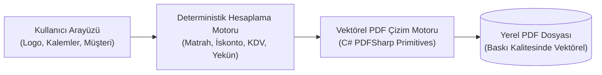

## Excel Tablolarında Kaybolan Teklif Süreçlerine Neden Son Verdim?

Yazılım geliştiricisi, bağımsız danışman veya ajans sahibi olarak potansiyel bir müşteriye sunduğunuz kurumsal teklif belgesi, teknik yetkinliğinizin ve profesyonelliğinizin ilk vitrinidir. Kendi projelerimde ve kurumsal danışmanlık süreçlerimde yıllarca aynı çileyi çektim: **Ya her seferinde tabloları kayan, yazı tipleri bozulan Microsoft Word şablonlarıyla saatlerce boğuşuyordum ya da ayda sadece 3-5 teklif PDF'i almak için aylık 20-30 dolar isteyen bulut faturalandırma yazılımlarına abone olmak zorunda kalıyordum.**

Bu gereksiz sürtünmeyi ortadan kaldırmak için C# .NET altyapısıyla **oaTeklif** masaüstü uygulamasını geliştirdim. Tamamen yerel öncelikli (offline-first) mimariyle çalışan bu araç; hiçbir bulut hesabı, internet bağlantısı veya aylık abonelik gerektirmeden saniyeler içinde kurumsal kimliğinize uygun, vektörel netlikte PDF teklifleri hazırlamanızı sağlıyor.

Bu yayında; oaTeklif'in arkasındaki yazılım mimarisini, dinamik KDV/iskonto hesaplama motorunu ve tek bir tıklamayla nasıl profesyonel PDF belgesi ürettiğimizi inceliyoruz.



---

## Mimari Kıyaslama: Word Şablonları vs. SaaS vs. oaTeklif

Kendi iş akışlarımda karşılaştığım sorunlar üzerinden hazırladığım karşılaştırma tablosu:

| Değerlendirme Kriteri | Microsoft Word / Excel Şablonu | Bulut SaaS Faturalama Araçları | oaTeklif (Açık Kaynak Masaüstü) |
|---|---|---|---|
| **Abonelik / Maliyet** | Office 365 lisansı | $15 – $45 / ay düzenli ücret | **%100 Ücretsiz ve Açık Kaynak** |
| **İnternet Bağımlılığı** | Çevrimdışı çalışabilir | İnternet olmadan çalışmaz | **Tamamen Çevrimdışı (Local-First)** |
| **Müşteri Verisi Gizliliği** | Yerel disk | Üçüncü parti sunucularda saklanır | **Sıfır Telemetri; %100 Yerel** |
| **Matematiksel Otomasyon** | Formüller bozulabilir / kayabilir | Otomatik | **Kusursuz Tip Güvenli Matematik** |
| **PDF Çıktı Kalitesi** | Yazı tipi ve tablo kaymaları | Standart HTML çıktısı | **Yüksek Çözünürlüklü Vektörel Tipografi** |

---

## 1. oaTeklif'in Teknik Mimarisi ve Veri Modeli

oaTeklif, hafif bir C# .NET masaüstü istemcisi olarak inşa edilmiştir. Uygulama belleğinde çalışan veri modeli, **The Vault** bölümünde paylaştığım mimari şemaya sadık kalır:

- **Dinamik Kalem Koleksiyonu:** Teklifinize dilediğiniz sayıda kalem ekleyebilirsiniz. Her kalem için miktar, birim (Adet, Saat, Gün, Lisans, Proje), birim fiyat, iskonto yüzdesi ve KDV oranı (`%0, %1, %10, %20`) bağımsız tanımlanır.
- **Kayan Nokta Hassasiyeti:** Vergi hesaplamaları IEEE kayan nokta hatalarından etkilenmemek adına doğrudan C# `decimal` türü üzerinde kuruş hassasiyetiyle çalıştırılır.
- **Profil Kalıcılığı:** Kurumsal logonuz (PNG/JPG), IBAN bilgileriniz ve standart teslimat koşulları Windows `AppData/Local` altında güvenli bir JSON konfigürasyonunda saklanır.

---

## 2. Vektörel PDF Çizim Motoru

Piyasadaki çoğu hafif teklif aracı web görünümünü (HTML to PDF) kaba bir raster ekran görüntüsü olarak basar. Bu yöntem, dosya boyutunu şişirdiği gibi müşteriniz teklifi yazdırdığında metinlerin bulanıklaşmasına yol açar.

oaTeklif'te tercih ettiğim yöntem doğrudan **vektörel çizim motorudur (PDFSharp Core)**:
- Şirket logonuz çözünürlük kaybı olmadan sayfaya gömülür.
- Tablo çizgileri, para birimi sembolleri ve tipografik hiyerarşi vektörel olarak çizilir.
- Üretilen PDF boyutu genellikle **100 KB'ın altındadır** ve e-posta ile gönderildiğinde anında açılır.

```csharp
// Örnek vektörel çizim mantığı (oaTeklif mimarisinden kesit)
XGraphics gfx = XGraphics.FromPdfPage(page);
XFont headerFont = new XFont("Segoe UI", 12, XFontStyle.Bold);
gfx.DrawString("TOPLAM MATRAH:", headerFont, XBrushes.Black, new XPoint(380, yPosition));
gfx.DrawString(netMatrah.ToString("C2", culture), headerFont, XBrushes.Gold, new XPoint(500, yPosition));
```

---

## 3. Tek Tıkla Kurumsal Teklif Hazırlama Adımları

Videoda 1 dakikalık canlı demonstrasyonda gösterdiğim gibi:
1. Uygulamayı açın ve müşteri unvanı ile adresini girin.
2. Sunduğunuz hizmetleri (örn. *Web Tasarımı*, *Sistem Mimarisi Danışmanlığı*, *Sunucu Kurulumu*) kalemler listesine ekleyin.
3. Varsa iskonto oranını girin; KDV ve genel toplam anında sağ altta belirecektir.
4. **"PDF Oluştur"** düğmesine basın; teklifiniz masaüstünüze hazır olarak düşer.

---

## Sık Karşılaşılan Sorunlar ve Çözümleri

1. **"Logo boyutu çok büyük veya sayfaya sığmıyor":**
   - *Çözüm:* oaTeklif yüksek çözünürlüklü logoları otomatik olarak en boy oranını koruyarak `200x80` piksel sınırına orantılar. Ancak en iyi görsel sonuç için şeffaf arka planlı PNG formatında logo yüklemeniz önerilir.
2. **"KDV oranını değiştirdiğimde toplam güncellenmiyor":**
   - *Çözüm:* Kalem tablosunda hücre düzenlemesi yaptıktan sonra `Enter` tuşuna basarak veya başka bir hücreye tıklayarak veri bağlama (data binding) tetikleyicisini tamamlayın.
3. **Antivirüs uyarıları (SmartScreen):**
   - *Sebep:* Bağımsız bir açık kaynak yazılım olduğu ve pahalı kurumsal kod imzalama sertifikası (EV Code Signing) satın alınmadığı için Windows ilk açılışta SmartScreen uyarısı verebilir.
   - *Çözüm:* "Ek bilgi" butonuna tıklayıp "Yine de çalıştır" diyerek uygulamayı güvenle kullanabilirsiniz. Kaynak kodları GitHub'da tamamen şeffaftır.

oaTeklif kurulum dosyasını (`.exe`) ve mimari şemasını yukarıdaki indirme kartından hemen edinebilirsiniz.
