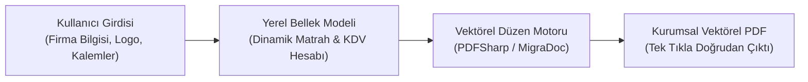

## Excel ve Word Dosyalarında Kaybolan Teklif Süreçlerine Son

Serbest çalışan yazılımcılar, danışmanlar ve ajanslar için müşteriye sunulan kurumsal teklif belgesi, profesyonelliğin ilk vitrinidir. Ancak çoğu girişimci ya her seferinde bozuk tablo düzenleriyle boğuştuğu Word şablonlarıyla vakit kaybeder ya da basit bir PDF teklif çıktısı almak için aylık yüksek abonelik ücretleri talep eden bulut faturalandırma yazılımlarına mahkum olur.

Bu sorunu kökten çözmek için geliştirdiğim açık kaynaklı masaüstü yazılımı **oaTeklif**, yerel öncelikli (offline-first) mimarisiyle hiçbir internet veya bulut hesabı gerektirmeden saniyeler içinde matbaa kalitesinde kurumsal PDF teklifleri üretmenizi sağlar.

---

## 1. Temel Yetenekler ve Mimari Özellikler

- **Yerel Öncelikli Güvenlik:** Müşteri listeniz, fiyat politikalarınız ve şirket finansal verileriniz asla harici bir sunucuya yüklenmez; tüm veriler bilgisayarınızda yerel kalır.
- **Dinamik Kalem Yönetimi:** Sınırsız sayıda hizmet veya ürün kalemi ekleme, birim fiyat, miktar, iskonto oranı ve KDV oranını bağımsız belirleme.
- **Otomatik Finansal Hesaplama:** Ara toplam, iskonto toplamı, tevkifat/KDV matrahı ve genel yekün anlık olarak matematiksel hassasiyetle hesaplanır.
- **Kurumsal Kimlik ve Logo Entegrasyonu:** Şirket logonuzu, banka IBAN bilgilerinizi, teklif geçerlilik süresini ve özel sözleşme şartlarını tek seferde tanımlayıp kalıcı şablon olarak saklayabilirsiniz.

---

## 2. Tek Tıkla Vektörel PDF Üretimi

Arayüzde girdiğiniz veriler arka planda doğrudan vektörel PDF çizim kütüphanesine aktarılır. Bu sayede üretilen PDF belgeleri; düşük çözünürlüklü raster ekran görüntüleri yerine, her boyutta kusursuz netlik sunan vektörel tipografi ve kurumsal renk paletiyle oluşturulur.

Yazılımın derlenmiş Windows kurulum dosyasını (`.exe`) ve kaynak kodlarını GitHub üzerinden ücretsiz indirip hemen kullanmaya başlayabilirsiniz.
