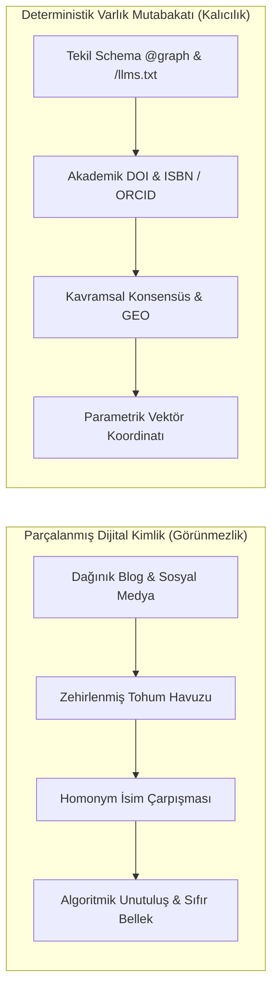

## Giriş: Arama Kutusunun Güvenli İllüzyonu

Son yirmi yıl boyunca dijital varlık yönetiminin ana omurgası tek bir hedefe kilitlenmişti: Arama motoru sonuç sayfalarında (SERP) ilk sıraya yerleşmek. Şirketler, ajanslar ve bağımsız uzmanlar milyonlarca liralık bütçeleri anahtar kelime hacimlerine, geri bağlantı (backlink) ağlarına ve sayfa içi optimizasyon tekniklerine yatırdı. Bu çabanın ödülü basitti; hedef kelimede ilk sırada çıkmak, sektörün doğal otoritesi ve ilk tercihi olmak anlamına geliyordu.

Bugün gelinen noktada ise son derece yaygın ve yanıltıcı bir şehir efsanesi dolaşıma girdi. Bazı yorumcular, Google'da birinci sırada çıkan bir kurumun Google'ın yapay zeka özetinde (AI Overviews) görünmediğini iddia ediyor. Bu teknik olarak hatalı bir tespittir. Google AI Overviews, temelde bir getirme ve artırma (RAG) mimarisidir; ilgili arama sorgusunda en tepede yer alan otoriter web sayfalarını doğal kaynak havuzu olarak okur ve özetler. Dolayısıyla kendi marka adınızda veya hedef anahtar kelimenizde organik olarak zirvedeyseniz, o kutucukta kaynak olarak listelenmeniz olağandır.

Asıl kriz ve asıl yapısal tehlike, Google'ın arama kutusunda değil; dijital dünyanın karar alma merkezinin o arama kutusundan tamamen uzaklaşmasında yatmaktadır.

Günümüzde kurumsal karar vericiler, küresel satın alma yöneticileri, yatırımcılar ve nitelikli tüketiciler artık arama çubuğuna iki kelime yazıp mavi bağlantıları tek tek gezmiyor. Karar alma süreçleri doğrudan büyük dil modellerinin (ChatGPT, Claude, Perplexity, Gemini) sohbet ekranlarına ve platformların kişiselleştirilmiş çok boyutlu öneri motorlarına kaymış durumdadır. Bu yeni ekosistemde ise kurallar kökünden değişmiştir: Arama motorları web sayfalarını dizinler ve listeler; yapay zeka sistemleri ise çok boyutlu vektör uzaylarında varlıkları ve kimlikleri birleştirir.

İşte bu noktada yüz binlerce sayfalık içeriğe ve birinci sıra etiketine sahip olan markalar, kurumlar ve içerik üreticileri derin bir sessizliğe ve görünmezliğe gömülmektedir. Konuyu [Onur Aksoy (Hackonomist)](/about/) kimliğimle kaleme aldığım [Yapay Zeka Sizi Tanımıyor](/#kitap) adlı kitabımda detaylandırdığım üzere; dijital kiracılık üzerine kurulu yapılar algoritmaların parametrik hafızasında kalıcı bir yer edinemez.

---

## 1. Klasik Dizin vs. Olasılıksal Ağırlık Uzayı

Geleneksel bir arama motoru, devasa bir kütüphane fihristi mantığıyla çalışır. Sistemin merkezinde ters dizin (inverted index) bulunur. Bir arama sorgusu geldiğinde, algoritmalar dizini tarar, kelimelerin frekansını, sayfa içi konumunu ve PageRank benzeri harici bağlantı ağırlıklarını hesaplayarak en uygun web sayfalarını sıraya dizer. Burada sistem için önemli olan tekil bir web belgesidir. Sayfa adresi (URL), içeriğin temel taşıyıcısıdır.

Büyük dil modelleri ise bir web sayfası kütüphanesi değildir. Onlar milyarlarca parametreden meydana gelen, çok boyutlu bir olasılıksal ağırlık uzayıdır. Bir dil modeli web belgelerini hafızasında ayrı dosyalar halinde saklamaz. Eğitim aşamasında trilyonlarca metin parçacığını (token) işlerken, kavramlar arasındaki anlamsal mesafeleri, birlikte geçme olasılıklarını ve varlık ilişkilerini matematiksel tensörlere dönüştürür.

Bu mimari fark şu hayati sonucu doğurur: Bir web sayfasını optimize ederek arama motorunda ilk sıraya çıkarmak, o bilginin yapay zekanın parametrik hafızasında kalıcı bir varlık haline geldiğini göstermez. Model, sorgu anında webde arama yapsa dahi, yalnızca tekil sayfaları değil; internet genelinde o varlık hakkında oluşmuş mutabakatı (consensus) sentezler.

Eğer bir kurumun, markanın veya uzmanın dijital izleri internet üzerinde parçalanmış, çelişkili veya tekil bir anlamsal mühürden yoksunsa; model o varlığı bağımsız bir aktör olarak tanıyamaz. Onu ya sektörün en bilinen küresel bir devinin alt unsuru olarak yorumlar ya da adaşı olan bambaşka bir yapıyla birleştirir. Teknik SEO denetimlerinde kullandığımız [SEO Lens](/projects/seo-lens/) gibi araçların gösterdiği üzere; saf meta etiketleri tek başına anlamsal uzayda varlık mutabakatı kurmaya yetmemektedir.

| Değerlendirme Boyutu | Klasik Ters Dizin SEO | Vektör Uzayı ve GEO Varlık Mutabakatı |
|---|---|---|
| **Temel Atomik Birim** | Bağımsız Web Sayfası (URL / HTML Belgesi) | Çok Boyutlu Varlık Düğümü (Entity Node & Tensor) |
| **İndeksleme Mantığı** | Ters Dizin (Inverted Index) ve Anahtar Kelime Eşleşmesi | Anlamsal Gömme Uzayı (High-Dimensional Embeddings) |
| **Sorgu Karşılama** | Sıralı Mavi Bağlantı Listesi (SERP) | Üretken Yanıt ve Konsensüs Sentezi (RAG & Parametric) |
| **Otorite Doğrulaması** | Geri Bağlantı Sayısı ve PageRank Grafı | Tescilli Kimlik Kanıtı (ORCID, DOI, ISBN, Tekil @graph) |
| **Kırılganlık Riski** | Algoritma Güncellemesi ve Sıralama Kaybı | İsim İkizi Çarpışması ve Algoritmik Unutuluş |

---

## 2. İsim İkizi Çarpışması (Homonym) ve Algoritmik Karışıklık

Kurumsal hafızanın karşılaştığı en somut tehditlerden biri, homonym yani isim ikizi çarpışmasıdır. Dünyada ve yerel pazarlarda aynı veya birbirine çok yakın ticari unvanları, marka adlarını taşıyan yüz binlerce işletme mevcuttur.

Klasik arama motorunda kullanıcı şirketinizin tam adını yazdığında, alan adınız (domain) sayesinde birinci sırada çıkmanız kolaydır. Ancak bir karar verici yapay zeka modeline dönüp şu soruyu sorduğunda denklem değişir:

*"Bu alanda faaliyet gösteren X şirketi kimdir, hangi projeleri tamamlamıştır ve finansal güvenilirliği nedir?"*

Dil modelleri doğruluk denetçisi değildir. Onlar, sorulan bağlam içinde istatistiksel olarak en olası ve en akıcı cevabı üreten olasılık makineleridir. Eğer sizin markanız bağımsız, tescilli ve sınırları net çizilmiş bir varlık kimliğine sahip değilse; model aynı adı taşıyan ve yakın geçmişte hukuki bir ihtilafla, tüketici şikayetiyle veya iflas haberiyle gündeme gelmiş bir adaşınızın verilerini sizin profilinize kaynaştırır.

Bu durum basit bir halüsinasyon vakası değildir. Bu, modelin vektör uzayında iki farklı anlamsal noktayı tek bir koordinat gibi okumasından kaynaklanan yapısal bir varlık birleştirme hatasıdır. Sonuç olarak kurumunuz, hiçbir ilginizin olmadığı krizlerin ve başarısızlıkların faturasını doğrudan kendi kurumsal hafızasında ödemek zorunda kalır. Nitekim [Tarihçi Anne Seda Aksoy](/projects/tarihci-anne-seda-aksoy/) projesinde kurduğumuz egemen bilgi mimarisi, tescilli kültürel kimliğin genel internet gürültüsünden nasıl izole edilebileceğini somut biçimde ortaya koymaktadır.

---

## 3. Sosyal Medya Mimarisi: Takipçi Grafiğinden Vektör Uzayına

Aynı algoritmik paradigma kırılması sosyal medya dünyasında da gerçekleşmiştir. YouTube, Instagram ve TikTok gibi küresel dağıtım ağları, eski sosyal grafik (social graph) modelini tamamen terk etmiştir.

Eski modelde temel mantık basitti: Bir kullanıcı bir markayı veya içerik üreticisini takip eder; üretici bir paylaşım yaptığında bu içerik takipçilerin kronolojik akışına düşerdi. O dönemde takipçi sayısı bir şirketin veya uzmanın dijital sermayesiydi.

Modern öneri sistemleri ise çok boyutlu içerik vektörleri (multimodal embeddings) üzerinde çalışır. Bir video sisteme yüklendiğinde; konuşmacının ses tonu ve diksiyonu, ekranda beliren görsel nesneler, kullanılan tipografi, videonun temposu ve izleyicinin videonun hangi milisaniyesinde ayrıldığı matematiksel birer vektöre çevrilir. Algoritma artık "Bu hesabı kim takip ediyor?" sorusunu sormaz; "Bu videonun içerik vektörü, şu anda platformda bulunan hangi kullanıcı kümesinin anlık tüketim vektörüyle eşleşiyor?" sorusunu sorar.

Bu geçiş, takipçi sayısını işlevsiz bir göstergeye dönüştürmüştür. Bugün yüz binlerce takipçiye sahip kurumsal hesapların paylaştığı videoların birkaç yüz izlenmede kalmasının, buna karşın yeni açılmış bir hesabın tek bir içerikle milyonlara ulaşabilmesinin arkasındaki matematiksel gerçeklik budur. Dağıtım artık ilişkisel ağlara değil, anlık anlamsal rezonansa bağlıdır.

---

## 4. Yanlış Küme Zehirlenmesi ve Tohum Havuzu (Seed Pool) Tuzağı

Sosyal medya öneri motorlarının kalbinde tohum havuzu (seed pool) mekanizması yer alır. Bir içerik yayınlandığında platform bunu doğrudan geniş kitlelere açmaz. Önce 200 ila 500 kişilik dar bir test kümesine gösterir. Bu ilk havuzdaki kullanıcıların ortalama izleme süresi, tamamlama oranı ve paylaşım tepkileri sistem tarafından ölçülür. Eğer bu tohum havuzundan yüksek sinyal gelirse içerik bir sonraki 5 bin kişilik halkaya, oradan 50 bin kişilik halkaya genişletilir.

Birçok köklü marka ve kurumsal içerik üreticisi, tam olarak burada viral olma tuzağına düşmektedir. Sırf etkileşim almak, takipçi sayısını artırmak veya dönemin modasına uymak amacıyla; şirketin asıl faaliyet alanıyla, mühendislik derinliğiyle veya kurumsal kimliğiyle hiçbir ilgisi olmayan mizah, akım veya magazin içerikleri paylaşılır.

Bu tür içerikler kısa vadede yüksek izlenme getirebilir; fakat algoritmanın gözünde ölümcül bir hasara yol açar: Hesap Vektörünün Zehirlenmesi.

Algoritma, o hesabı mizah veya yüzeysel tüketim peşinde koşan bir kitle vektörüne kilitler. Ardından şirket kendi uzmanlık alanını, katma değerli bir projesini veya derinlikli bir analizini paylaştığında; sistem bu yeni videoyu yine o magazin tüketen tohum havuzuna servis eder. Doğal olarak o kitle teknik bir analizi ilk beş saniyede terk eder. Algoritma içeriğin kalitesiz olduğuna hükmederek dağıtımı durdurur.

Böylece kurum, kendi elleriyle kendi algoritmik dağıtım kanalını felç etmiş olur. Yüksek takipçi sayısı, dağıtımı kurtarmaya yetmez; çünkü tohum havuzu zehirlenmiştir.

---

## 5. Dijital Gürültü ve Algoritmik Unutuluş Mekanizması

Geleneksel pazarlama ajanslarının bu krize önerdiği reçete genellikle aynıdır: "Daha fazla içerik üretin, her gün paylaşım yapın."

Oysa sistem mimarisi açısından bakıldığında, sürekli ve yüzeysel içerik üretimi sorunu çözmez; aksine felaketi derinleştirir. Her gün paylaşılan vasat bültenler, stok görsellerle hazırlanan kurumsal kutlamalar ve yapay zeka araçlarıyla kontrolsüzce çoğaltılan metinler, interneti devasa bir bilgi çöplüğüne çevirmektedir.

Yeni nesil yapay zeka modelleri ve öneri sistemleri, eğitim ve filtreleme süreçlerinde bu kontrolsüz gürültüyü ayıklamak için agresif veri kalitesi filtreleri çalıştırmaktadır. Doğrulanabilir bir kaynağa dayanmayan, tekil bir değer üretmeyen ve birbirini tekrar eden milyonlarca sayfa, modelin ağırlık uzayından budanmaktadır.

Biz buna algoritmik unutuluş diyoruz. Çok konuşan ama hiçbir özgün kavram üretmeyen yapılar, modellerin bir sonraki sürümünde tamamen sessizliğe mahkum edilmektedir. Görünürlük ile hatırlanmak arasındaki fark tam olarak burada belirir. Görünürlük anlık bir dikkat parlamasıdır; hatırlanmak ise sistemin hafızasına kalıcı bir koordinat olarak işlenmektir.

---

## 6. B2B Ticaret ve İhracatta Görünmezliğin Bilanço Bedeli

Bu algoritmik kırılma yalnızca bir iletişim veya pazarlama sorunu değildir; doğrudan şirket bilançolarını ve küresel ihracat kabiliyetini ilgilendiren bir sermaye güvenliği meselesidir.

Bugün küresel ticarette satın alma süreçleri hızla otonomlaşmaktadır. Almanya'daki, Amerika'daki veya Japonya'daki büyük sanayi grupları, tedarikçi analizlerini açık web aramaları üzerinden yapmayı bırakmıştır. Kurum içi güvenli yapay zeka ajanları çalıştırılmakta; bu ajanlara teknik şartnameler, kalite sertifikasyonu beklentileri ve üretim kapasitesi parametreleri verilerek küresel pazar taraması yaptırılmaktadır.

Bir yapay zeka ajanı sizin sektörünüzde bir değerlendirme yaptığında; eğer şirketiniz bağımsız kaynaklarca doğrulanmış, sınırları net bir varlık olarak sistemin anlamsal uzayında yer almıyorsa, o listenin dışında kalırsınız. Satış ekibinizin dünyanın en iyi teklifini hazırlayabilmesi hiçbir şey ifade etmez; çünkü o teklifi sunabileceğiniz masaya hiç davet edilmezsiniz. [Ankara OSB sanayi B2B ihracat web mimarisi](/broadcasts/ankara-osb-sanayi-b2b-ihracat-web-mimarisi/) analizimizde ve CERN/Zenodo altyapısında yayımladığım [10.5281/zenodo.24113990](https://doi.org/10.5281/zenodo.24113990) kayıtlı makalemde gösterdiğim gibi; dijital tedarik zincirinde görünürlük artık katalog yüklemekle değil, makine tarafından okunabilir veri sözleşmeleriyle kazanılmaktadır.

Kendi marka adınızda Google'da birinci olmanız, fabrikanızın kapısına gelen müşteriyi karşılamak gibidir. Oysa asıl ticaret, fabrikanızın varlığından haberdar olmayan ama sizin ürettiğiniz çözüme acil ihtiyaç duyan küresel alıcıların yapay zeka sistemleri tarafından yönlendirilmesiyle döner. Kurumsal ölçekte kurguladığımız [Ankara yapay zeka otomasyonu](/ankara-yapay-zeka-otomasyonu/) hatlarında, şirketlerin karar ajanlarına nasıl tescilli birer otorite olarak sunulacağını somut olarak inşa ediyoruz.

---

## 7. İki Sistemin Ortak Sorusu: Varlık Mutabakatı

Bugün dijital ekosistemi yöneten iki ana güç merkezi vardır: Bir yanda kullanıcıların anlık dikkatini ve ilgisini dağıtan sosyal medya öneri motorları, diğer yanda bilgiye erişimi ve karar alma süreçlerini tekeline alan üretken yapay zeka modelleri.

Farklı teknolojilere dayansalar da her iki sistem de markaları, kurumları ve üreticileri tek bir temel soru üzerinden puanlamaktadır:

*"Bu yapı hangi spesifik problemin en net, en gürültüsüz, en tutarlı ve en doğrulanabilir karşılığıdır?"*

Eğer bir marka bir gün e-ticaret, ertesi gün genel teknoloji dedikodusu, üçüncü gün sektör dışı bir siyasi yorum yapıyorsa; onun içerik vektörü tutarsızdır. Sosyal medya motoru onu hangi kitleye göstereceğini bilemez, yapay zeka modeli ise onu hangi uzmanlık kümesine atayacağını kestiremez.

Çözüm, daha fazla anahtar kelime satın almak veya her gün rastgele videolar paylaşmak değildir. Çözüm, kurumun tüm dijital varlığını tekil bir varlık kimliği (entity reconciliation) etrafında toplamak ve bu kimliği bağımsız, tescilli, kurumsal mühürlerle tahkim etmektir. Kendi verisinin sahibi olmayan, dağıtık kiralık platformlarda savrulan ve gürültü üreten yapılar elenirken; tutarlı bir anlamsal omurgaya sahip olanlar, algoritmaların hafızasında kalıcı birer referans noktası olarak yerlerini alacaktır.
