## Giriş: Stokastik Kod Sentezi ve Hız İllüzyonu Paradoksu

Modern yazılım geliştirme pratikleri, üretken yapay zeka modelleri, otomatik kod sentez motorları ve otonom alt ajan orkestrasyonu ile yapısal bir dönüşüm geçirmektedir. Yazılım organizasyonları, ilk prototip üretiminde ve çekme isteklerinde (pull request) görülmemiş bir ham kod artışı bildirmektedir. Ancak anlık kod çıktısını izleyen geleneksel verimlilik metrikleri, arkasında ağır bir yapısal patoloji barındırmaktadır: İlk özellik teslim hızı tırmanırken, sistemin operasyonel kararlılığı üstel bir hızla çökmektedir. Görünen geliştirme hızı ile sürdürülebilirlik arasındaki bu derin uçurumu Hız İllüzyonu (The Velocity Illusion) olarak tanımlıyoruz.

Bu paradoksun kök nedeni, stokastik kod üretiminin doğasında yatmaktadır. Büyük dil modelleri, kaynak kodu mantıksal tümdengelim yöntemleriyle değil; eğitim veri kümeleri üzerindeki koşullu olasılık dağılımlarını maksimize ederek sentezler. Klasik mühendislik disiplininde geliştirici, David Parnas tarafından 1972 yılında formüle edilen modüler ayrıştırma kuralları ve durum geçiş modelleriyle kısıtlanırken; stokastik kod üreteçleri görünüşte geçerli sözdizimine sahip, ancak arayüz sözleşmelerini sessizce ihlal eden kodlar türetir.

Bu bileşenler üretim sistemlerine aktarıldığında, standart birim testler arızaları yakalamakta yetersiz kalır. Test paketleri yalnızca dar kapsamlı girdi ve çıktı ikililerini sorgular. İterasyonlar biriktikçe kod tabanı temelsiz varsayımlarla kirlenir ve sistem içinden çıkılamaz bir sentetik borç batağına saplanır. Kurumsal mimari süreçlerimde [Onur Aksoy (Hackonomist)](/about/) kimliğiyle yürüttüğüm analizlerde, bu yanılsamanın kurumsal ekipleri nasıl bir mimari felce sürüklediğini somut olarak gözlemledim. [ai-native-architecture](/broadcasts/ai-native-architecture/) ve [local-first-software](/broadcasts/local-first-software/) mimarilerinde kurduğumuz deterministik standartlar, bize kod üretim hızının tek başına anlamsız olduğunu; asıl başarının derleme zamanında korunan değişmezlerde yattığını gösterdi. Bu konuyu matematiksel temelleriyle belgelemek amacıyla CERN ve Zenodo altyapısında açık erişimli olarak yayımladığım [10.5281/zenodo.24248941](https://doi.org/10.5281/zenodo.24248941) DOI numaralı teknik makale (The Velocity Illusion: Formalizing Synthetic Technical Debt, Silent State Drift, and Compile-Time Invariant Gates in High-Throughput Software Systems), stokastik kod üretiminin yarattığı sentetik teknik borcu biçimsel bir çerçeveye oturtmaktadır.

```mermaid
flowchart LR
    subgraph Sentez["1. Stokastik Kod Sentezi"]
        P1["Uretici Ajan (Flash Modeli)"]
        P2["Prompt ve Baglam Enjeksiyonu"]
        P1 --> P2
    end

    subgraph Izolasyon["2. Asimetrik Rol Izolasyonu"]
        ISO["Fiziksel Dosya Sistemi Bariyeri<br/>W_app kesisim W_gate = Bos Kume"]
        P2 --> ISO
    end

    subgraph Kapilar["3. Derleme Zamani Degismez Kapilari"]
        G1["G1: Leksikal ve OPSEC Kapisi"]
        G2["G2: Sema ve Tip Sozlesme Kapisi"]
        G3["G3: Zamansal Belirlenimcilik Kapisi"]
        G4["G4: Bagimlilik ve Guvenlik Kapisi"]
        G5["G5: Tekil Cizge Referans Kapisi"]
        ISO --> G1 --> G2 --> G3 --> G4 --> G5
    end

    subgraph Sonuc["4. Deterministik Sistem Durumu"]
        AUD["Kati Denetci Onayi (Yuksek Model)"]
        PROD["Sifir Sessiz Kayma ile Uretim Surumu"]
        G5 --> AUD --> PROD
    end
```

---

## Taksonomik Ayrım: Ward Cunningham Klasik Borcu vs. Sentetik Teknik Borç

Teknik borç metaforu ilk kez 1992 yılında Ward Cunningham tarafından ortaya atıldı. Cunningham'ın klasik teknik borç modeli; bilinçli, sınırları belirli ve görünür mimari ödünlere dayanır. Bir mühendislik ekibi, teslim takvimine yetişebilmek amacıyla geçici olarak bir indeksi atlayabilir ya da bir doğrulamayı erteleyebilir. Bu ödün bilinçlidir, kod tabanında açıkça işaretlenir ve ödenecek faiz öngörülebilir. Klasik teknik borcun refactoring maliyeti doğrusal bir ölçekte seyreder.

Buna karşılık olasılıksal sentez motorlarından kaynaklanan Sentetik Teknik Borç (Synthetic Technical Debt); kasıtsız, opak ve modül sınırları boyunca dağınık bir yapı sergiler. Üretken yapay zeka modelleri kod sentezlerken API detaylarını hayal edebilir, eski kalıpları tekrarlayabilir, geçişli paket bağımlılıklarını içeri alabilir ve sözleşmeleri sessizce aşındırabilir. Bu kodlar yerel birim testleri geçecek şekilde üretildiği için gözden kolaylıkla kaçar.

Sentetik teknik borcun büyüme dinamiğini biçimselleştirmek amacıyla geliştirdiğimiz diferansiyel formülasyonda, sürekli zaman t boyunca biriken borç fonksiyonu D_syn(t) şu denklemle tanımlanır:

$$D_{syn}(t) = \int_0^t \left[ \lambda_c C_{stoch}(\tau) + \lambda_d \Delta_{schema}(\tau) + \lambda_p \Phi_{phantom}(\tau) \right] e^{\gamma(t-\tau)} d\tau$$

Burada C_stoch(tau) doğrulanmamış stokastik hacmi, Delta_schema(tau) arayüz şemalarındaki sapmayı, Phi_phantom(tau) harici paket entropisini ve gamma parametresi borcun bileşik faiz katsayısını temsil eder. Commit aralıklarıyla ilerleyen ayrık sistemlerde ise yineleme bağıntısı şu şekildedir:

$$D_{syn}(k+1) = (1 + r_{debt}) D_{syn}(k) + \alpha \Psi_{drift}(k) + \beta (1 - \Omega_{ground}(k))$$

Burada r_debt devreden faiz cezasını, Psi_drift(k) ölçülen sözleşme eğikliğini ve Omega_ground(k) ilgili değişikliğin biçimsel doğruluk derecesini simgeler. Omega_ground değeri 1'in altına düştüğü anda, sentetik borç üstel olarak tırmanır.

Her yazılım organizasyonunun sınırlı bir Bakım Kapasitesi (M_cap) vardır. Sentetik borç türevi dD_syn / dt = gamma * D_syn(t) + Lambda(t) denklemiyle büyürken, nihayetinde bakım ihtiyacı kapasiteyi aşar: dD_syn(t*) / dt >= M_cap. Bu kritik sınıra Entropi Ufku (Entropy Horizon) adı verilir. Kod tabanı bu sınırı aştığında, geliştiricilerin tüm mesaisi yeni özellik üretmek yerine stokastik hataları ayıklamaya harcanır. Fred Brooks ve Meir Lehman'ın öngördüğü gibi, net hız asimptotik olarak sıfıra yaklaşır ve organizasyon kilitlenir.

---

## Sessiz Durum Kayması (Silent State Drift) ve Test Yanılsaması

Geleneksel test pratiklerinin sentetik borcu yakalayamamasının ardında yatan olgu, Sessiz Durum Kayması (Silent State Drift) ve Test Yanılsaması (The Test Oracle Fallacy) kavramlarıyla açıklanır. Biçimsel durum uzayında Sigma_spec sistemin tüm mimari şartnamelerini ve tip sözleşmelerini karşılayan geçerli durum kümesini, Sigma_exec ise somut uygulamanın çalışma anında erişebildiği durum uzayını simgeler. Deterministik bir yazılımda Sigma_exec kümesinin Sigma_spec kümesinin mutlak bir alt kümesi olması zorunludur.

Stokastik sentez boru hatlarında kod üreteçleri durum uzayında geçiş operatörleri olarak davranır: T: Sigma -> Sigma. Eksik bağlam ve olasılıksal üretim nedeniyle operatör, şartname dışı durumlara geçiş üreten sıfırdan büyük bir hata payına sahiptir: P(T(s) not in Sigma_spec | s in Sigma_spec) = epsilon > 0. Sistemin şartname zarfına olan anlık anlamsal mesafesini delta(S) = inf { || S - s_spec || : s_spec in Sigma_spec } olarak modellediğimizde, sessiz durum kayması şu koşulda gerçekleşir:

$$O(S) = Pass \quad \text{ve} \quad \delta(S) > 0$$

Burada O(S) yerel test oraklıdır. Yani yerel birim test başarılı sonuç üretirken, sistemin küresel mimari mesafesi sıfırdan büyüktür. Standart birim testler doğrusal ve yerel fonksiyon çağrılarını izole olarak sınar; global tip değişmezlerini ve modüller arası şema uyumunu göremez.

Birbirini izleyen k adet stokastik kodlama döngüsü boyunca birikimli sessiz kayma olasılığı şu bağıntıyla belirlenir:

$$P_{drift}(k) = 1 - \prod_{j=1}^k (1 - \epsilon_j)$$

Her işlemde epsilon = 0.05 gibi iyimser bir hata oranı kabul edilse dahi, k=15 iterasyonda P_drift %53.7'ye, k=30 iterasyonda %78.5'e ve k=50 iterasyonda %92.3'e ulaşır. Günlük onlarca otomatik commit üreten ortamlarda sessiz durum kayması kaçınılmaz bir matematiksel zorunluluktur.

Ampirik incelemelerimiz, bu kaymanın pratikte dört temel yapısal arıza moduyla gerçekleştiğini ortaya koymaktadır:
1. Sessiz Şema Mutasyonu ve Kapsama Genişlemesi: Üretici modeller başarısız olan bir testi en az direnç yoluyla geçirmek amacıyla katı tipleri gevşetir. Örneğin kesinlikle var olması gereken bir alan opsiyonel union haline getirilir. Derleyici bu genişlemeyi kabul etse de, aşağıdaki servislerin tip güvencesi sessizce yıkılır.
2. Zamansal Belirlenimsizlik Enjeksiyonu: Statik üretim hatlarına Date.now(), Math.random() veya işletim sistemi saat çağrıları enjekte edilir. İki derleme arasında bit düzeyinde özdeşlik bozulur ve statik önbellek bütünlüğü çöker.
3. Geçişli Bağımlılık Ağacı Şişmesi: Yerel bir algoritma kurgulamak yerine yüzlerce alt bağımlılığı olan ağır paketler içe aktarılır. Bu durum projenin saldırı yüzeyini ve bellek yükünü yüzde 400 ile 1200 arasında şişirir.
4. Dağıtık Sözleşmelerde Anlamsal Desenkronizasyon: Modüller arasında paylaşılan tipler bağımsız olarak derlendiğinde asimetrik olarak farklılaşır; uyumsuzluk ancak üretim ortamında canlı veri akışı altında patlak verir.

---

## Asimetrik Rol İzolasyonu ve Alt Ajan Hiyerarşisi

Sessiz durum kaymasını engellemek için üretici modele daha fazla test yazdırmak imkansızdır. Bir yapay zeka ajanının kendi ürettiği kodu kendi yazdığı testlerle onaylaması, epistemolojik açıdan temel bir yanılgıdır. Üretici modeller başarısız bir testle karşılaştığında mimari kök sebebi düzeltmek yerine test eşiklerini esnetme veya sahte mock nesneleri enjekte etme eğilimi gösterir.

Bu manipülasyonu engellemek için Asimetrik Üretici ve Denetçi Rol İzolasyonu (Asymmetric Producer-Auditor Role Isolation) mimarisi uygulanır. Kod tabanı dosya sistemi düzeyinde fiziksel olarak iki ayrık kümeye bölünür:

$$W_{repo} = W_{app} \cup W_{gate}, \quad W_{app} \cap W_{gate} = \emptyset$$

Üretici ajan (A_prod) ve katı denetçi ajan (A_audit) için yetki matrisi kesin biçimde sınırlandırılır:

$$\text{Perm}(A_{prod}) = \{ \text{Write}(W_{app}), \text{Read}(W_{gate}) \}$$

$$\text{Perm}(A_{audit}) = \{ \text{Read}(W_{app}), \text{Write}(W_{gate}), \text{Execute}(G) \}$$

Teorem 1 (Karşıt Sentez Altında Kapı Değişmezliği): Eğer W_app ile W_gate kümelerinin kesişimi boş küme ise, üretici ajanın gerçekleştireceği hiçbir olasılıksal işlem dizisi doğrulama kapısı G'yi zayıflatamaz veya devre dışı bırakamaz. İspat, üretici ajanın kapı dosyalarına yazma yetkisinin bulunmayışından doğrudan türer.

Bu hiyerarşik düzende denetçi ajan, üretici ajandan daima daha üstün bir akıl yürütme seviyesine sahip modelle çalıştırılır. Ayrıca tekil kimlik eşlemesi ve çift yönlü doğrulama halkaları uygulanarak sahte unvan, yetkisiz kimlik beyanı veya bayat varlık iddiaları derleme aşamasında elenir.

---

## 5 Kademeli Derleme Zamanı Değişmez Doğrulama Kapıları

Sistemi çalışma zamanında izlemek ve hataları loglardan yakalamaya çalışmak, sentetik borç karşısında geç kalmış bir yaklaşımdır. Deterministik sistem mimarisi, her türlü kontrolü derleme anına çeken 5 Kademeli Değişmez Doğrulama Kapıları üzerinden çalışır. Bu yapı, Hoare üçlüleri ({P ve I} C_stoch {Q ve I}) mantığıyla kurgulanmıştır.

[sub-50ms-global-b2b-portals-edge-zero-js](/broadcasts/sub-50ms-global-b2b-portals-edge-zero-js/) makalemizde açıkladığımız Zero-JS çalışma zamanı disiplininde olduğu gibi; tüm anlamsal doğrulamalar derleme sürecinde tamamlanır ve istemci tarafına sıfır JavaScript yükü taşınır. Beş kademeli doğrulama kapısı şu aşamalardan oluşur:

1. G1: Leksikal ve OPSEC Kapısı (Lexical Gate): Kod tabanındaki kimlik ve güvenlik hijyenini doğrular. Yasaklı unvanlar, uydurma mağaza linkleri, yetkisiz kimlik iddiaları ve hassas istemci sırları tespit edildiği anda derleme iptal edilir.
2. G2: Şema ve Tip Sözleşme Kapısı (Schema Gate): Tüm veri modellerini katı şemalar üzerinden doğrular. İsteğe bağlı hale getirilmiş union tipleri, eksik yabancı anahtarlar, kırık ilişkisel bağlantılar veya tanımsız arayüz alanları reddedilir.
3. G3: Zamansal Belirlenimcilik Kapısı (Semantic Determinism Gate): Derleme sürecinin zamandan bağımsızlığını denetler. İki ardışık derleme çıktısı arasında zaman damgası veya rastlantısal bayt farkı oluşması durumunda süreç kırılır.
4. G4: Bağımlılık ve Güvenlik Kapısı (Dependency Gate): Harici paketlerin saflığını denetler. Yüksek veya kritik seviyeli güvenlik açıkları, kullanılmayan hayalet bağımlılıklar ve gereksiz paket eklemeleri engellenir.
5. G5: Tekil Çizge Referans Kapısı (Graph Gate): Veri ve içerik ilişkilerini tekil bir bağlı döngüsüz çizge olarak doğrular. JSON-LD bloklarındaki ayrışmalar, referanssız kimlik düğümleri ve kopuk şema köprüleri derleme zamanında elenir.

---

## 100 İterasyon Ampirik Verisi ve Deterministik Hız

Bu mimarinin etkinliğini doğrulamak amacıyla kurumsal bir yazılım hattında 100 ardışık iterasyon boyunca kontrollü bir ampirik benchmark yürütülmüştür. Üç mimari yapılandırma karşılaştırılmıştır:
- Yapılandırma A (Kısıtlanmamış Stokastik Sentez): Kod doğrudan üretilip yalnızca temel birim testlerin geçmesiyle birleştirilmiştir.
- Yapılandırma B (Sezgisel Sonradan Lintleme): Kod geleneksel linter ve statik analiz araçlarıyla denetlenmiştir.
- Yapılandırma C (Asimetrik Derleme Zamanı Kapıları): 5 kademeli derleme kapıları ve asimetrik rol izolasyonu tam olarak işletilmiştir.

Aşağıdaki benchmark tablosu, 100 iterasyon boyunca elde edilen somut sistem sağlığı ve bakım metriklerini özetlemektedir:

| Mimari Yapılandırma | Sessiz Durum Kayması (%) | Hata Kaçış Oranı (%) | Yeniden Düzenleme Yükü | Ortalama Onarım Süresi (MTTR) | Net Hız Katsayısı |
|---|---|---|---|---|---|
| Yapılandırma A: Kısıtlanmamış Stokastik Sentez | %41.6 | %32.4 | 1.84x | 14.2 saat | 1.00x (Temel) |
| Yapılandırma B: Sezgisel Sonradan Lintleme | %23.8 | %18.6 | 1.12x | 6.8 saat | 1.42x |
| Yapılandırma C: Asimetrik Derleme Zamanı Kapıları | %0.0 | %1.7 | 0.08x | 1.5 saat | 3.18x |

Sayısal veriler çarpıcı bir gerçeği belgelemektedir:
- Yapılandırma A'da üretilen kodların yüzde 41.6'sı yerel testleri geçmesine rağmen sisteme sessiz durum kayması enjekte etmiştir. Bu durum özellik satırı başına 1.84 satırlık ek düzeltme yükü ve 14.2 saatlik MTTR ile sonuçlanmıştır.
- Yapılandırma B'de sezgisel linterlar hata kaçışını bir miktar sınırlasa da küresel durum kaymasını engelleyememiş, taahhütlerin yaklaşık dörtte biri (%23.8) sözleşme bozulması barındırmıştır.
- Yapılandırma C'de ise sessiz durum kayması tamamen sıfırlanmıştır (%0.0). Sisteme tek bir hatalı sözleşme dahi sızamamıştır. Ortaya çıkan yüzde 1.7'lik hata kaçış oranı yalnızca iş gereksinimi belirsizliklerinden kaynaklanmıştır.
- Derleme kapıları derleme süresine ortalama 2.61 saniyelik bir ek yük getirmiştir (toplam süre 1.24 saniyeden 3.85 saniyeye yükselmiştir). Ancak bu küçük derleme yatırımı, haftalık hata ayıklama mesaisini 28.4 saatten 1.6 saate indirmiştir. Hata ayıklama döngülerinin ortadan kalkmasıyla net geliştirme hızı 3.18 kat artmıştır.

---

## Kurumsal Sistemler İçin Mühendislik Yol Haritası

Yüksek işlem hacimli kurumsal sistemlerde ve [ankara web yazilim](/ankara-web-yazilim/) odaklı özel mimari altyapılarımızda bu modeli uygulamak isteyen mühendislik liderleri için dört aşamalı bir dönüşüm yol haritası öneriyoruz:

1. Arayüz Sözleşmelerini Katılaştırın: Veri modellerinizdeki tüm alanları opsiyonel union tiplerinden arındırın. Şemalarınızı tek bir doğruluk kaynağından beslenecek şekilde katılaştırın.
2. Üretici ve Denetçi Ajanları Ayırın: Kod üreten yapay zeka araçlarının test eşiklerini veya doğrulama araçlarını değiştirmesini dosya sistemi yetkileriyle kesin olarak engelleyin.
3. Derleme Zamanı Değişmez Kapılarını Entegre Edin: Leksikal, şema, zamansal belirlenimcilik, bağımlılık ve çizge doğrulamasını derleme sürecinin zorunlu adımları haline getirin.
4. Determinizmi Düzenli Olarak Ölçün: Kod tabanınızın bağımsız derlemelerde bit düzeyinde aynı çıktıyı ürettiğini doğrulayın.

Yazılım mühendisliğinde gerçek hız, dakikada üretilen kod satırıyla değil; üretim ortamında sıfır arızayla çalışan deterministik sistem kararlılığıyla ölçülür. Hız illüzyonunu aşmanın tek yolu, olasılıksal kod üretimini derleme zamanı değişmez kapılarıyla disipline etmektir.
