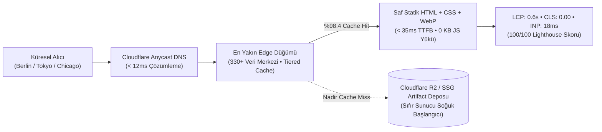

## Hız Bir Tercih Değil, En Güçlü İkna Aracıdır

Dijital dünyada çoğu şirket hız konusunu yalnızca bir teknik teferruat veya "tasarım bittikten sonra bakılacak bir cila" olarak görür. Oysa sistem mimarisi perspektifinden baktığımızda hız; **bir şirketin mühendislik yetkinliğini, işine duyduğu saygıyı ve operasyonel disiplinini kanıtlayan en somut vitrindir.**

Özellikle küresel pazara yüksek katma değerli ürünler ihraç eden bir üreticiyseniz; Almanya'daki bir mühendislik direktörü, İtalya'daki bir satın alma uzmanı veya ABD'deki bir tedarik zinciri yöneticisi sitenize girdiğinde sayfa anında karşısına çıkmalıdır. 3 saniye dönen beyaz ekranlar, yüklenirken zıplayan butonlar ve tarayıcıyı donduran JavaScript kütüphaneleri, potansiyel müşterinize bilinçaltında tek bir mesaj fısıldar: *"Biz henüz dijital altyapımızı bile verimli yönetemiyoruz."*

Kendi geliştirdiğim sistemlerde, [oaPOS](/projects/oapos/) ve [oaTeklif](/broadcasts/oateklif-ucretsiz-teklif-olusturucu/) gibi yüksek performanslı mimarilerde uyguladığım değişmez bir ilke vardır: **Gereksiz katmanları yok et, deterministik ol ve veriyi kullanıcıya en yakın noktada teslim et.**

Bu yayında; küresel ölçekte **50 milisaniyenin altında açılan** kurumsal B2B portallar inşa etmenin arkasındaki 5 mimari ayağı inceliyoruz.

---

## 50ms Altı Küresel B2B Mimarinin 5 Temel Ayağı

Dünya standartlarında bir dijital ihracat portalını mümkün kılan mühendislik prensipleri:

### 1. Astro Statik Derleme (SSG) ve HTML Önceliği
Geleneksel web sitelerinde her sayfa isteği geldiğinde sunucu uyanır, veritabanına bağlanır, şablonları birleştirir ve HTML üretir. Bu dinamik süreç tek başına 200-800 milisaniye gecikme ekler.

Modern mimaride bu hantallık reddedilir. [Ankara kurumsal web tasarım](/ankara-kurumsal-web-tasarim/) yaklaşımımızda olduğu gibi Astro SSG motoru; yüzlerce ürün sayfasını, teknik spesifikasyonları ve çoklu dil varyantlarını derleme (build) aşamasında bir kez hesaplar ve saf, sıkıştırılmış statik dosyalara dönüştürür. Kullanıcı siteye geldiğinde sunucunun "düşünmesine" gerek kalmaz; önceden hazırlanmış mükemmel HTML anında akıtılır.

### 2. Zero-JS Disiplini: Tarayıcıyı Kod Hamallığından Kurtarmak
Modern web geliştiriciliğinin en büyük hastalığı, 5 satırlık basit bir menü açma animasyonu için 2 megabaytlık React veya Vue kütüphanelerini tarayıcıya indirtmektir. Düşük işlemcili mobil cihazlarda bu kütüphanelerin çözümlenmesi (parse ve execute) 2-4 saniye sürer ve tarayıcıyı kilitler.

Zero-JS mimarisinde ana sayfa ve ürün katalogları **0 kilobayt harici JavaScript** ile çalışır.
- Açılır menüler ve filtreler CSS `:has()` ve `:focus-within` ile yönetilir.
- Sıkça sorulan sorular (SSS) semantik HTML `
` ve `
` etiketleriyle sıfır script ile çözülür.
- Tüm görseller modern WebP/AVIF formatında doğru `width` ve `height` nitelikleriyle yerleştirilir, böylece sayfa yüklenirken layout kayması (CLS) sıfır olur.

### 3. Cloudflare 330+ Anycast Edge ve Tiered Cache Mimarisi
Bir web sitesini tek bir coğrafi sunucuya hapsetmek, uluslararası ihracat vizyonuyla çelişir. Siteniz Ankara'da barındırılıyorsa, Frankfurt'taki kullanıcı için gecikme 60ms iken, Houston'daki alıcı için 180ms, Sidney'deki alıcı için 350ms'dir.

Biz mimariyi Anycast Edge üzerinde kurgularız:
- Web varlıkları tek bir sunucuda değil, dünya genelindeki 330'dan fazla Cloudflare edge düğümünde aynı anda yaşar.
- **Tiered Cache (Kademeli Önbellek)** teknolojisiyle bölgesel üst merkezler (hub) tanımlanır. Bir içeriğin önbellek geçerliliği sona erse dahi istek Türkiye'ye gelmez; bölgesel hub üzerinden sub-10ms gecikmeyle yenilenir.
- Önbellek isabet oranı (Cache Hit Ratio) %98'in üzerine çıkar; bu da sitenin her an, dünyanın her noktasında ışık hızında açılmasını sağlar.

### 4. Kurumsal Tip Güvenliği ve Kasa İndirmeleri
Bir sanayi portalı yalnızca okunabilir metinlerden ibaret değildir; teknik şartnamelerin, CAD çizimlerinin ve teklif taleplerinin (RFQ) yönetildiği bir operasyon merkezidir.

The Vault üzerinde paylaştığım kaynaklar bu mimarinin pratik uygulamasını gösterir:
- [B2B Uluslararası İhracat RFQ Veri Sözleşmesi Şeması](/vault/b2b/b2b-export-rfq-schema.json): Satın alma taleplerinin istemci ve sunucu arasında tip güvenli JSON sözleşmeleriyle nasıl doğrulandığını tanımlar.
- [2026 Kurumsal Siber Güvenlik Başlıkları & WAF Konfigürasyonu](/vault/b2b/enterprise-security-headers-2026.conf): Edge seviyesinde katı CSP, HSTS Preload ve bot savunmasını devreye alan üretim kurallarını sunar.

### 5. 100/100 Core Web Vitals ve Sıfır Layout Kayması
Performans ölçülmeyen bir soyutluk değildir; Google'ın Core Web Vitals metrikleriyle matematiksel olarak test edilir. Kusursuz bir B2B portalın karnesi şu değerleri sağlamalıdır:

| Metrik | Anlamı | Geleneksel WordPress Sitesi | Zero-JS Edge SSG Mimarisi |
|---|---|---|---|
| **TTFB (Time to First Byte)** | Sunucudan ilk baytın gelme süresi | 650ms – 1.800ms | **< 35ms** |
| **FCP (First Contentful Paint)** | İlk metin/öğenin ekranda belirmesi | 1.8s – 3.2s | **< 0.4s** |
| **LCP (Largest Contentful Paint)** | Ana görselin/başlığın render olması | 3.5s – 6.5s | **< 0.8s** |
| **CLS (Cumulative Layout Shift)** | Sayfa yüklenirken öğelerin kayması | 0.18 – 0.45 (Bozuk) | **0.00 (Sıfır kayma)** |
| **INP (Interaction to Next Paint)** | Tıklama ve etkileşim gecikmesi | 180ms – 400ms | **< 20ms (Anında tepki)** |
| **Lighthouse Skoru** | Genel performans ve SEO puanı | 35 – 55 / 100 | **100 / 100 Tam Puan** |

---

## Küresel Alıcılar İçin Kusursuz İhracat Hattı

Uluslararası B2B pazarda rekabet eden sanayi ve teknoloji şirketleri için [Ankara web yazılım](/ankara-web-yazilim/) ve sistem mühendisliği çözümlerimiz; hantal ajans kalıplarını bir kenara bırakarak şu kazanımları sunar:

1. **Küresel Erişilebilirlik:** Şirketiniz dünyanın hangi ülkesinden ziyaret edilirse edilsin yerel bir süper bilgisayar hızında açılır.
2. **Sıfır Altyapı Bakımı:** Canlıda veritabanı veya PHP sunucusu çalışmadığı için sunucu çökmesi, bellek taşması veya veritabanı kilitlenmesi gibi kabuslar tarihe karışır.
3. **Maksimum Arama Otoritesi:** Kusursuz Core Web Vitals ve iki dilli statik hreflang mimarisi sayesinde hem geleneksel arama motorlarında hem de yapay zeka arama motorlarında fabrikanız en üst sıraya yerleşir.

Hız bir süs değil; küresel ticarette güveni inşa eden ve alıcıyı masaya oturtan en sessiz mühendislik gücüdür.
