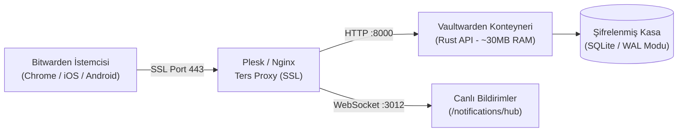

## Neden Parolalarınızı Üçüncü Parti Bulutlara Bırakasınız?

Günümüzde şifre yöneticileri lüks değil, dijital varlık güvenliğinin temel omurgasıdır. Ancak LastPass gibi merkezi servislerin yaşadığı veri ihlalleri veya ticari şifre yöneticilerinin değişen abonelik modelleri, bireysel ve kurumsal kullanıcıları haklı olarak yerel öncelikli (self-hosted) alternatiflere yöneltiyor.

Resmi Bitwarden sunucu altyapısı kurumsal MSSQL ve .NET yığını kullandığı için minimum 2-4 GB RAM gerektirirken; Rust ile baştan yazılan **Vaultwarden**, aynı Bitwarden istemci API'sini yalnızca **25-40 MB RAM** tüketimiyle eksiksiz sunar. Üstelik resmi Bitwarden'da ücretli olan dahili TOTP iki adımlı doğrulama (2FA), şifreli dosya eki depolama ve organizasyon paylaşımı Vaultwarden'da tamamen ücretsiz ve sınırsızdır.

Bu videoda; kendi geliştirdiğim açık kaynaklı `oaVaultWardenInstaller` betiğiyle, Plesk veya bağımsız bir Ubuntu VDS üzerinde tek bir komutla Vaultwarden'ı nasıl ayağa kaldırdığımızı adım adım inceliyoruz.



---

## 1. Tek Komutla Otomatik Kurulum Sihirbazı

Kurulum sürecini standartlaştırmak ve hata payını sıfıra indirmek için açık kaynaklı `oaVaultWardenInstaller` betiğini hazırladım. Betik sunucunuzda Docker ve Docker Compose bağımlılıklarını kontrol eder, güvenli dizin yapısını oluşturur ve interaktif bir sihirbazla gerekli parametreleri toplar:

```bash
# Kurulum betiğini doğrudan GitHub üzerinden çalıştırın
wget -qO- https://raw.githubusercontent.com/oaonuraksoy/oaVaultWardenInstaller/main/install.sh | bash
```

Sihirbaz şu parametreleri güvenli şekilde yapılandırır:
1. **Çalışma Dizini:** Kasa verilerinin tutulacağı `/opt/vaultwarden/data` kalıcı Docker hacmi.
2. **Kasa Alan Adı:** `vault.sizin-domaininiz.com` şeklinde FQDN tanımlaması.
3. **Argon2id Admin Token:** Yönetici paneline (`/admin`) yetkisiz erişimi engellemek için SHA256 yerine modern Argon2id algoritmasıyla türetilen karmaşık erişim anahtarı.
4. **Kayıt Politikası:** Sunucunuzun yetkisiz kullanıcı kayıtlarına maruz kalmaması için ilk hesap açılışından sonra `SIGNUPS_ALLOWED=false` kuralı otomatik devreye alınır.

---

## 2. Plesk Nginx Ters Proxy ve WebSocket Entegrasyonu

Bitwarden istemcilerinin kasadaki parola değişikliklerini anında tarayıcıya yansıtabilmesi için WebSocket bağlantısının (`/notifications/hub`) Nginx ters proxy katmanında doğru yönlendirilmesi şarttır. Plesk üzerinde ilgili alt alan adının **Ek Nginx Yönergeleri** bölümüne şu yapılandırma eklenir:

```nginx
location / {
    proxy_pass http://127.0.0.1:8000;
    proxy_set_header Host $host;
    proxy_set_header X-Real-IP $remote_addr;
    proxy_set_header X-Forwarded-For $proxy_add_x_forwarded_for;
    proxy_set_header X-Forwarded-Proto $scheme;
}

location /notifications/hub {
    proxy_pass http://127.0.0.1:3012;
    proxy_set_header Upgrade $http_upgrade;
    proxy_set_header Connection "upgrade";
}

location /notifications/hub/negotiate {
    proxy_pass http://127.0.0.1:8000;
}
```

Bu yapılandırma tamamlandığında, `Let's Encrypt` SSL sertifikası üzerinden uçtan uca şifrelenmiş (E2EE) HTTPS tüneli aktifleşir.

---

## 3. Canlı TOTP 2FA ve İstemci Eşitleme Testi

Kurulumun ardından resmi Bitwarden masaüstü uygulaması veya tarayıcı eklentisinde **Ayarlar > Özel Ortam (Self-hosted)** seçeneği işaretlenerek kendi sunucu adresiniz girilir (`https://vault.sizin-domaininiz.com`).

Videoda canlı olarak test ettiğimiz gibi:
- Yeni bir hesap oluşturulduğunda, dahili **Doğrulayıcı Anahtarı (TOTP)** alanına gizli anahtar (secret key) yapıştırılır.
- Vaultwarden, harici Google Authenticator veya Authy uygulamasına ihtiyaç duymadan 30 saniyelik 6 haneli 2FA kodlarını kasanız içinde otomatik üretir.
- Tarayıcıda bir siteye giriş yaparken Bitwarden eklentisi hem kullanıcı adı/şifreyi doldurur hem de üretilen TOTP kodunu panoya kopyalayarak tek tıkla oturum açmanızı sağlar.

GitHub reposundaki betiği inceleyerek kendi altyapınıza dakikalar içinde entegre edebilirsiniz.
