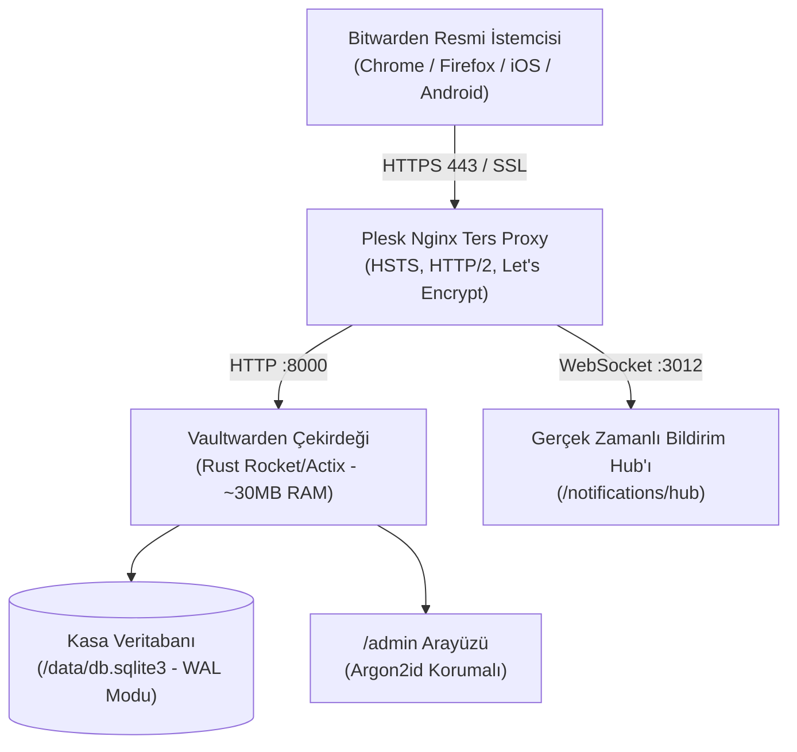

## Kendi Sunucumda Şifre Egemenliği: Neden Vaultwarden?

Yıllarca kendi sunucularımda, ajans operasyonlarımda ve bağımsız dijital ürünlerimde yüzlerce sunucu anahtarını, veri tabanı şifresini, müşteri API token'ını ve ödeme ağ geçidi kimliklerini yönetirken bir şeyi çok net anladım: **Master parolanızı ve kritik iki adımlı doğrulama (TOTP) tohumlarınızı üçüncü parti ticari bulutlara emanet etmek, tüm dijital altyapınızı başkasının insafına bırakmaktır.**

LastPass'in yaşadığı yıkıcı veri sızıntılarını veya ticari şifre yöneticilerinin bir gecede fiyat modellerini değiştirip özellik kısıtlamalarını hepimiz gördük. Ancak resmi Bitwarden sunucusunu kendi VDS'inize kurmaya kalktığınızda karşınıza ağır bir kurumsal .NET mimarisi, MSSQL veritabanı konteynerleri ve minimum 3-4 GB bellek tüketimi çıkıyor.

Tam bu noktada devreye Rust ile baştan yazılan **Vaultwarden** giriyor. Kendi üretim sunucularımda test ettiğimde gördüm ki; resmi Bitwarden API sözleşmesini %100 uygularken sunucu belleğinden yalnızca **25 ila 40 megabayt** tüketiyor. Üstelik resmi Bitwarden'da yıllık 10-40$ abonelik ücretiyle satılan **dahili TOTP kod üretimi (Google Authenticator yerine geçen 30 saniyelik 2FA kodları)**, şifreli ek dosya yükleme ve organizasyon içi parola paylaşımı Vaultwarden üzerinde tamamen limitsiz ve ücretsiz.

Bu rehberde; Plesk kontrol paneli kurulu veya standart bir Ubuntu Linux sunucuda, tek komutla çalışan açık kaynaklı kurulum sihirbazım `oaVaultWardenInstaller` ile Vaultwarden'ı nasıl ayağa kaldırdığımızı uçtan uca anlatıyorum.



---

## Mimari Kıyaslama: Resmi Bitwarden vs. Vaultwarden

Aşağıdaki tablo, kendi üretim ortamlarımda yaptığım gerçek kaynak tüketimi ve özellik kıyaslamasını gösterir:

| Karşılaştırma Kriteri | Resmi Bitwarden Sunucusu (SaaS / Docker) | Vaultwarden (Rust Self-Hosted) |
|---|---|---|
| **Yazılım Yığını** | C# .NET Core + MSSQL Server + NodeJS | Rust (Rocket/Actix) + SQLite / PostgreSQL |
| **RAM Tüketimi** | ~2.5 GB – 4.0 GB RAM | **25 MB – 40 MB RAM** |
| **Konteyner Sayısı** | 10–12 adet Docker konteyneri | **Tek bir hafif Docker konteyneri** |
| **Dahili TOTP (2FA) Kodları** | Ücretli Premium plan ($10/yıl veya $40/kullanıcı) | **Tamamen Ücretsiz ve Sınırsız** |
| **Şifreli Ek Dosya Depolama** | 1 GB ile sınırlı (ek kota ücretli) | **Sunucu diskiniz kadar sınırsız** |
| **Yedekleme Kolaylığı** | MSSQL backup + birden çok hacim | **Tek bir SQLite (.sqlite3) dosyasını kopyalamak yeterli** |

---

## 1. Tek Komutla Otomatik Kurulum: `oaVaultWardenInstaller`

Kurulum esnasında Docker parametreleri, port çakışmaları ve çevre değişkenleriyle tek tek uğraşmamak için hazırladığım açık kaynaklı `oaVaultWardenInstaller` kabuk betiğini sunucunuzda çalıştırmanız yeterli:

```bash
# Kurulum sihirbazını sunucunuzda doğrudan başlatın
wget -qO- https://raw.githubusercontent.com/oaonuraksoy/oaVaultWardenInstaller/main/install.sh | bash
```

Bu sihirbaz arka planda şu kritik adımları deterministik olarak icra eder:
1. Docker motorunun varlığını kontrol eder, eksikse resmi repodan kurar.
2. `/opt/vaultwarden/data` kalıcı hacmini oluşturur ve doğru dosya izinlerini (`chmod 700`) ayarlar.
3. Kasa yönetimi için modern **Argon2id** tabanlı karmaşık bir Admin Token türetir.
4. Vaultwarden imajını (`vaultwarden/server:latest`) çekerek yerel `127.0.0.1:8000` (HTTP) ve `127.0.0.1:3012` (WebSocket) portlarına bağlar.

```bash
# Konteyner durumunu kontrol etmek için:
docker ps --filter "name=vaultwarden"
```

---

## 2. Plesk ve Nginx Ters Proxy Yapılandırması

Vaultwarden doğrudan internete açılmamalıdır; önünde Let's Encrypt SSL sertifikasıyla korunan bir Nginx ters proxy katmanı bulunmalıdır. Plesk'te `vault.alanadiniz.com` alt alan adını açtıktan sonra **Apache & Nginx Ayarları > Ek Nginx Yönergeleri** alanına indirilebilir kasada paylaştığım şu konfigürasyonu yapıştırın:

```nginx
# Client gövde boyutu (Büyük şifreli ekler için 128MB)
client_max_body_size 128M;

# 1. Ana Vaultwarden API ve Web Arayüzü
location / {
    proxy_pass http://127.0.0.1:8000;
    proxy_set_header Host $host;
    proxy_set_header X-Real-IP $remote_addr;
    proxy_set_header X-Forwarded-For $proxy_add_x_forwarded_for;
    proxy_set_header X-Forwarded-Proto $scheme;
}

# 2. Canlı Eşitleme İçin WebSocket Hub (Olmazsa olmaz!)
location /notifications/hub {
    proxy_pass http://127.0.0.1:3012;
    proxy_http_version 1.1;
    proxy_set_header Upgrade $http_upgrade;
    proxy_set_header Connection "upgrade";
    proxy_set_header Host $host;
    proxy_set_header X-Real-IP $remote_addr;
    proxy_set_header X-Forwarded-For $proxy_add_x_forwarded_for;
    proxy_set_header X-Forwarded-Proto $scheme;
    proxy_read_timeout 3600s;
    proxy_send_timeout 3600s;
}

location /notifications/hub/negotiate {
    proxy_pass http://127.0.0.1:8000;
    proxy_set_header Host $host;
    proxy_set_header X-Real-IP $remote_addr;
    proxy_set_header X-Forwarded-For $proxy_add_x_forwarded_for;
    proxy_set_header X-Forwarded-Proto $scheme;
}
```

---

## 3. Canlı TOTP 2FA ve Eklenti Entegrasyon Testi

Kurulum tamamlandığında resmi Bitwarden tarayıcı eklentisini (Chrome, Firefox, Brave veya Edge) açın:
1. Oturum açma ekranının sol üst köşesindeki dişli çark (**Ayarlar**) simgesine tıklayın.
2. **Özel Ortam (Self-hosted)** kutucuğuna kendi sunucu adresinizi yazın: `https://vault.alanadiniz.com`.
3. Yeni bir hesap oluşturun ve kasanıza giriş yapın.
4. Yeni bir giriş eklerken **Doğrulayıcı Anahtarı (TOTP)** alanına gizli anahtarı yapıştırın.

Artık web sitelerine giriş yaparken Bitwarden eklentisi hem kullanıcı adı ve şifrenizi otomatik dolduracak, hem de 30 saniyelik 2FA doğrulama kodunu anında panoya kopyalayacaktır.

---

## Sık Karşılaşılan Hatalar ve Çözümleri (Troubleshooting)

Kendi kurulumlarımda ve topluluktan gelen sorularda en sık rastlanan 3 senaryo ve çözümleri:

1. **"Websocket connection failed" / Kasa anlık eşitlenmiyor:**
   - *Sebep:* Nginx ters proxy üzerinde `/notifications/hub` bloğunun eksik olması veya `3012` portunun Docker konteyneri içinde dinlenmemesi.
   - *Çözüm:* Docker başlatma parametresinde `-p 127.0.0.1:3012:3012` ve ortam değişkenlerinde `WEBSOCKET_ENABLED=true` bulunduğundan emin olun.
2. **Kayıt olduktan sonra yabancıların hesap açması riski:**
   - *Çözüm:* İlk hesabınızı açtıktan sonra `/opt/vaultwarden/` dizinindeki ortam dosyasında veya docker run komutunda `SIGNUPS_ALLOWED=false` tanımlayın ve konteyneri yeniden başlatın (`docker restart vaultwarden`).
3. **Yönetici paneline (`/admin`) erişememe veya şifre hatası:**
   - *Çözüm:* `ADMIN_TOKEN` karma değerini doğrudan string olarak değil, argon2 ile hash'lenmiş biçimde tanımlayın. Token'ı kaybettiyseniz konteyner içine girmeden `docker exec -it vaultwarden /vaultwarden hash` komutuyla yeni bir hash üretebilirsiniz.

Bu yayındaki yapılandırma dosyalarını yukarıdaki **The Vault** indirme kutusundan edinebilir, GitHub üzerindeki installer depoma yıldız vererek katkıda bulunabilirsiniz.
