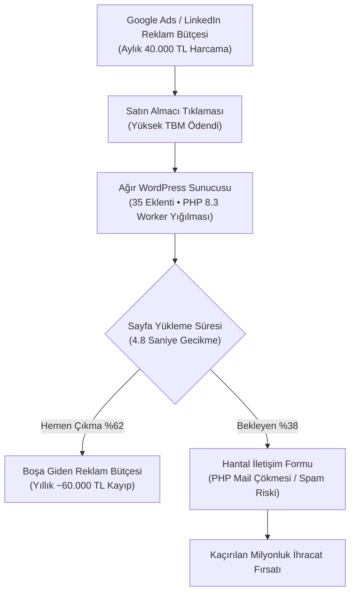

## "Ücretsiz ve Hızlı" Yalanı: Bir B2B Şirketin WordPress Otopsisi

Kurumsal şirketlerin yönetim kurullarında ve satın alma masalarında sıkça duyduğum klasik bir cümle vardır: *"Zaten hazır WordPress var, bir tema kurup birkaç eklentiyle iki günde yayına alalım; özel yazılıma neden bütçe ayıralım?"*

Bu yaklaşım, ilk 3 ay için masum ve ekonomik görünebilir. Ancak kurumsal bir şirket büyüdükçe, ürün sayısı arttıkça ve yurt dışı pazarlara yönelik dijital reklam kampanyaları başladıkça WordPress siteleri tam bir finansal kara deliğe dönüşür. Kendi danışmanlık deneyimlerimde B2B şirketlerin bilanço satırlarını incelediğimde, "ucuza çözüldü" denilen sitelerin arkasında her yıl sessiz sedasız yüz binlerce liranın buharlaştığına defalarca şahit oldum.

Sorun WordPress'in kendisi değil; monolitik, dinamik ve eklentiye bağımlı bir blog motorunun kurumsal bir B2B ihracat vitrini veya yüksek trafikli kurumsal platform gibi kullanılmaya zorlanmasıdır.

Bu analizde; tipik bir orta ölçekli B2B ihracat firmasının WordPress eklenti borcu yüzünden her yıl ödediği 4 gizli maliyet kalemini somut rakamlarla masaya yatırıyorum.

---

## 4 Gizli Maliyet Kalemi: Yıllık Bilanço Zararı

Bir B2B işletmenin farkında olmadan katlandığı teknik borç faturaları:

### 1. Eklenti Lisansları ve Yıllık Yenileme Çıkmazı
WordPress'i kurumsal bir seviyeye getirmek için çekirdek sistem yetersiz kalır. Şirketler mecburen şu eklenti paketlerine abone olurlar:
- **Çoklu Dil Yönetimi (WPML / Polylang):** Yıllık ~$99 – $199
- **Özel Alanlar ve Veri Tipleri (ACF Pro):** Yıllık ~$49 – $249
- **Görsel Sayfa İnşa Edici (Elementor / Divi):** Yıllık ~$59 – $199
- **Kurumsal Formlar (Gravity Forms / WPForms Pro):** Yıllık ~$159 – $299
- **Siber Güvenlik ve WAF Eklentisi (Wordfence / iThemes):** Yıllık ~$119 – $199
- **Önbellek ve Hızlandırma (WP Rocket):** Yıllık ~$59 – $299

Bu lisanslar yılda ortalama **600$ ile 1.500$ (güncel kurla 25.000 TL – 60.000 TL)** arasında düzenli bir ödeme gerektirir. Üstelik lisans yenilenmediğinde sitenin yönetim paneli kilitlenir veya güvenlik açıkları oluşur.

### 2. Şişen Sunucu Kaynakları ve Dedicated Sunucu İhtiyacı
WordPress'te bir sayfa açıldığında sunucu arka planda ortalama 30-60 PHP dosyasını yorumlar ve MySQL veritabanına 40'tan fazla sorgu atar. 10 kullanıcı aynı anda siteye girdiğinde sunucu işlemcisi (CPU) %100'e fırlar.

Ajanslar bu darboğazı çözmek için mimariyi optimize etmek yerine müşteriye *"Sunucunuz yetersiz, 8 çekirdekli Dedicated sunucuya geçmemiz lazım"* der. Sonuç: Aylık 1.500 TL – 3.500 TL sunucu faturası. Yıllık toplamda **20.000 TL – 40.000 TL** sunucu maliyeti ortaya çıkar.

Oysa [Ankara kurumsal web tasarım](/ankara-kurumsal-web-tasarim/) standartlarımızda kullandığımız Astro SSG mimarisinde sayfalar saf statik dosyalardır; sunucuda PHP veya veritabanı çalışmadığı için en ucuz Cloudflare Edge altyapısında dahi saniyede binlerce isteği sıfır ek maliyetle karşılar.

### 3. Düşük Kalite Puanı ile Buharlaşan Reklam Bütçesi
En yıkıcı ve CFO'ların genellikle gözden kaçırdığı kalem burasıdır. Bir B2B ihracat firması Google Ads veya LinkedIn üzerinde ayda 30.000 TL reklam veriyorsa;
- Yavaş açılan bir sitede (LCP > 3.5s) Google Ads **Açılış Sayfası Deneyimi** puanını düşürür.
- Kalite Puanı 10 üzerinden 4'e gerileyen bir reklam veren, 8 kalite puanına sahip rakibine göre **tıklama başına %40 daha fazla para öder**.
- Ayrıca mobilden tıklayan satın alma yöneticilerinin %50'den fazlası sayfanın 3 saniyede açılmadığını görünce geri döner.

Ayda 30.000 TL harcanan bir reklam hesabında bu performans kaybı, yılda en az **50.000 TL ile 80.000 TL arasındaki bütçenin doğrudan çöpe gitmesi** anlamına gelir.

### 4. Güvenlik Yamaları ve Kurtarma Operasyonu Harcamaları
WordPress eklentileri dünyadaki en büyük siber saldırı vektörlerinden biridir. Güncellenmeyen tek bir slider eklentisi yüzünden sitenize Rus veya Çin menşeli botlar tarafından bahis reklamı linkleri (SEO spam) enjekte edilir.

Siteniz Google tarafından "Bu site saldırıya uğramış olabilir" uyarısıyla kara listeye alındığında, sitenin temizlenmesi ve kurtarılması için güvenlik uzmanlarına ödenen acil müdahale bedeli olay başına **20.000 TL – 40.000 TL** arasındadır.

---

## 3 Yıllık Toplam Sahip Olma Maliyeti (TCO) Karşılaştırması

Rakamları 3 yıllık projeksiyonda yan yana koyduğumuzda gerçek ekonomik tablo netleşir:

| Gider Kalemi | 3 Yıllık Kurumsal WordPress Sitesi | 3 Yıllık Özel Mimarili Statik Sistem |
|---|---|---|
| **İlk Kurulum / Geliştirme** | 45.000 TL – 75.000 TL (Görünürde ucuz) | 110.000 TL – 160.000 TL (Mühendislik yatırımı) |
| **Yıllık Eklenti Lisansları (3 Yıl)** | 75.000 TL – 135.000 TL | **0 TL (Sıfır harici lisans bağımlılığı)** |
| **Sunucu & Veritabanı Barındırma (3 Yıl)** | 60.000 TL – 120.000 TL | **1.800 TL – 5.000 TL (Global Edge altyapısı)** |
| **Google Ads Kalite Puanı Kaybı (3 Yıl)** | 150.000 TL – 240.000 TL | **0 TL (10/10 Açılış Sayfası Deneyimi)** |
| **Bakım, Yama ve Kurtarma Maliyeti** | 45.000 TL – 90.000 TL | **15.000 TL (Minimum teknik müdahale)** |
| **3 YILIK TOPLAM MALİYET (TCO)** | **375.000 TL – 660.000 TL** | **126.800 TL – 180.000 TL** |

Tablo açıkça göstermektedir ki; "ucuz" diye tercih edilen WordPress mimarisi, 3 yılın sonunda şirkete özel bir sistem mimarisinin **2 ila 3 katı maliyet** çıkarmaktadır.

---

## Kurumsal Karar Vericiler İçin Çözüm Yolu

Mevcut WordPress sitenizdeki eklenti bataklığından kurtulmak ve dijital varlıklarınızı gerçek bir kâr merkezine dönüştürmek için [Ankara web yazılım](/ankara-web-yazilim/) prensiplerimiz doğrultusunda şu adımları atabilirsiniz:

1. **Eklenti Denetimi Yapın:** Sitenizde kurulu olan 25-40 eklentinin hangilerinin gerçekten gerekli olduğunu, hangilerinin sadece basit bir CSS/JS fonksiyonu için kurulduğunu belirleyin.
2. **Statik Mimariye Geçin:** İçeriklerinizi WordPress REST API üzerinden çekip Astro tabanlı modern bir ön yüze aktararak sunucu ve veritabanı yükünü sıfırlayın.
3. **Reklam Açılış Sayfalarını İzolasyona Alın:** Google Ads trafiği alan sayfalarınızı 0 KB JavaScript ile çalışan ultra hızlı statik şablonlarla yeniden inşa ederek Kalite Puanınızı maksimuma çıkarın.
4. **Teklif Süreçlerini Tip Korumalı Hale Getirin:** Tıpkı [oaTeklif](/broadcasts/oateklif-ucretsiz-teklif-olusturucu/) ve [oaPOS](/projects/oapos/) sistemlerimizde olduğu gibi, müşteri teklif taleplerini eklentilere değil, doğrudan çalışan güvenli API hatlarına bağlayın.

Teknoloji seçimlerinizi ilk günkü satın alma fiyatına göre değil, 3 yıllık birim ekonomisi ve operasyonel verimliliğe göre yapın.
